# 01 – Database schema

> **Generated** from `src/database/schema/*.ts` by `npm run docs:db` — do not edit by hand.
> Migrations live in `drizzle/` (`npm run db:migrate`). Seeds: `npm run db:seed`.

## Conventions

- PostgreSQL 16+ (Neon), PostGIS enabled. Primary keys are UUID v4 (`gen_random_uuid()`), except `wilayas`/`communes` (official codes) and `platform_settings` (key).
- All timestamps are `timestamptz` and stored in UTC. `created_at` / `updated_at` everywhere; `deleted_at` (soft delete) on users, files, addresses, dependants.
- **Money is `bigint` centimes of DZD** (`*_centimes`), never floats. `CHECK >= 0` on every amount; totals are verified by CHECK constraints.
- Secrets and sensitive identifiers are stored **encrypted** (`*_encrypted`, AES-256-GCM) or **hashed** (`*_hash`, HMAC-SHA256 with a server pepper / argon2id for passwords).
- Append-only tables (`audit_logs`, `sensitive_access_logs`, `order_status_history`, `delivery_status_history`) reject UPDATE/DELETE via trigger (migration `0002`).
- Human references use sequences: `request_reference_seq`, `order_reference_seq`, `complaint_reference_seq`, `receipt_number_seq` (format e.g. `RX-2026-000123`).
- Geo: `latitude`/`longitude` (double) + generated `location geography` with a GiST index on addresses and pharmacies; expression GiST index on drivers.

## Seeds

| Seed | Content |
|---|---|
| Geography | 58 wilayas + 1,541 communes (ar/fr) from `src/database/seeds/data/algeria-geo.json` |
| Platform settings | `payment_before_validation`, `request_expiry_hours`, `offer_validity_hours`, `payment_deadline_minutes`, `max_pharmacies_per_request`, `delivery_enabled`, `sensitive_data_retention_days` |
| Eligibility policies | One example policy per category, **all disabled** (`is_enabled=false`, no legal basis yet) |
| Super admin | Only if `SEED_SUPER_ADMIN_EMAIL` + `SEED_SUPER_ADMIN_PASSWORD` are set. MFA enrolment forced at first login. |

## Enums

| Enum | Values |
|---|---|
| `account_status` | `PENDING_VERIFICATION`, `ACTIVE`, `SUSPENDED`, `DELETED` |
| `chifa_verification_status` | `NOT_VERIFIED`, `PENDING_OFFICIAL_CHECK`, `VERIFIED`, `FAILED` |
| `commission_scope` | `GLOBAL`, `PHARMACY` |
| `commission_type` | `PERCENT`, `FIXED`, `SUBSCRIPTION` |
| `complaint_against_type` | `PHARMACY`, `DRIVER`, `PATIENT`, `PLATFORM` |
| `complaint_status` | `OPEN`, `IN_REVIEW`, `RESOLVED`, `REJECTED`, `ESCALATED` |
| `consent_type` | `TERMS`, `PRIVACY`, `HEALTH_DATA_PROCESSING`, `SHARE_PRESCRIPTION_WITH_PHARMACY` |
| `conversation_status` | `OPEN`, `CLOSED` |
| `delivery_company_doc_type` | `COMMERCIAL_REGISTER`, `TAX`, `ID`, `INSURANCE`, `OTHER` |
| `delivery_company_status` | `PENDING_VERIFICATION`, `VERIFIED`, `REJECTED`, `SUSPENDED` |
| `delivery_status` | `AVAILABLE`, `ASSIGNED`, `PICKED_UP`, `OUT_FOR_DELIVERY`, `DELIVERED`, `FAILED`, `RETURNED`, `CANCELLED` |
| `dependant_authorization_status` | `DECLARED`, `VERIFIED`, `REJECTED` |
| `device_platform` | `ios`, `android`, `web` |
| `document_review_status` | `PENDING`, `APPROVED`, `REJECTED` |
| `driver_status` | `PENDING_VERIFICATION`, `VERIFIED`, `SUSPENDED` |
| `file_purpose` | `PRESCRIPTION`, `CHIFA_CARD`, `PHARMACY_DOC`, `DRIVER_DOC`, `MESSAGE_ATTACHMENT`, `PROOF_OF_DELIVERY`, `DEPENDANT_PROOF` |
| `file_quality_status` | `UNCHECKED`, `READABLE`, `UNREADABLE` |
| `fulfillment_type` | `DELIVERY`, `PICKUP` |
| `gender` | `MALE`, `FEMALE` |
| `invitation_status` | `PENDING`, `ACCEPTED`, `REVOKED`, `EXPIRED` |
| `item_availability` | `AVAILABLE`, `PARTIAL`, `UNAVAILABLE`, `ALTERNATIVE` |
| `language` | `ar`, `fr` |
| `malware_scan_status` | `PENDING`, `CLEAN`, `INFECTED` |
| `medicine_category` | `OTC`, `PRESCRIPTION`, `CONTROLLED`, `COLD_CHAIN`, `PSYCHOTROPIC`, `OTHER` |
| `message_type` | `TEXT`, `IMAGE`, `SYSTEM`, `CLARIFICATION_QUESTION`, `CLARIFICATION_ANSWER` |
| `notification_channel` | `IN_APP`, `PUSH`, `SMS`, `EMAIL` |
| `notification_status` | `QUEUED`, `SENT`, `FAILED` |
| `ocr_status` | `PENDING`, `COMPLETED`, `FAILED` |
| `offer_status` | `DRAFT`, `SENT`, `ACCEPTED`, `REJECTED`, `EXPIRED`, `WITHDRAWN` |
| `order_status` | `AWAITING_PAYMENT`, `PAYMENT_PENDING`, `PAYMENT_CONFIRMED`, `PHARMACIST_VALIDATION_PENDING`, `PREPARING`, `READY_FOR_PICKUP`, `DELIVERY_ASSIGNED`, `PICKED_UP`, `OUT_FOR_DELIVERY`, `DELIVERED`, `COMPLETED`, `CANCELLED`, `REFUND_PENDING`, `REFUNDED`, `FAILED` |
| `otp_purpose` | `REGISTER`, `LOGIN`, `RESET_PASSWORD`, `VERIFY_PHONE`, `VERIFY_EMAIL` |
| `otp_target_type` | `PHONE`, `EMAIL` |
| `patient_approval` | `NOT_REQUIRED`, `PENDING`, `APPROVED`, `REJECTED` |
| `payment_provider` | `EDAHABIA_SATIM`, `MOCK` |
| `payment_status` | `INITIATED`, `PENDING`, `CONFIRMED`, `FAILED`, `CANCELLED`, `REFUND_PENDING`, `REFUNDED` |
| `payout_account_type` | `BANK`, `CCP` |
| `pharmacy_doc_type` | `AUTHORIZATION`, `PHARMACIST_DIPLOMA`, `ID`, `TAX`, `OTHER` |
| `pharmacy_status` | `DRAFT`, `PENDING_VERIFICATION`, `VERIFIED`, `REJECTED`, `SUSPENDED` |
| `proof_type` | `OTP`, `SIGNATURE`, `PHOTO_NO_FACE` |
| `recipient_status` | `SENT`, `VIEWED`, `INTERESTED`, `DECLINED`, `CLARIFICATION_ASKED`, `OFFERED`, `EXPIRED` |
| `refund_status` | `REQUESTED`, `APPROVED`, `PROCESSING`, `COMPLETED`, `REJECTED` |
| `relationship` | `CHILD`, `PARENT`, `SPOUSE`, `OTHER` |
| `request_item_source` | `PATIENT`, `OCR`, `PHARMACIST` |
| `request_status` | `REQUEST_SUBMITTED`, `AWAITING_PHARMACY_RESPONSE`, `CLARIFICATION_REQUIRED`, `OFFER_AVAILABLE`, `OFFER_ACCEPTED`, `EXPIRED`, `CANCELLED` |
| `request_type` | `PRESCRIPTION`, `CHIFA`, `PRODUCT` |
| `request_urgency` | `NORMAL`, `URGENT` |
| `retention_job_status` | `RUNNING`, `SUCCEEDED`, `FAILED` |
| `role` | `PATIENT`, `PHARMACY_OWNER`, `PHARMACIST`, `PHARMACY_ASSISTANT`, `DELIVERY_COMPANY_ADMIN`, `DRIVER`, `ADMIN`, `SUPER_ADMIN` |
| `sensitive_resource_type` | `PRESCRIPTION`, `CHIFA`, `PATIENT_PROFILE` |
| `settlement_status` | `DRAFT`, `APPROVED`, `PAID` |
| `staff_role` | `OWNER`, `PHARMACIST`, `ASSISTANT` |
| `stock_status` | `IN_STOCK`, `LOW`, `OUT_OF_STOCK` |
| `vehicle_type` | `MOTORCYCLE`, `CAR`, `VAN`, `BIKE` |
| `order_workflow_variant` | `VALIDATION_FIRST`, `PAYMENT_FIRST` |

## ER diagrams (per domain)

Relationships point from the referencing table to the referenced one. Tables from other domains appear without columns.

### 1. Identity & security

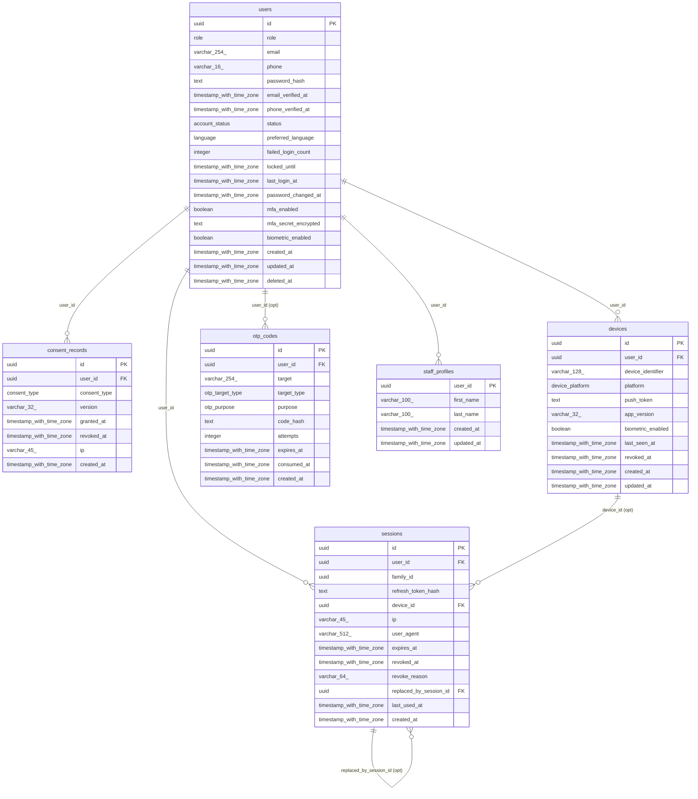

### 2. Files

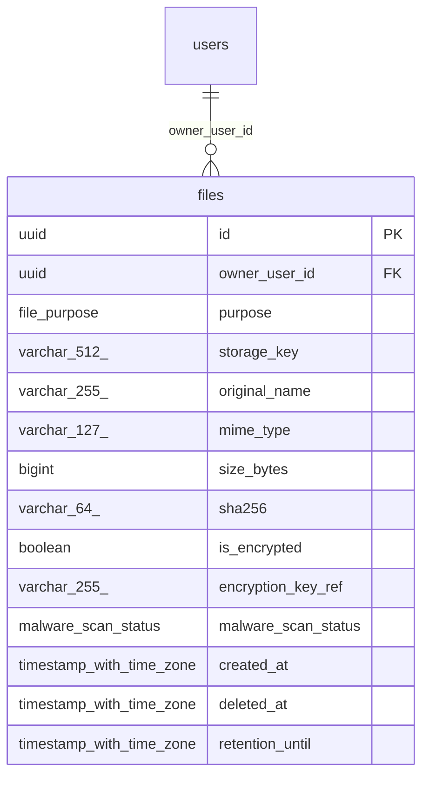

### 3. Patient & geography

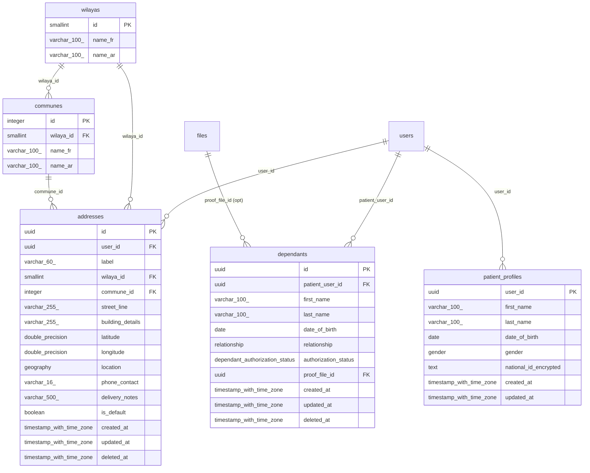

### 4. Pharmacy

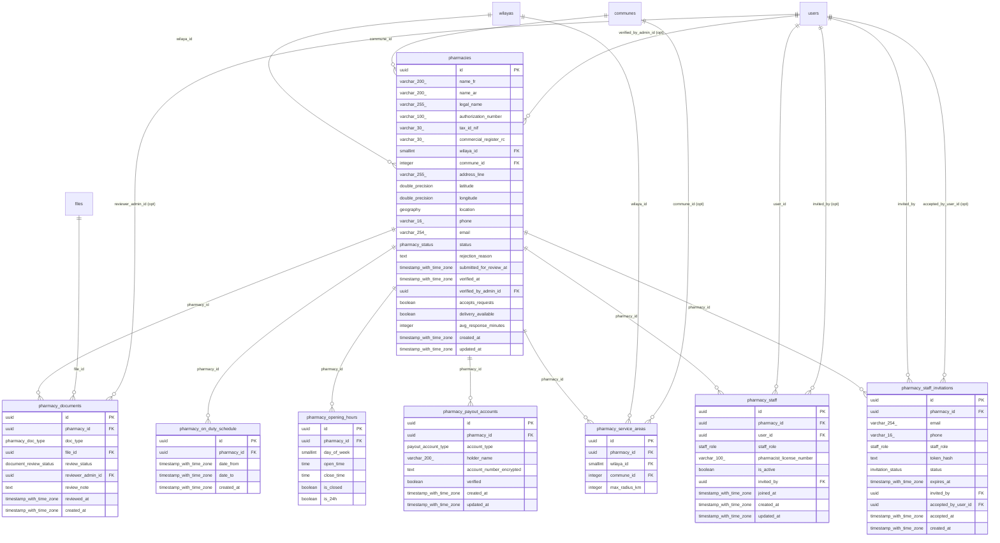

### 5. Catalog & stock

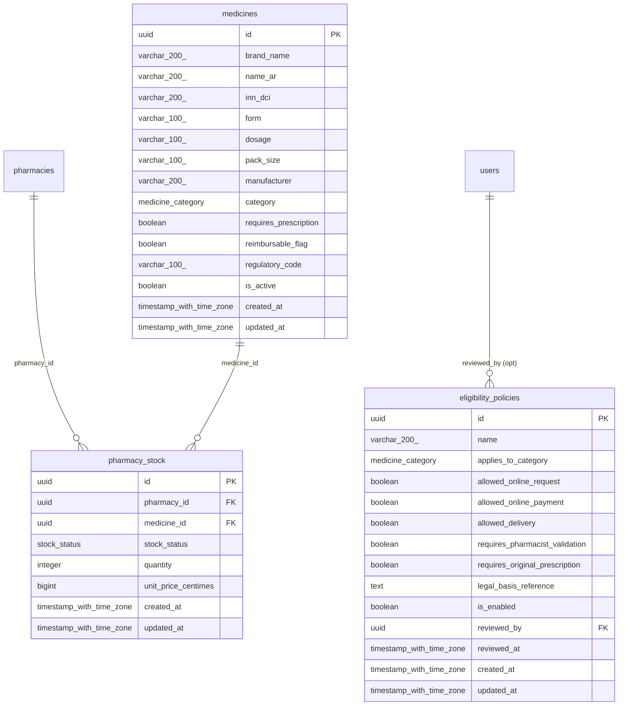

### 6. Requests

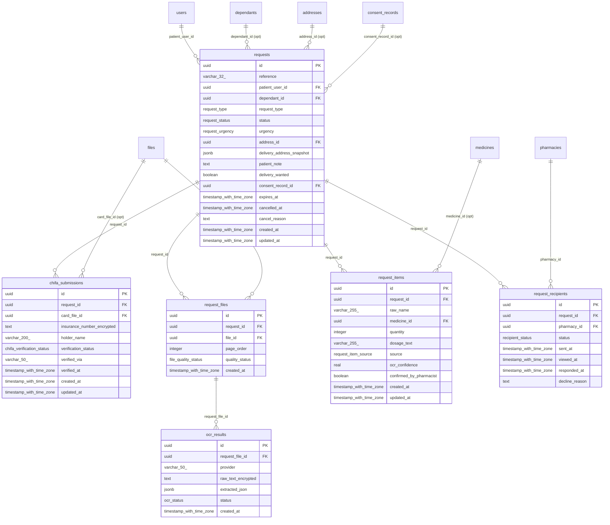

### 7. Offers

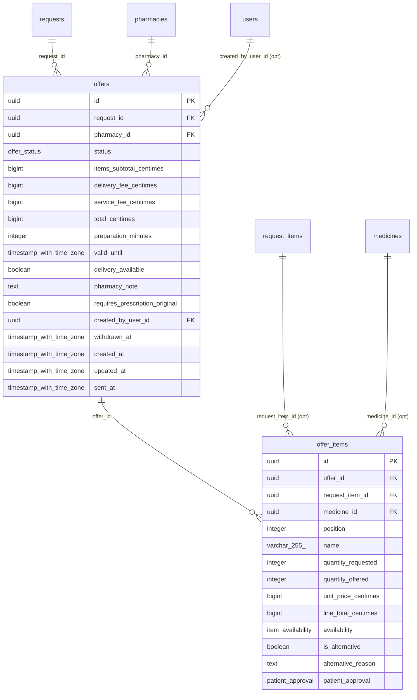

### 8. Messaging & notifications

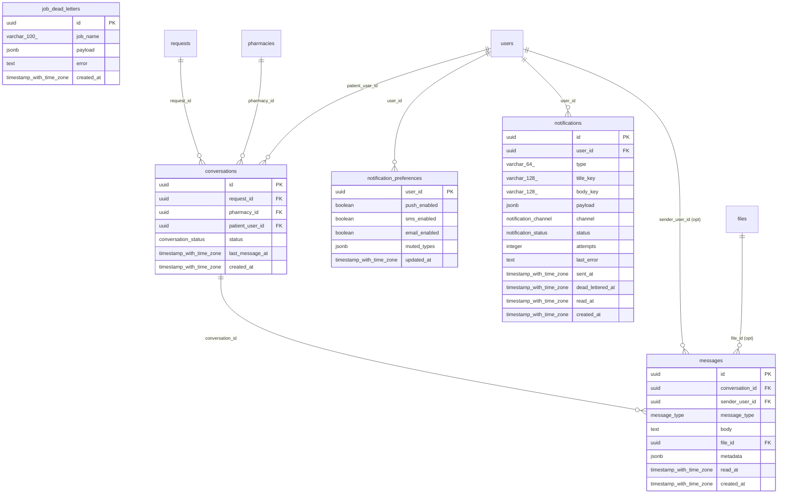

### 9. Orders

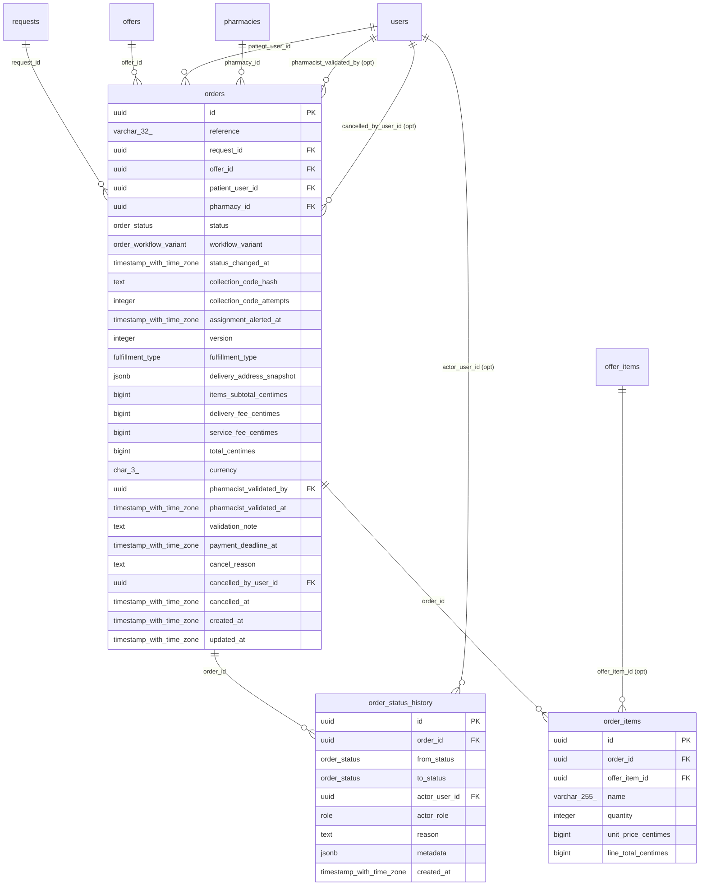

### 10. Payments

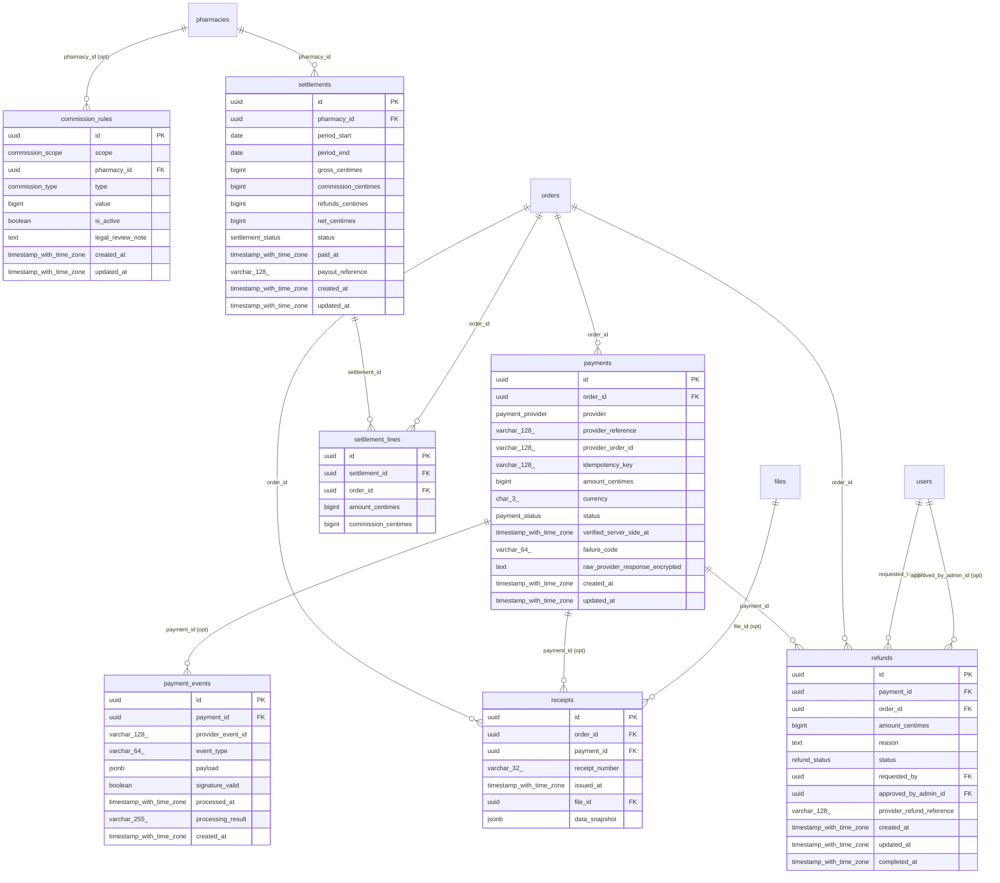

### 11. Delivery

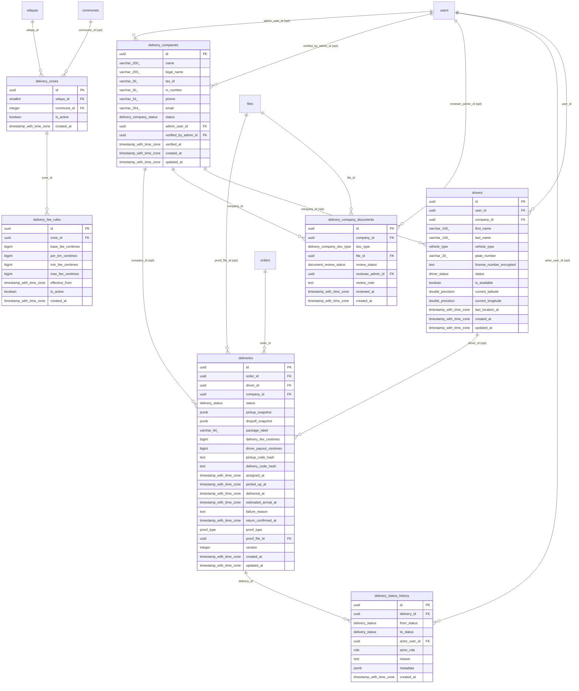

### 12. Support & governance

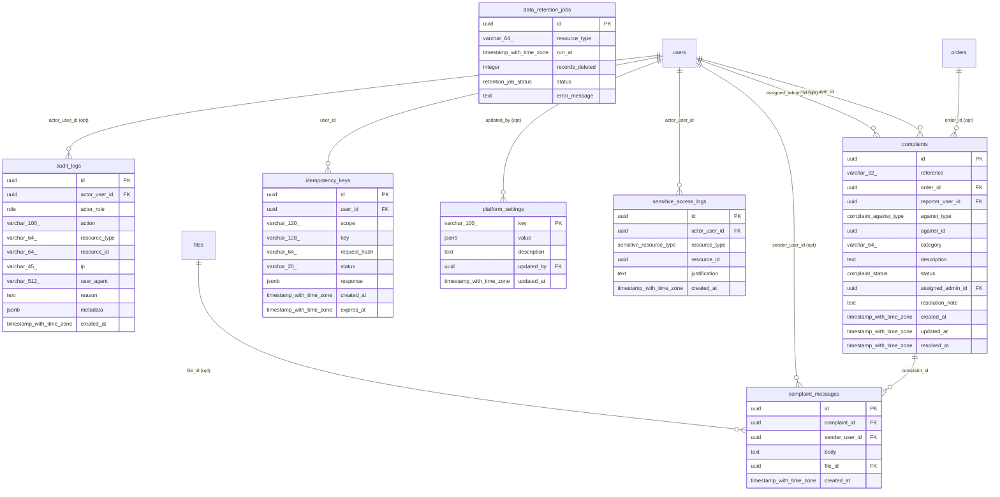

## Field dictionary

### 1. Identity & security

#### `consent_records`

Versioned consent history (grant / revoke), never overwritten.

| Column | Type | Null | Default | References |
|---|---|---|---|---|
| `id` | uuid **PK** | no | gen_random_uuid() |  |
| `user_id` | uuid | no |  | users.id (on delete cascade) |
| `consent_type` | consent_type | no |  |  |
| `version` | varchar(32) | no |  |  |
| `granted_at` | timestamp with time zone | no | now() |  |
| `revoked_at` | timestamp with time zone | yes |  |  |
| `ip` | varchar(45) | yes |  |  |
| `created_at` | timestamp with time zone | no | now() |  |

**Indexes:** `consent_user_type_idx` on (user_id, consent_type)

#### `devices`

Client devices. `biometric_enabled` is a flag only; sessions can be bound to a device.

| Column | Type | Null | Default | References |
|---|---|---|---|---|
| `id` | uuid **PK** | no | gen_random_uuid() |  |
| `user_id` | uuid | no |  | users.id (on delete cascade) |
| `device_identifier` | varchar(128) | no |  |  |
| `platform` | device_platform | no |  |  |
| `push_token` | text | yes |  |  |
| `app_version` | varchar(32) | yes |  |  |
| `biometric_enabled` | boolean | no | false |  |
| `last_seen_at` | timestamp with time zone | yes |  |  |
| `revoked_at` | timestamp with time zone | yes |  |  |
| `created_at` | timestamp with time zone | no | now() |  |
| `updated_at` | timestamp with time zone | no | now() |  |

**Indexes:** `devices_user_identifier_uq` (unique) on (user_id, device_identifier)

#### `otp_codes`

One-time codes (HMAC-hashed). Newest code per target+purpose is the only valid one.

| Column | Type | Null | Default | References |
|---|---|---|---|---|
| `id` | uuid **PK** | no | gen_random_uuid() |  |
| `user_id` | uuid | yes |  | users.id (on delete cascade) |
| `target` | varchar(254) | no |  |  |
| `target_type` | otp_target_type | no |  |  |
| `purpose` | otp_purpose | no |  |  |
| `code_hash` | text | no |  |  |
| `attempts` | integer | no | 0 |  |
| `expires_at` | timestamp with time zone | no |  |  |
| `consumed_at` | timestamp with time zone | yes |  |  |
| `created_at` | timestamp with time zone | no | now() |  |

**Indexes:** `otp_target_purpose_created_idx` on (target, purpose, created_at); `otp_user_idx` on (user_id)

**Checks:** `otp_attempts_chk`: `"attempts" >= 0`

#### `sessions`

Refresh-token sessions. Rotations share `family_id`; reuse of a rotated token revokes the family.

| Column | Type | Null | Default | References |
|---|---|---|---|---|
| `id` | uuid **PK** | no | gen_random_uuid() |  |
| `user_id` | uuid | no |  | users.id (on delete cascade) |
| `family_id` | uuid | no |  |  |
| `refresh_token_hash` | text | no |  |  |
| `device_id` | uuid | yes |  | devices.id (on delete set null) |
| `ip` | varchar(45) | yes |  |  |
| `user_agent` | varchar(512) | yes |  |  |
| `expires_at` | timestamp with time zone | no |  |  |
| `revoked_at` | timestamp with time zone | yes |  |  |
| `revoke_reason` | varchar(64) | yes |  |  |
| `replaced_by_session_id` | uuid | yes |  | sessions.id (on delete set null) |
| `last_used_at` | timestamp with time zone | yes |  |  |
| `created_at` | timestamp with time zone | no | now() |  |

**Indexes:** `sessions_user_idx` on (user_id); `sessions_family_idx` on (family_id); `sessions_device_idx` on (device_id)

#### `staff_profiles`

Names for non-patient accounts (pharmacy staff, delivery admins, platform admins).

| Column | Type | Null | Default | References |
|---|---|---|---|---|
| `user_id` | uuid **PK** | no | gen_random_uuid() | users.id (on delete cascade) |
| `first_name` | varchar(100) | no |  |  |
| `last_name` | varchar(100) | no |  |  |
| `created_at` | timestamp with time zone | no | now() |  |
| `updated_at` | timestamp with time zone | no | now() |  |

#### `users`

Every account (all roles). Login identifier = email and/or E.164 phone. Soft-deleted.

| Column | Type | Null | Default | References |
|---|---|---|---|---|
| `id` | uuid **PK** | no | gen_random_uuid() |  |
| `role` | role | no |  |  |
| `email` | varchar(254) | yes |  |  |
| `phone` | varchar(16) | yes |  |  |
| `password_hash` | text | no |  |  |
| `email_verified_at` | timestamp with time zone | yes |  |  |
| `phone_verified_at` | timestamp with time zone | yes |  |  |
| `status` | account_status | no | 'PENDING_VERIFICATION' |  |
| `preferred_language` | language | no | 'fr' |  |
| `failed_login_count` | integer | no | 0 |  |
| `locked_until` | timestamp with time zone | yes |  |  |
| `last_login_at` | timestamp with time zone | yes |  |  |
| `password_changed_at` | timestamp with time zone | yes |  |  |
| `mfa_enabled` | boolean | no | false |  |
| `mfa_secret_encrypted` | text | yes |  |  |
| `biometric_enabled` | boolean | no | false |  |
| `created_at` | timestamp with time zone | no | now() |  |
| `updated_at` | timestamp with time zone | no | now() |  |
| `deleted_at` | timestamp with time zone | yes |  |  |

**Indexes:** `users_email_uq` (unique) on (email) WHERE "users"."deleted_at" IS NULL; `users_phone_uq` (unique) on (phone) WHERE "users"."deleted_at" IS NULL; `users_role_idx` on (role); `users_status_created_idx` on (status, created_at)

**Checks:** `users_email_or_phone_chk`: `"email" IS NOT NULL OR "phone" IS NOT NULL`; `users_failed_login_count_chk`: `"failed_login_count" >= 0`

### 2. Files

#### `files`

Metadata of stored objects (prescriptions, documents…). Content lives in object storage, encrypted.

| Column | Type | Null | Default | References |
|---|---|---|---|---|
| `id` | uuid **PK** | no | gen_random_uuid() |  |
| `owner_user_id` | uuid | no |  | users.id (on delete restrict) |
| `purpose` | file_purpose | no |  |  |
| `storage_key` | varchar(512) | no |  |  |
| `original_name` | varchar(255) | yes |  |  |
| `mime_type` | varchar(127) | no |  |  |
| `size_bytes` | bigint | no |  |  |
| `sha256` | varchar(64) | no |  |  |
| `is_encrypted` | boolean | no | true |  |
| `encryption_key_ref` | varchar(255) | yes |  |  |
| `malware_scan_status` | malware_scan_status | no | 'PENDING' |  |
| `created_at` | timestamp with time zone | no | now() |  |
| `deleted_at` | timestamp with time zone | yes |  |  |
| `retention_until` | timestamp with time zone | yes |  |  |

**Indexes:** `files_storage_key_uq` (unique) on (storage_key); `files_owner_idx` on (owner_user_id); `files_purpose_created_idx` on (purpose, created_at); `files_retention_idx` on (retention_until) WHERE "files"."deleted_at" IS NULL

**Checks:** `files_size_chk`: `"size_bytes" >= 0`

### 3. Patient & geography

#### `addresses`

Patient delivery addresses with PostGIS point. One default per user.

| Column | Type | Null | Default | References |
|---|---|---|---|---|
| `id` | uuid **PK** | no | gen_random_uuid() |  |
| `user_id` | uuid | no |  | users.id (on delete cascade) |
| `label` | varchar(60) | yes |  |  |
| `wilaya_id` | smallint | no |  | wilayas.id (on delete restrict) |
| `commune_id` | integer | no |  | communes.id (on delete restrict) |
| `street_line` | varchar(255) | no |  |  |
| `building_details` | varchar(255) | yes |  |  |
| `latitude` | double precision | yes |  |  |
| `longitude` | double precision | yes |  |  |
| `location` | geography | yes | generated: CASE WHEN latitude IS NOT NULL AND longitude IS NOT NULL THE… |  |
| `phone_contact` | varchar(16) | yes |  |  |
| `delivery_notes` | varchar(500) | yes |  |  |
| `is_default` | boolean | no | false |  |
| `created_at` | timestamp with time zone | no | now() |  |
| `updated_at` | timestamp with time zone | no | now() |  |
| `deleted_at` | timestamp with time zone | yes |  |  |

**Indexes:** `addresses_user_idx` on (user_id); `addresses_commune_idx` on (commune_id); `addresses_one_default_per_user_uq` (unique) on (user_id) WHERE "addresses"."is_default" = true AND "addresses"."deleted_at" IS NULL; `addresses_location_gix` using gist on (location)

#### `communes`

The 1,541 communes. Seeded.

| Column | Type | Null | Default | References |
|---|---|---|---|---|
| `id` | integer **PK** | no |  |  |
| `wilaya_id` | smallint | no |  | wilayas.id (on delete restrict) |
| `name_fr` | varchar(100) | no |  |  |
| `name_ar` | varchar(100) | no |  |  |

**Indexes:** `communes_wilaya_idx` on (wilaya_id)

#### `dependants`

People a patient orders for (children, parents…).

| Column | Type | Null | Default | References |
|---|---|---|---|---|
| `id` | uuid **PK** | no | gen_random_uuid() |  |
| `patient_user_id` | uuid | no |  | users.id (on delete cascade) |
| `first_name` | varchar(100) | no |  |  |
| `last_name` | varchar(100) | no |  |  |
| `date_of_birth` | date | yes |  |  |
| `relationship` | relationship | no |  |  |
| `authorization_status` | dependant_authorization_status | no | 'DECLARED' |  |
| `proof_file_id` | uuid | yes |  | files.id (on delete set null) |
| `created_at` | timestamp with time zone | no | now() |  |
| `updated_at` | timestamp with time zone | no | now() |  |
| `deleted_at` | timestamp with time zone | yes |  |  |

**Indexes:** `dependants_patient_idx` on (patient_user_id)

#### `patient_profiles`

Patient identity (1-1 with users).

| Column | Type | Null | Default | References |
|---|---|---|---|---|
| `user_id` | uuid **PK** | no | gen_random_uuid() | users.id (on delete cascade) |
| `first_name` | varchar(100) | no |  |  |
| `last_name` | varchar(100) | no |  |  |
| `date_of_birth` | date | yes |  |  |
| `gender` | gender | yes |  |  |
| `national_id_encrypted` | text | yes |  |  |
| `created_at` | timestamp with time zone | no | now() |  |
| `updated_at` | timestamp with time zone | no | now() |  |

#### `wilayas`

The 58 wilayas (id = official code). Seeded.

| Column | Type | Null | Default | References |
|---|---|---|---|---|
| `id` | smallint **PK** | no |  |  |
| `name_fr` | varchar(100) | no |  |  |
| `name_ar` | varchar(100) | no |  |  |

### 4. Pharmacy

#### `pharmacies`

Pharmacy legal + location data, verification status.

| Column | Type | Null | Default | References |
|---|---|---|---|---|
| `id` | uuid **PK** | no | gen_random_uuid() |  |
| `name_fr` | varchar(200) | no |  |  |
| `name_ar` | varchar(200) | no |  |  |
| `legal_name` | varchar(255) | yes |  |  |
| `authorization_number` | varchar(100) | yes |  |  |
| `tax_id_nif` | varchar(30) | yes |  |  |
| `commercial_register_rc` | varchar(30) | yes |  |  |
| `wilaya_id` | smallint | no |  | wilayas.id (on delete restrict) |
| `commune_id` | integer | no |  | communes.id (on delete restrict) |
| `address_line` | varchar(255) | no |  |  |
| `latitude` | double precision | yes |  |  |
| `longitude` | double precision | yes |  |  |
| `location` | geography | yes | generated: CASE WHEN latitude IS NOT NULL AND longitude IS NOT NULL THE… |  |
| `phone` | varchar(16) | yes |  |  |
| `email` | varchar(254) | yes |  |  |
| `status` | pharmacy_status | no | 'DRAFT' |  |
| `rejection_reason` | text | yes |  |  |
| `submitted_for_review_at` | timestamp with time zone | yes |  |  |
| `verified_at` | timestamp with time zone | yes |  |  |
| `verified_by_admin_id` | uuid | yes |  | users.id (on delete set null) |
| `accepts_requests` | boolean | no | false |  |
| `delivery_available` | boolean | no | false |  |
| `avg_response_minutes` | integer | yes |  |  |
| `created_at` | timestamp with time zone | no | now() |  |
| `updated_at` | timestamp with time zone | no | now() |  |

**Indexes:** `pharmacies_authorization_number_uq` (unique) on (authorization_number); `pharmacies_status_created_idx` on (status, created_at); `pharmacies_wilaya_commune_idx` on (wilaya_id, commune_id); `pharmacies_location_gix` using gist on (location)

**Checks:** `pharmacies_avg_response_chk`: `"avg_response_minutes" IS NULL OR "avg_response_minutes" >= 0`

#### `pharmacy_documents`

Documents submitted for verification and their admin review.

| Column | Type | Null | Default | References |
|---|---|---|---|---|
| `id` | uuid **PK** | no | gen_random_uuid() |  |
| `pharmacy_id` | uuid | no |  | pharmacies.id (on delete cascade) |
| `doc_type` | pharmacy_doc_type | no |  |  |
| `file_id` | uuid | no |  | files.id (on delete restrict) |
| `review_status` | document_review_status | no | 'PENDING' |  |
| `reviewer_admin_id` | uuid | yes |  | users.id (on delete set null) |
| `review_note` | text | yes |  |  |
| `reviewed_at` | timestamp with time zone | yes |  |  |
| `created_at` | timestamp with time zone | no | now() |  |

**Indexes:** `pharmacy_documents_pharmacy_idx` on (pharmacy_id); `pharmacy_documents_review_idx` on (review_status, created_at)

#### `pharmacy_on_duty_schedule`

Garde / on-duty periods.

| Column | Type | Null | Default | References |
|---|---|---|---|---|
| `id` | uuid **PK** | no | gen_random_uuid() |  |
| `pharmacy_id` | uuid | no |  | pharmacies.id (on delete cascade) |
| `date_from` | timestamp with time zone | no |  |  |
| `date_to` | timestamp with time zone | no |  |  |
| `created_at` | timestamp with time zone | no | now() |  |

**Indexes:** `on_duty_pharmacy_range_idx` on (pharmacy_id, date_from, date_to)

**Checks:** `on_duty_range_chk`: `"date_to" > "date_from"`

#### `pharmacy_opening_hours`

Weekly opening hours (one row per day).

| Column | Type | Null | Default | References |
|---|---|---|---|---|
| `id` | uuid **PK** | no | gen_random_uuid() |  |
| `pharmacy_id` | uuid | no |  | pharmacies.id (on delete cascade) |
| `day_of_week` | smallint | no |  |  |
| `open_time` | time | yes |  |  |
| `close_time` | time | yes |  |  |
| `is_closed` | boolean | no | false |  |
| `is_24h` | boolean | no | false |  |

**Indexes:** `opening_hours_pharmacy_day_uq` (unique) on (pharmacy_id, day_of_week)

**Checks:** `opening_hours_day_chk`: `"day_of_week" BETWEEN 0 AND 6`

#### `pharmacy_payout_accounts`

Bank / CCP accounts for settlements (number encrypted).

| Column | Type | Null | Default | References |
|---|---|---|---|---|
| `id` | uuid **PK** | no | gen_random_uuid() |  |
| `pharmacy_id` | uuid | no |  | pharmacies.id (on delete cascade) |
| `account_type` | payout_account_type | no |  |  |
| `holder_name` | varchar(200) | no |  |  |
| `account_number_encrypted` | text | no |  |  |
| `verified` | boolean | no | false |  |
| `created_at` | timestamp with time zone | no | now() |  |
| `updated_at` | timestamp with time zone | no | now() |  |

**Indexes:** `payout_accounts_pharmacy_idx` on (pharmacy_id)

#### `pharmacy_service_areas`

Where a pharmacy accepts requests / delivers.

| Column | Type | Null | Default | References |
|---|---|---|---|---|
| `id` | uuid **PK** | no | gen_random_uuid() |  |
| `pharmacy_id` | uuid | no |  | pharmacies.id (on delete cascade) |
| `wilaya_id` | smallint | no |  | wilayas.id (on delete restrict) |
| `commune_id` | integer | yes |  | communes.id (on delete restrict) |
| `max_radius_km` | integer | yes |  |  |

**Indexes:** `service_areas_pharmacy_idx` on (pharmacy_id); `service_areas_wilaya_commune_idx` on (wilaya_id, commune_id)

**Checks:** `service_area_radius_chk`: `"max_radius_km" IS NULL OR "max_radius_km" > 0`

#### `pharmacy_staff`

Links users to a pharmacy with a staff role. A user is active in at most one pharmacy.

| Column | Type | Null | Default | References |
|---|---|---|---|---|
| `id` | uuid **PK** | no | gen_random_uuid() |  |
| `pharmacy_id` | uuid | no |  | pharmacies.id (on delete cascade) |
| `user_id` | uuid | no |  | users.id (on delete cascade) |
| `staff_role` | staff_role | no |  |  |
| `pharmacist_license_number` | varchar(100) | yes |  |  |
| `is_active` | boolean | no | true |  |
| `invited_by` | uuid | yes |  | users.id (on delete set null) |
| `joined_at` | timestamp with time zone | no | now() |  |
| `created_at` | timestamp with time zone | no | now() |  |
| `updated_at` | timestamp with time zone | no | now() |  |

**Indexes:** `pharmacy_staff_pharmacy_user_uq` (unique) on (pharmacy_id, user_id); `pharmacy_staff_one_active_per_user_uq` (unique) on (user_id) WHERE "pharmacy_staff"."is_active" = true

#### `pharmacy_staff_invitations`

Expiring invitations sent by an owner (token stored as HMAC).

| Column | Type | Null | Default | References |
|---|---|---|---|---|
| `id` | uuid **PK** | no | gen_random_uuid() |  |
| `pharmacy_id` | uuid | no |  | pharmacies.id (on delete cascade) |
| `email` | varchar(254) | yes |  |  |
| `phone` | varchar(16) | yes |  |  |
| `staff_role` | staff_role | no |  |  |
| `token_hash` | text | no |  |  |
| `status` | invitation_status | no | 'PENDING' |  |
| `expires_at` | timestamp with time zone | no |  |  |
| `invited_by` | uuid | no |  | users.id (on delete restrict) |
| `accepted_by_user_id` | uuid | yes |  | users.id (on delete set null) |
| `accepted_at` | timestamp with time zone | yes |  |  |
| `created_at` | timestamp with time zone | no | now() |  |

**Indexes:** `invitations_token_hash_uq` (unique) on (token_hash); `invitations_pharmacy_status_idx` on (pharmacy_id, status)

**Checks:** `invitations_email_or_phone_chk`: `"email" IS NOT NULL OR "phone" IS NOT NULL`; `invitations_not_owner_chk`: `"staff_role" <> 'OWNER'`

### 5. Catalog & stock

#### `eligibility_policies`

What the platform allows per medicine category. Disabled by default; enabling requires review + legal basis (DB CHECK).

| Column | Type | Null | Default | References |
|---|---|---|---|---|
| `id` | uuid **PK** | no | gen_random_uuid() |  |
| `name` | varchar(200) | no |  |  |
| `applies_to_category` | medicine_category | no |  |  |
| `allowed_online_request` | boolean | no | false |  |
| `allowed_online_payment` | boolean | no | false |  |
| `allowed_delivery` | boolean | no | false |  |
| `requires_pharmacist_validation` | boolean | no | true |  |
| `requires_original_prescription` | boolean | no | true |  |
| `legal_basis_reference` | text | yes |  |  |
| `is_enabled` | boolean | no | false |  |
| `reviewed_by` | uuid | yes |  | users.id (on delete set null) |
| `reviewed_at` | timestamp with time zone | yes |  |  |
| `created_at` | timestamp with time zone | no | now() |  |
| `updated_at` | timestamp with time zone | no | now() |  |

**Indexes:** `eligibility_one_enabled_per_category_uq` (unique) on (applies_to_category) WHERE "eligibility_policies"."is_enabled" = true

**Checks:** `eligibility_enabled_requires_review_chk`: `"is_enabled" = false OR ("reviewed_by" IS NOT NULL AND "reviewed_at" IS NOT NULL AND "legal_basis_reference" IS NOT NULL)`

#### `medicines`

Medicine catalog. `reimbursable_flag` is informational only.

| Column | Type | Null | Default | References |
|---|---|---|---|---|
| `id` | uuid **PK** | no | gen_random_uuid() |  |
| `brand_name` | varchar(200) | no |  |  |
| `name_ar` | varchar(200) | yes |  |  |
| `inn_dci` | varchar(200) | yes |  |  |
| `form` | varchar(100) | yes |  |  |
| `dosage` | varchar(100) | yes |  |  |
| `pack_size` | varchar(100) | yes |  |  |
| `manufacturer` | varchar(200) | yes |  |  |
| `category` | medicine_category | no |  |  |
| `requires_prescription` | boolean | no | true |  |
| `reimbursable_flag` | boolean | no | false |  |
| `regulatory_code` | varchar(100) | yes |  |  |
| `is_active` | boolean | no | true |  |
| `created_at` | timestamp with time zone | no | now() |  |
| `updated_at` | timestamp with time zone | no | now() |  |

**Indexes:** `medicines_brand_idx` on (brand_name); `medicines_brand_trgm_idx` using gin on (brand_name); `medicines_name_ar_trgm_idx` using gin on (name_ar); `medicines_inn_trgm_idx` using gin on (inn_dci); `medicines_inn_idx` on (inn_dci); `medicines_category_idx` on (category, is_active); `medicines_regulatory_code_uq` (unique) on (regulatory_code)

#### `pharmacy_stock`

Per-pharmacy availability and price (centimes).

| Column | Type | Null | Default | References |
|---|---|---|---|---|
| `id` | uuid **PK** | no | gen_random_uuid() |  |
| `pharmacy_id` | uuid | no |  | pharmacies.id (on delete cascade) |
| `medicine_id` | uuid | no |  | medicines.id (on delete restrict) |
| `stock_status` | stock_status | no |  |  |
| `quantity` | integer | yes |  |  |
| `unit_price_centimes` | bigint | yes |  |  |
| `created_at` | timestamp with time zone | no | now() |  |
| `updated_at` | timestamp with time zone | no | now() |  |

**Indexes:** `pharmacy_stock_pharmacy_medicine_uq` (unique) on (pharmacy_id, medicine_id); `pharmacy_stock_medicine_status_idx` on (medicine_id, stock_status)

**Checks:** `pharmacy_stock_quantity_chk`: `"quantity" IS NULL OR "quantity" >= 0`; `pharmacy_stock_price_chk`: `"unit_price_centimes" IS NULL OR "unit_price_centimes" >= 0`

### 6. Requests

#### `chifa_submissions`

CHIFA card data. VERIFIED is impossible without an official source (DB CHECK).

| Column | Type | Null | Default | References |
|---|---|---|---|---|
| `id` | uuid **PK** | no | gen_random_uuid() |  |
| `request_id` | uuid | no |  | requests.id (on delete cascade) |
| `card_file_id` | uuid | yes |  | files.id (on delete restrict) |
| `insurance_number_encrypted` | text | yes |  |  |
| `holder_name` | varchar(200) | yes |  |  |
| `verification_status` | chifa_verification_status | no | 'NOT_VERIFIED' |  |
| `verified_via` | varchar(50) | yes |  |  |
| `verified_at` | timestamp with time zone | yes |  |  |
| `created_at` | timestamp with time zone | no | now() |  |
| `updated_at` | timestamp with time zone | no | now() |  |

**Indexes:** `chifa_request_idx` on (request_id)

**Checks:** `chifa_verified_requires_source_chk`: `"verification_status" <> 'VERIFIED' OR ("verified_via" IS NOT NULL AND "verified_via" <> 'MOCK' AND "verified_at" IS NOT NULL)`

#### `ocr_results`

Advisory OCR output (raw text encrypted).

| Column | Type | Null | Default | References |
|---|---|---|---|---|
| `id` | uuid **PK** | no | gen_random_uuid() |  |
| `request_file_id` | uuid | no |  | request_files.id (on delete cascade) |
| `provider` | varchar(50) | no |  |  |
| `raw_text_encrypted` | text | yes |  |  |
| `extracted_json` | jsonb | yes |  |  |
| `status` | ocr_status | no | 'PENDING' |  |
| `created_at` | timestamp with time zone | no | now() |  |

**Indexes:** `ocr_results_request_file_idx` on (request_file_id)

#### `request_files`

Pages of the uploaded prescription / documents.

| Column | Type | Null | Default | References |
|---|---|---|---|---|
| `id` | uuid **PK** | no | gen_random_uuid() |  |
| `request_id` | uuid | no |  | requests.id (on delete cascade) |
| `file_id` | uuid | no |  | files.id (on delete restrict) |
| `page_order` | integer | no | 1 |  |
| `quality_status` | file_quality_status | no | 'UNCHECKED' |  |
| `created_at` | timestamp with time zone | no | now() |  |

**Indexes:** `request_files_request_page_uq` (unique) on (request_id, page_order)

**Checks:** `request_files_page_order_chk`: `"page_order" >= 1`

#### `request_items`

Requested items (typed by patient, OCR-suggested or confirmed by a pharmacist).

| Column | Type | Null | Default | References |
|---|---|---|---|---|
| `id` | uuid **PK** | no | gen_random_uuid() |  |
| `request_id` | uuid | no |  | requests.id (on delete cascade) |
| `raw_name` | varchar(255) | no |  |  |
| `medicine_id` | uuid | yes |  | medicines.id (on delete set null) |
| `quantity` | integer | no | 1 |  |
| `dosage_text` | varchar(255) | yes |  |  |
| `source` | request_item_source | no |  |  |
| `ocr_confidence` | real | yes |  |  |
| `confirmed_by_pharmacist` | boolean | no | false |  |
| `created_at` | timestamp with time zone | no | now() |  |
| `updated_at` | timestamp with time zone | no | now() |  |

**Indexes:** `request_items_request_idx` on (request_id)

**Checks:** `request_items_quantity_chk`: `"quantity" > 0`; `request_items_ocr_confidence_chk`: `"ocr_confidence" IS NULL OR ("ocr_confidence" >= 0 AND "ocr_confidence" <= 1)`

#### `request_recipients`

Which pharmacies received a request and how they responded.

| Column | Type | Null | Default | References |
|---|---|---|---|---|
| `id` | uuid **PK** | no | gen_random_uuid() |  |
| `request_id` | uuid | no |  | requests.id (on delete cascade) |
| `pharmacy_id` | uuid | no |  | pharmacies.id (on delete restrict) |
| `status` | recipient_status | no | 'SENT' |  |
| `sent_at` | timestamp with time zone | no | now() |  |
| `viewed_at` | timestamp with time zone | yes |  |  |
| `responded_at` | timestamp with time zone | yes |  |  |
| `decline_reason` | text | yes |  |  |

**Indexes:** `request_recipients_request_pharmacy_uq` (unique) on (request_id, pharmacy_id); `request_recipients_pharmacy_status_idx` on (pharmacy_id, status, sent_at)

#### `requests`

A patient request (prescription / CHIFA / product) sent to pharmacies.

| Column | Type | Null | Default | References |
|---|---|---|---|---|
| `id` | uuid **PK** | no | gen_random_uuid() |  |
| `reference` | varchar(32) | no |  |  |
| `patient_user_id` | uuid | no |  | users.id (on delete restrict) |
| `dependant_id` | uuid | yes |  | dependants.id (on delete set null) |
| `request_type` | request_type | no |  |  |
| `status` | request_status | no | 'REQUEST_SUBMITTED' |  |
| `urgency` | request_urgency | no | 'NORMAL' |  |
| `address_id` | uuid | yes |  | addresses.id (on delete set null) |
| `delivery_address_snapshot` | jsonb | yes |  |  |
| `patient_note` | text | yes |  |  |
| `delivery_wanted` | boolean | no | false |  |
| `consent_record_id` | uuid | yes |  | consent_records.id (on delete restrict) |
| `expires_at` | timestamp with time zone | yes |  |  |
| `cancelled_at` | timestamp with time zone | yes |  |  |
| `cancel_reason` | text | yes |  |  |
| `created_at` | timestamp with time zone | no | now() |  |
| `updated_at` | timestamp with time zone | no | now() |  |

**Indexes:** `requests_reference_uq` (unique) on (reference); `requests_patient_created_idx` on (patient_user_id, created_at); `requests_status_created_idx` on (status, created_at); `requests_expires_idx` on (expires_at)

### 7. Offers

#### `offer_items`

Offer lines, alternatives and patient approval. line_total = unit × qty (DB CHECK).

| Column | Type | Null | Default | References |
|---|---|---|---|---|
| `id` | uuid **PK** | no | gen_random_uuid() |  |
| `offer_id` | uuid | no |  | offers.id (on delete cascade) |
| `request_item_id` | uuid | yes |  | request_items.id (on delete set null) |
| `medicine_id` | uuid | yes |  | medicines.id (on delete set null) |
| `position` | integer | no | 0 |  |
| `name` | varchar(255) | no |  |  |
| `quantity_requested` | integer | no | 0 |  |
| `quantity_offered` | integer | no | 0 |  |
| `unit_price_centimes` | bigint | no | 0 |  |
| `line_total_centimes` | bigint | no | 0 |  |
| `availability` | item_availability | no |  |  |
| `is_alternative` | boolean | no | false |  |
| `alternative_reason` | text | yes |  |  |
| `patient_approval` | patient_approval | no | 'NOT_REQUIRED' |  |

**Indexes:** `offer_items_offer_idx` on (offer_id)

**Checks:** `offer_items_qty_chk`: `"quantity_requested" >= 0 AND "quantity_offered" >= 0`; `offer_items_money_chk`: `"unit_price_centimes" >= 0 AND "line_total_centimes" >= 0`; `offer_items_line_total_chk`: `"line_total_centimes" = "unit_price_centimes" * "quantity_offered"`

#### `offers`

A pharmacy quote for a request. total = subtotal + fees (DB CHECK).

| Column | Type | Null | Default | References |
|---|---|---|---|---|
| `id` | uuid **PK** | no | gen_random_uuid() |  |
| `request_id` | uuid | no |  | requests.id (on delete restrict) |
| `pharmacy_id` | uuid | no |  | pharmacies.id (on delete restrict) |
| `status` | offer_status | no | 'DRAFT' |  |
| `items_subtotal_centimes` | bigint | no | 0 |  |
| `delivery_fee_centimes` | bigint | no | 0 |  |
| `service_fee_centimes` | bigint | no | 0 |  |
| `total_centimes` | bigint | no | 0 |  |
| `preparation_minutes` | integer | yes |  |  |
| `valid_until` | timestamp with time zone | yes |  |  |
| `delivery_available` | boolean | no | false |  |
| `pharmacy_note` | text | yes |  |  |
| `requires_prescription_original` | boolean | no | false |  |
| `created_by_user_id` | uuid | yes |  | users.id (on delete set null) |
| `withdrawn_at` | timestamp with time zone | yes |  |  |
| `created_at` | timestamp with time zone | no | now() |  |
| `updated_at` | timestamp with time zone | no | now() |  |
| `sent_at` | timestamp with time zone | yes |  |  |

**Indexes:** `offers_request_idx` on (request_id, status); `offers_pharmacy_status_created_idx` on (pharmacy_id, status, created_at)

**Checks:** `offers_money_chk`: `"items_subtotal_centimes" >= 0 AND "delivery_fee_centimes" >= 0 AND "service_fee_centimes" >= 0 AND "total_centimes" >= 0`; `offers_total_chk`: `"total_centimes" = "items_subtotal_centimes" + "delivery_fee_centimes" + "service_fee_centimes"`; `offers_preparation_chk`: `"preparation_minutes" IS NULL OR "preparation_minutes" >= 0`

### 8. Messaging & notifications

#### `conversations`

One thread per (request, pharmacy).

| Column | Type | Null | Default | References |
|---|---|---|---|---|
| `id` | uuid **PK** | no | gen_random_uuid() |  |
| `request_id` | uuid | no |  | requests.id (on delete cascade) |
| `pharmacy_id` | uuid | no |  | pharmacies.id (on delete restrict) |
| `patient_user_id` | uuid | no |  | users.id (on delete restrict) |
| `status` | conversation_status | no | 'OPEN' |  |
| `last_message_at` | timestamp with time zone | yes |  |  |
| `created_at` | timestamp with time zone | no | now() |  |

**Indexes:** `conversations_request_pharmacy_uq` (unique) on (request_id, pharmacy_id); `conversations_patient_idx` on (patient_user_id); `conversations_pharmacy_idx` on (pharmacy_id, status)

#### `job_dead_letters`

| Column | Type | Null | Default | References |
|---|---|---|---|---|
| `id` | uuid **PK** | no | gen_random_uuid() |  |
| `job_name` | varchar(100) | no |  |  |
| `payload` | jsonb | yes |  |  |
| `error` | text | yes |  |  |
| `created_at` | timestamp with time zone | no | now() |  |

**Indexes:** `job_dead_letters_name_created_idx` on (job_name, created_at)

#### `messages`

Messages inside a conversation (clarifications, attachments).

| Column | Type | Null | Default | References |
|---|---|---|---|---|
| `id` | uuid **PK** | no | gen_random_uuid() |  |
| `conversation_id` | uuid | no |  | conversations.id (on delete cascade) |
| `sender_user_id` | uuid | yes |  | users.id (on delete set null) |
| `message_type` | message_type | no | 'TEXT' |  |
| `body` | text | yes |  |  |
| `file_id` | uuid | yes |  | files.id (on delete set null) |
| `metadata` | jsonb | yes |  |  |
| `read_at` | timestamp with time zone | yes |  |  |
| `created_at` | timestamp with time zone | no | now() |  |

**Indexes:** `messages_conversation_created_idx` on (conversation_id, created_at)

#### `notification_preferences`

| Column | Type | Null | Default | References |
|---|---|---|---|---|
| `user_id` | uuid **PK** | no | gen_random_uuid() | users.id (on delete cascade) |
| `push_enabled` | boolean | no | true |  |
| `sms_enabled` | boolean | no | true |  |
| `email_enabled` | boolean | no | true |  |
| `muted_types` | jsonb | no |  |  |
| `updated_at` | timestamp with time zone | no | now() |  |

#### `notifications`

Notifications with i18n title/body keys, per channel.

| Column | Type | Null | Default | References |
|---|---|---|---|---|
| `id` | uuid **PK** | no | gen_random_uuid() |  |
| `user_id` | uuid | no |  | users.id (on delete cascade) |
| `type` | varchar(64) | no |  |  |
| `title_key` | varchar(128) | no |  |  |
| `body_key` | varchar(128) | no |  |  |
| `payload` | jsonb | yes |  |  |
| `channel` | notification_channel | no | 'IN_APP' |  |
| `status` | notification_status | no | 'QUEUED' |  |
| `attempts` | integer | no | 0 |  |
| `last_error` | text | yes |  |  |
| `sent_at` | timestamp with time zone | yes |  |  |
| `dead_lettered_at` | timestamp with time zone | yes |  |  |
| `read_at` | timestamp with time zone | yes |  |  |
| `created_at` | timestamp with time zone | no | now() |  |

**Indexes:** `notifications_user_created_idx` on (user_id, created_at); `notifications_status_created_idx` on (status, created_at)

### 9. Orders

#### `order_items`

Frozen order lines.

| Column | Type | Null | Default | References |
|---|---|---|---|---|
| `id` | uuid **PK** | no | gen_random_uuid() |  |
| `order_id` | uuid | no |  | orders.id (on delete cascade) |
| `offer_item_id` | uuid | yes |  | offer_items.id (on delete set null) |
| `name` | varchar(255) | no |  |  |
| `quantity` | integer | no |  |  |
| `unit_price_centimes` | bigint | no |  |  |
| `line_total_centimes` | bigint | no |  |  |

**Indexes:** `order_items_order_idx` on (order_id)

**Checks:** `order_items_qty_chk`: `"quantity" > 0`; `order_items_money_chk`: `"unit_price_centimes" >= 0 AND "line_total_centimes" = "unit_price_centimes" * "quantity"`

#### `order_status_history`

APPEND-ONLY status trail (UPDATE/DELETE blocked by trigger).

| Column | Type | Null | Default | References |
|---|---|---|---|---|
| `id` | uuid **PK** | no | gen_random_uuid() |  |
| `order_id` | uuid | no |  | orders.id (on delete restrict) |
| `from_status` | order_status | yes |  |  |
| `to_status` | order_status | no |  |  |
| `actor_user_id` | uuid | yes |  | users.id (on delete set null) |
| `actor_role` | role | yes |  |  |
| `reason` | text | yes |  |  |
| `metadata` | jsonb | yes |  |  |
| `created_at` | timestamp with time zone | no | now() |  |

**Indexes:** `order_history_order_created_idx` on (order_id, created_at)

#### `orders`

An accepted offer becomes an order. Optimistic lock `version`; one active order per offer.

| Column | Type | Null | Default | References |
|---|---|---|---|---|
| `id` | uuid **PK** | no | gen_random_uuid() |  |
| `reference` | varchar(32) | no |  |  |
| `request_id` | uuid | no |  | requests.id (on delete restrict) |
| `offer_id` | uuid | no |  | offers.id (on delete restrict) |
| `patient_user_id` | uuid | no |  | users.id (on delete restrict) |
| `pharmacy_id` | uuid | no |  | pharmacies.id (on delete restrict) |
| `status` | order_status | no | 'AWAITING_PAYMENT' |  |
| `workflow_variant` | order_workflow_variant | no | 'VALIDATION_FIRST' |  |
| `status_changed_at` | timestamp with time zone | no | now() |  |
| `collection_code_hash` | text | yes |  |  |
| `collection_code_attempts` | integer | no | 0 |  |
| `assignment_alerted_at` | timestamp with time zone | yes |  |  |
| `version` | integer | no | 1 |  |
| `fulfillment_type` | fulfillment_type | no |  |  |
| `delivery_address_snapshot` | jsonb | yes |  |  |
| `items_subtotal_centimes` | bigint | no |  |  |
| `delivery_fee_centimes` | bigint | no | 0 |  |
| `service_fee_centimes` | bigint | no | 0 |  |
| `total_centimes` | bigint | no |  |  |
| `currency` | char(3) | no | 'DZD' |  |
| `pharmacist_validated_by` | uuid | yes |  | users.id (on delete set null) |
| `pharmacist_validated_at` | timestamp with time zone | yes |  |  |
| `validation_note` | text | yes |  |  |
| `payment_deadline_at` | timestamp with time zone | yes |  |  |
| `cancel_reason` | text | yes |  |  |
| `cancelled_by_user_id` | uuid | yes |  | users.id (on delete set null) |
| `cancelled_at` | timestamp with time zone | yes |  |  |
| `created_at` | timestamp with time zone | no | now() |  |
| `updated_at` | timestamp with time zone | no | now() |  |

**Indexes:** `orders_reference_uq` (unique) on (reference); `orders_offer_active_uq` (unique) on (offer_id) WHERE "orders"."status" NOT IN ('CANCELLED', 'FAILED', 'REFUNDED'); `orders_patient_created_idx` on (patient_user_id, created_at); `orders_pharmacy_status_created_idx` on (pharmacy_id, status, created_at); `orders_status_created_idx` on (status, created_at); `orders_request_idx` on (request_id)

**Checks:** `orders_money_chk`: `"items_subtotal_centimes" >= 0 AND "delivery_fee_centimes" >= 0 AND "service_fee_centimes" >= 0 AND "total_centimes" >= 0`; `orders_total_chk`: `"total_centimes" = "items_subtotal_centimes" + "delivery_fee_centimes" + "service_fee_centimes"`; `orders_currency_chk`: `"currency" = 'DZD'`; `orders_version_chk`: `"version" >= 1`

### 10. Payments

#### `commission_rules`

Platform commission (PERCENT in basis points; FIXED/SUBSCRIPTION in centimes).

| Column | Type | Null | Default | References |
|---|---|---|---|---|
| `id` | uuid **PK** | no | gen_random_uuid() |  |
| `scope` | commission_scope | no |  |  |
| `pharmacy_id` | uuid | yes |  | pharmacies.id (on delete cascade) |
| `type` | commission_type | no |  |  |
| `value` | bigint | no |  |  |
| `is_active` | boolean | no | false |  |
| `legal_review_note` | text | yes |  |  |
| `created_at` | timestamp with time zone | no | now() |  |
| `updated_at` | timestamp with time zone | no | now() |  |

**Indexes:** `commission_rules_pharmacy_idx` on (pharmacy_id, is_active)

**Checks:** `commission_value_chk`: `"value" >= 0`; `commission_percent_range_chk`: `"type" <> 'PERCENT' OR "value" <= 10000`; `commission_scope_pharmacy_chk`: `("scope" = 'GLOBAL' AND "pharmacy_id" IS NULL) OR ("scope" = 'PHARMACY' AND "pharmacy_id" IS NOT NULL)`

#### `payment_events`

Provider webhooks / callbacks (idempotent on provider_event_id).

| Column | Type | Null | Default | References |
|---|---|---|---|---|
| `id` | uuid **PK** | no | gen_random_uuid() |  |
| `payment_id` | uuid | yes |  | payments.id (on delete set null) |
| `provider_event_id` | varchar(128) | no |  |  |
| `event_type` | varchar(64) | no |  |  |
| `payload` | jsonb | yes |  |  |
| `signature_valid` | boolean | no | false |  |
| `processed_at` | timestamp with time zone | yes |  |  |
| `processing_result` | varchar(255) | yes |  |  |
| `created_at` | timestamp with time zone | no | now() |  |

**Indexes:** `payment_events_provider_event_uq` (unique) on (provider_event_id); `payment_events_payment_idx` on (payment_id)

#### `payments`

Payment attempts. CONFIRMED requires server-side verification (DB CHECK).

| Column | Type | Null | Default | References |
|---|---|---|---|---|
| `id` | uuid **PK** | no | gen_random_uuid() |  |
| `order_id` | uuid | no |  | orders.id (on delete restrict) |
| `provider` | payment_provider | no |  |  |
| `provider_reference` | varchar(128) | yes |  |  |
| `provider_order_id` | varchar(128) | yes |  |  |
| `idempotency_key` | varchar(128) | no |  |  |
| `amount_centimes` | bigint | no |  |  |
| `currency` | char(3) | no | 'DZD' |  |
| `status` | payment_status | no | 'INITIATED' |  |
| `verified_server_side_at` | timestamp with time zone | yes |  |  |
| `failure_code` | varchar(64) | yes |  |  |
| `raw_provider_response_encrypted` | text | yes |  |  |
| `created_at` | timestamp with time zone | no | now() |  |
| `updated_at` | timestamp with time zone | no | now() |  |

**Indexes:** `payments_idempotency_key_uq` (unique) on (idempotency_key); `payments_provider_order_uq` (unique) on (provider, provider_order_id); `payments_order_idx` on (order_id); `payments_status_created_idx` on (status, created_at)

**Checks:** `payments_amount_chk`: `"amount_centimes" >= 0`; `payments_currency_chk`: `"currency" = 'DZD'`; `payments_confirmed_verified_chk`: `"status" <> 'CONFIRMED' OR "verified_server_side_at" IS NOT NULL`

#### `receipts`

Issued receipts (sequential number, data snapshot).

| Column | Type | Null | Default | References |
|---|---|---|---|---|
| `id` | uuid **PK** | no | gen_random_uuid() |  |
| `order_id` | uuid | no |  | orders.id (on delete restrict) |
| `payment_id` | uuid | yes |  | payments.id (on delete restrict) |
| `receipt_number` | varchar(32) | no |  |  |
| `issued_at` | timestamp with time zone | no | now() |  |
| `file_id` | uuid | yes |  | files.id (on delete set null) |
| `data_snapshot` | jsonb | no |  |  |

**Indexes:** `receipts_number_uq` (unique) on (receipt_number); `receipts_order_idx` on (order_id)

#### `refunds`

Refund requests and their processing.

| Column | Type | Null | Default | References |
|---|---|---|---|---|
| `id` | uuid **PK** | no | gen_random_uuid() |  |
| `payment_id` | uuid | no |  | payments.id (on delete restrict) |
| `order_id` | uuid | no |  | orders.id (on delete restrict) |
| `amount_centimes` | bigint | no |  |  |
| `reason` | text | no |  |  |
| `status` | refund_status | no | 'REQUESTED' |  |
| `requested_by` | uuid | yes |  | users.id (on delete set null) |
| `approved_by_admin_id` | uuid | yes |  | users.id (on delete set null) |
| `provider_refund_reference` | varchar(128) | yes |  |  |
| `created_at` | timestamp with time zone | no | now() |  |
| `updated_at` | timestamp with time zone | no | now() |  |
| `completed_at` | timestamp with time zone | yes |  |  |

**Indexes:** `refunds_payment_idx` on (payment_id); `refunds_order_idx` on (order_id); `refunds_status_created_idx` on (status, created_at)

**Checks:** `refunds_amount_chk`: `"amount_centimes" > 0`

#### `settlement_lines`

Orders included in a settlement.

| Column | Type | Null | Default | References |
|---|---|---|---|---|
| `id` | uuid **PK** | no | gen_random_uuid() |  |
| `settlement_id` | uuid | no |  | settlements.id (on delete cascade) |
| `order_id` | uuid | no |  | orders.id (on delete restrict) |
| `amount_centimes` | bigint | no |  |  |
| `commission_centimes` | bigint | no |  |  |

**Indexes:** `settlement_lines_settlement_order_uq` (unique) on (settlement_id, order_id); `settlement_lines_order_idx` on (order_id)

**Checks:** `settlement_lines_money_chk`: `"amount_centimes" >= 0 AND "commission_centimes" >= 0`

#### `settlements`

Periodic payouts to pharmacies.

| Column | Type | Null | Default | References |
|---|---|---|---|---|
| `id` | uuid **PK** | no | gen_random_uuid() |  |
| `pharmacy_id` | uuid | no |  | pharmacies.id (on delete restrict) |
| `period_start` | date | no |  |  |
| `period_end` | date | no |  |  |
| `gross_centimes` | bigint | no | 0 |  |
| `commission_centimes` | bigint | no | 0 |  |
| `refunds_centimes` | bigint | no | 0 |  |
| `net_centimes` | bigint | no | 0 |  |
| `status` | settlement_status | no | 'DRAFT' |  |
| `paid_at` | timestamp with time zone | yes |  |  |
| `payout_reference` | varchar(128) | yes |  |  |
| `created_at` | timestamp with time zone | no | now() |  |
| `updated_at` | timestamp with time zone | no | now() |  |

**Indexes:** `settlements_pharmacy_period_uq` (unique) on (pharmacy_id, period_start, period_end); `settlements_status_idx` on (status, created_at)

**Checks:** `settlements_period_chk`: `"period_end" >= "period_start"`; `settlements_money_chk`: `"gross_centimes" >= 0 AND "commission_centimes" >= 0 AND "refunds_centimes" >= 0`

### 11. Delivery

#### `deliveries`

Delivery of an order. Snapshots contain NO medical data; package label is opaque.

| Column | Type | Null | Default | References |
|---|---|---|---|---|
| `id` | uuid **PK** | no | gen_random_uuid() |  |
| `order_id` | uuid | no |  | orders.id (on delete restrict) |
| `driver_id` | uuid | yes |  | drivers.id (on delete set null) |
| `company_id` | uuid | yes |  | delivery_companies.id (on delete set null) |
| `status` | delivery_status | no | 'AVAILABLE' |  |
| `pickup_snapshot` | jsonb | no |  |  |
| `dropoff_snapshot` | jsonb | no |  |  |
| `package_label` | varchar(64) | no |  |  |
| `delivery_fee_centimes` | bigint | no | 0 |  |
| `driver_payout_centimes` | bigint | no | 0 |  |
| `pickup_code_hash` | text | yes |  |  |
| `delivery_code_hash` | text | yes |  |  |
| `assigned_at` | timestamp with time zone | yes |  |  |
| `picked_up_at` | timestamp with time zone | yes |  |  |
| `delivered_at` | timestamp with time zone | yes |  |  |
| `estimated_arrival_at` | timestamp with time zone | yes |  |  |
| `failure_reason` | text | yes |  |  |
| `return_confirmed_at` | timestamp with time zone | yes |  |  |
| `proof_type` | proof_type | yes |  |  |
| `proof_file_id` | uuid | yes |  | files.id (on delete set null) |
| `version` | integer | no | 1 |  |
| `created_at` | timestamp with time zone | no | now() |  |
| `updated_at` | timestamp with time zone | no | now() |  |

**Indexes:** `deliveries_order_uq` (unique) on (order_id); `deliveries_status_created_idx` on (status, created_at); `deliveries_driver_status_idx` on (driver_id, status); `deliveries_company_status_idx` on (company_id, status)

**Checks:** `deliveries_money_chk`: `"delivery_fee_centimes" >= 0 AND "driver_payout_centimes" >= 0`; `deliveries_version_chk`: `"version" >= 1`

#### `delivery_companies`

Delivery partners and their verification.

| Column | Type | Null | Default | References |
|---|---|---|---|---|
| `id` | uuid **PK** | no | gen_random_uuid() |  |
| `name` | varchar(200) | no |  |  |
| `legal_name` | varchar(255) | yes |  |  |
| `tax_id` | varchar(30) | yes |  |  |
| `rc_number` | varchar(30) | yes |  |  |
| `phone` | varchar(16) | yes |  |  |
| `email` | varchar(254) | yes |  |  |
| `status` | delivery_company_status | no | 'PENDING_VERIFICATION' |  |
| `admin_user_id` | uuid | yes |  | users.id (on delete set null) |
| `verified_by_admin_id` | uuid | yes |  | users.id (on delete set null) |
| `verified_at` | timestamp with time zone | yes |  |  |
| `created_at` | timestamp with time zone | no | now() |  |
| `updated_at` | timestamp with time zone | no | now() |  |

**Indexes:** `delivery_companies_status_idx` on (status, created_at); `delivery_companies_rc_uq` (unique) on (rc_number)

#### `delivery_company_documents`

Documents submitted by delivery companies.

| Column | Type | Null | Default | References |
|---|---|---|---|---|
| `id` | uuid **PK** | no | gen_random_uuid() |  |
| `company_id` | uuid | no |  | delivery_companies.id (on delete cascade) |
| `doc_type` | delivery_company_doc_type | no |  |  |
| `file_id` | uuid | no |  | files.id (on delete restrict) |
| `review_status` | document_review_status | no | 'PENDING' |  |
| `reviewer_admin_id` | uuid | yes |  | users.id (on delete set null) |
| `review_note` | text | yes |  |  |
| `reviewed_at` | timestamp with time zone | yes |  |  |
| `created_at` | timestamp with time zone | no | now() |  |

**Indexes:** `delivery_company_documents_company_idx` on (company_id); `delivery_company_documents_review_idx` on (review_status, created_at)

#### `delivery_fee_rules`

Fee formula per zone.

| Column | Type | Null | Default | References |
|---|---|---|---|---|
| `id` | uuid **PK** | no | gen_random_uuid() |  |
| `zone_id` | uuid | no |  | delivery_zones.id (on delete cascade) |
| `base_fee_centimes` | bigint | no |  |  |
| `per_km_centimes` | bigint | no | 0 |  |
| `min_fee_centimes` | bigint | yes |  |  |
| `max_fee_centimes` | bigint | yes |  |  |
| `effective_from` | timestamp with time zone | no | now() |  |
| `is_active` | boolean | no | true |  |
| `created_at` | timestamp with time zone | no | now() |  |

**Indexes:** `fee_rules_zone_active_idx` on (zone_id, is_active, effective_from)

**Checks:** `fee_rules_money_chk`: `"base_fee_centimes" >= 0 AND "per_km_centimes" >= 0 AND ("min_fee_centimes" IS NULL OR "min_fee_centimes" >= 0) AND ("max_fee_centimes" IS NULL OR "max_fee_centimes" >= 0)`; `fee_rules_min_max_chk`: `"min_fee_centimes" IS NULL OR "max_fee_centimes" IS NULL OR "max_fee_centimes" >= "min_fee_centimes"`

#### `delivery_status_history`

APPEND-ONLY delivery status trail.

| Column | Type | Null | Default | References |
|---|---|---|---|---|
| `id` | uuid **PK** | no | gen_random_uuid() |  |
| `delivery_id` | uuid | no |  | deliveries.id (on delete restrict) |
| `from_status` | delivery_status | yes |  |  |
| `to_status` | delivery_status | no |  |  |
| `actor_user_id` | uuid | yes |  | users.id (on delete set null) |
| `actor_role` | role | yes |  |  |
| `reason` | text | yes |  |  |
| `metadata` | jsonb | yes |  |  |
| `created_at` | timestamp with time zone | no | now() |  |

**Indexes:** `delivery_history_delivery_created_idx` on (delivery_id, created_at)

#### `delivery_zones`

Areas where delivery is offered.

| Column | Type | Null | Default | References |
|---|---|---|---|---|
| `id` | uuid **PK** | no | gen_random_uuid() |  |
| `wilaya_id` | smallint | no |  | wilayas.id (on delete restrict) |
| `commune_id` | integer | yes |  | communes.id (on delete restrict) |
| `is_active` | boolean | no | true |  |
| `created_at` | timestamp with time zone | no | now() |  |

**Indexes:** `delivery_zones_wilaya_commune_idx` on (wilaya_id, commune_id)

#### `drivers`

Drivers (company or independent), availability and live position.

| Column | Type | Null | Default | References |
|---|---|---|---|---|
| `id` | uuid **PK** | no | gen_random_uuid() |  |
| `user_id` | uuid | no |  | users.id (on delete cascade) |
| `company_id` | uuid | yes |  | delivery_companies.id (on delete set null) |
| `first_name` | varchar(100) | no |  |  |
| `last_name` | varchar(100) | no |  |  |
| `vehicle_type` | vehicle_type | no |  |  |
| `plate_number` | varchar(20) | yes |  |  |
| `license_number_encrypted` | text | yes |  |  |
| `status` | driver_status | no | 'PENDING_VERIFICATION' |  |
| `is_available` | boolean | no | false |  |
| `current_latitude` | double precision | yes |  |  |
| `current_longitude` | double precision | yes |  |  |
| `last_location_at` | timestamp with time zone | yes |  |  |
| `created_at` | timestamp with time zone | no | now() |  |
| `updated_at` | timestamp with time zone | no | now() |  |

**Indexes:** `drivers_user_uq` (unique) on (user_id); `drivers_company_idx` on (company_id); `drivers_available_idx` on (status, is_available) WHERE "drivers"."is_available" = true; `drivers_location_gix` using gist on (expr)

### 12. Support & governance

#### `audit_logs`

APPEND-ONLY audit trail (logins, admin actions, sensitive access…).

| Column | Type | Null | Default | References |
|---|---|---|---|---|
| `id` | uuid **PK** | no | gen_random_uuid() |  |
| `actor_user_id` | uuid | yes |  | users.id (on delete set null) |
| `actor_role` | role | yes |  |  |
| `action` | varchar(100) | no |  |  |
| `resource_type` | varchar(64) | yes |  |  |
| `resource_id` | varchar(64) | yes |  |  |
| `ip` | varchar(45) | yes |  |  |
| `user_agent` | varchar(512) | yes |  |  |
| `reason` | text | yes |  |  |
| `metadata` | jsonb | yes |  |  |
| `created_at` | timestamp with time zone | no | now() |  |

**Indexes:** `audit_actor_created_idx` on (actor_user_id, created_at); `audit_resource_idx` on (resource_type, resource_id); `audit_action_created_idx` on (action, created_at)

#### `complaint_messages`

Messages inside a complaint.

| Column | Type | Null | Default | References |
|---|---|---|---|---|
| `id` | uuid **PK** | no | gen_random_uuid() |  |
| `complaint_id` | uuid | no |  | complaints.id (on delete cascade) |
| `sender_user_id` | uuid | yes |  | users.id (on delete set null) |
| `body` | text | no |  |  |
| `file_id` | uuid | yes |  | files.id (on delete set null) |
| `created_at` | timestamp with time zone | no | now() |  |

**Indexes:** `complaint_messages_complaint_created_idx` on (complaint_id, created_at)

#### `complaints`

Complaints / disputes and their resolution.

| Column | Type | Null | Default | References |
|---|---|---|---|---|
| `id` | uuid **PK** | no | gen_random_uuid() |  |
| `reference` | varchar(32) | no |  |  |
| `order_id` | uuid | yes |  | orders.id (on delete set null) |
| `reporter_user_id` | uuid | no |  | users.id (on delete restrict) |
| `against_type` | complaint_against_type | no |  |  |
| `against_id` | uuid | yes |  |  |
| `category` | varchar(64) | no |  |  |
| `description` | text | no |  |  |
| `status` | complaint_status | no | 'OPEN' |  |
| `assigned_admin_id` | uuid | yes |  | users.id (on delete set null) |
| `resolution_note` | text | yes |  |  |
| `created_at` | timestamp with time zone | no | now() |  |
| `updated_at` | timestamp with time zone | no | now() |  |
| `resolved_at` | timestamp with time zone | yes |  |  |

**Indexes:** `complaints_reference_uq` (unique) on (reference); `complaints_status_created_idx` on (status, created_at); `complaints_reporter_idx` on (reporter_user_id); `complaints_against_idx` on (against_type, against_id); `complaints_assigned_idx` on (assigned_admin_id)

#### `data_retention_jobs`

Runs of the data-retention purge job.

| Column | Type | Null | Default | References |
|---|---|---|---|---|
| `id` | uuid **PK** | no | gen_random_uuid() |  |
| `resource_type` | varchar(64) | no |  |  |
| `run_at` | timestamp with time zone | no | now() |  |
| `records_deleted` | integer | no | 0 |  |
| `status` | retention_job_status | no | 'RUNNING' |  |
| `error_message` | text | yes |  |  |

**Indexes:** `retention_jobs_resource_run_idx` on (resource_type, run_at)

#### `idempotency_keys`

| Column | Type | Null | Default | References |
|---|---|---|---|---|
| `id` | uuid **PK** | no | gen_random_uuid() |  |
| `user_id` | uuid | no |  | users.id (on delete cascade) |
| `scope` | varchar(120) | no |  |  |
| `key` | varchar(128) | no |  |  |
| `request_hash` | varchar(64) | no |  |  |
| `status` | varchar(20) | no |  |  |
| `response` | jsonb | yes |  |  |
| `created_at` | timestamp with time zone | no | now() |  |
| `expires_at` | timestamp with time zone | no |  |  |

**Indexes:** `idempotency_user_scope_key_uq` (unique) on (user_id, scope, key); `idempotency_expires_idx` on (expires_at)

#### `platform_settings`

Runtime settings (key → JSON value). Seeded.

| Column | Type | Null | Default | References |
|---|---|---|---|---|
| `key` | varchar(100) **PK** | no |  |  |
| `value` | jsonb | no |  |  |
| `description` | text | yes |  |  |
| `updated_by` | uuid | yes |  | users.id (on delete set null) |
| `updated_at` | timestamp with time zone | no | now() |  |

#### `sensitive_access_logs`

APPEND-ONLY log of every read of prescriptions / CHIFA / patient profiles.

| Column | Type | Null | Default | References |
|---|---|---|---|---|
| `id` | uuid **PK** | no | gen_random_uuid() |  |
| `actor_user_id` | uuid | no |  | users.id (on delete restrict) |
| `resource_type` | sensitive_resource_type | no |  |  |
| `resource_id` | uuid | no |  |  |
| `justification` | text | yes |  |  |
| `created_at` | timestamp with time zone | no | now() |  |

**Indexes:** `sensitive_access_actor_created_idx` on (actor_user_id, created_at); `sensitive_access_resource_idx` on (resource_type, resource_id)

## Constraints added in raw SQL migrations

- `0002_append_only_guards.sql`: triggers `*_append_only` on the four append-only tables; `addresses_lat_lng_chk`, `pharmacies_lat_lng_chk`, `drivers_lat_lng_chk` (lat ∈ [-90,90], lng ∈ [-180,180]).
- `0000_extensions.sql`: `pgcrypto`, `postgis`.

