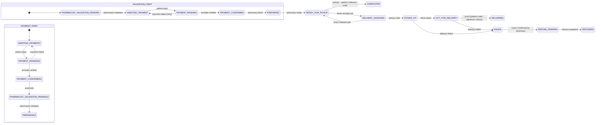

# 06 – Order state machine (design)

Single source of truth: `src/modules/orders/order-state-machine.ts` (transition table) executed by `OrderStateMachineService` – **the only code path allowed to change `orders.status`**.

## 1. Request vs order

Requests keep their own lifecycle (`REQUEST_SUBMITTED → … → OFFER_ACCEPTED | EXPIRED | CANCELLED`, see [api/03-patient.md](./api/03-patient.md#1-request-status-lifecycle)). An **order** exists only after the patient accepts one offer (`POST /offers/:id/accept`). From then on the request stays `OFFER_ACCEPTED` and progress is tracked on the order. If the order ends `CANCELLED` / `REFUNDED` / `FAILED` before hand-over, the request moves to `CANCELLED`.

## 2. Two workflow variants

`platform_settings.payment_before_validation` decides the order of payment and pharmacist validation. **The legal decision is pending; the default (`false`) is the conservative `VALIDATION_FIRST`**: no money is captured before a pharmacist has validated the order against the prescription.

The variant is frozen on the order (`orders.workflow_variant`) at creation, so changing the setting never affects orders in flight.

| | VALIDATION_FIRST (default) | PAYMENT_FIRST |
|---|---|---|
| Initial status | `PHARMACIST_VALIDATION_PENDING` | `AWAITING_PAYMENT` |
| Validation | before payment: `→ AWAITING_PAYMENT` | after payment: `PAYMENT_CONFIRMED → PHARMACIST_VALIDATION_PENDING → PREPARING` |
| Pharmacist refuses | `→ CANCELLED` (nothing to refund) | `→ REFUND_PENDING` |
| Patient risk | never pays for something refused | may pay then be refunded |

## 3. Diagram

(`AWAITING_PAYMENT2` etc. are the same statuses drawn twice for readability.)

Side states: `CANCELLED` (nothing paid), `REFUND_PENDING` → `REFUNDED` (money returned), `FAILED` (delivery failed, goods returning).

## 4. Transition table

Actor kinds: **PATIENT** (owner of the order) · **PHARMACY** (active staff of the order's pharmacy; `PHARMACIST*` = staff role OWNER or PHARMACIST) · **DRIVER** (assigned driver) · **ADMIN** · **SYSTEM** (jobs, payment verification, other state machines).

| # | From | To | Variant | Actor | Preconditions | Side effects | Notification |
|---|---|---|---|---|---|---|---|
| 1 | — (accept) | PHARMACIST_VALIDATION_PENDING / AWAITING_PAYMENT | VF / PF | PATIENT | offer SENT, unexpired, no PENDING alternative, items still eligible & in stock, delivery allowed if DELIVERY | order + frozen items; offer ACCEPTED; other SENT offers REJECTED; request OFFER_ACCEPTED; PF: `payment_deadline_at` | pharmacy: OFFER_ACCEPTED |
| 2 | PHARMACIST_VALIDATION_PENDING | AWAITING_PAYMENT | VF | PHARMACIST* | `confirm=true`, decision APPROVE, note | `pharmacist_validated_by/at`, `validation_note`, `payment_deadline_at = now + payment_deadline_minutes` | patient |
| 3 | AWAITING_PAYMENT | PAYMENT_PENDING | both | SYSTEM (payment initiated) | before deadline | payment row | — |
| 4 | PAYMENT_PENDING | AWAITING_PAYMENT | both | SYSTEM | payment failed / cancelled | — | patient: PAYMENT_FAILED |
| 5 | PAYMENT_PENDING | PAYMENT_CONFIRMED | both | SYSTEM | provider status verified server-side, amount matches | receipt | patient, pharmacy |
| 6 | PAYMENT_CONFIRMED | PHARMACIST_VALIDATION_PENDING | PF | SYSTEM (automatic, same transaction) | — | — | pharmacy |
| 7 | PHARMACIST_VALIDATION_PENDING | PREPARING | PF | PHARMACIST* | `confirm=true`, APPROVE, note | validation fields | patient |
| 8 | PAYMENT_CONFIRMED | PREPARING | VF | PHARMACY | — | — | patient |
| 9 | PREPARING | READY_FOR_PICKUP | both | PHARMACY | — | DELIVERY: delivery job created (pickup code to pharmacy, delivery code to patient) · PICKUP: collection code to patient | patient |
| 10 | READY_FOR_PICKUP | COMPLETED | both | PHARMACY | PICKUP order, valid patient collection code | — | patient |
| 11 | READY_FOR_PICKUP | DELIVERY_ASSIGNED | both | DRIVER / SYSTEM | DELIVERY order, verified available driver, atomic job accept | — | patient |
| 12 | DELIVERY_ASSIGNED | READY_FOR_PICKUP | both | DRIVER / ADMIN | release reason, daily limit | — | — |
| 13 | DELIVERY_ASSIGNED | PICKED_UP | both | DRIVER | valid pickup code | — | patient |
| 14 | PICKED_UP | OUT_FOR_DELIVERY | both | DRIVER | — | live location visible to patient | patient |
| 15 | OUT_FOR_DELIVERY | DELIVERED | both | DRIVER | valid proof (delivery code / signature / photo without face) | — | patient |
| 16 | PICKED_UP, OUT_FOR_DELIVERY | FAILED | both | DRIVER / ADMIN | reason | return flow starts | patient, pharmacy |
| 17 | FAILED | REFUND_PENDING | both | PHARMACY / ADMIN / SYSTEM | return confirmed by pharmacy | refund requested | patient |
| 18 | PHARMACIST_VALIDATION_PENDING, AWAITING_PAYMENT, PAYMENT_PENDING | CANCELLED | VF (PVP), both | PATIENT, PHARMACY (with reason), ADMIN, SYSTEM | nothing captured | pending payment cancelled; request CANCELLED | other side |
| 19 | PHARMACIST_VALIDATION_PENDING | CANCELLED | VF | PHARMACIST* (decision REJECT) | note required | request CANCELLED | patient |
| 20 | PAYMENT_CONFIRMED | REFUND_PENDING | both | PATIENT (free cancel window), PHARMACY, ADMIN | reason | refund requested (Phase 7) | other side |
| 21 | PHARMACIST_VALIDATION_PENDING | REFUND_PENDING | PF | PATIENT, PHARMACIST* (REJECT), ADMIN, SYSTEM (timeout) | reason | refund requested | other side |
| 22 | PREPARING, READY_FOR_PICKUP, DELIVERY_ASSIGNED | REFUND_PENDING | both | PHARMACY, ADMIN | reason (patient → `409 ORDER_CANCEL_REQUIRES_APPROVAL`) | refund requested; delivery cancelled | other side |
| 23 | REFUND_PENDING | REFUNDED | both | SYSTEM (refund completed) / ADMIN | — | request CANCELLED | patient |

**Never cancellable** after `PICKED_UP` (only the FAILED path), nor from `DELIVERED`, `COMPLETED`, `REFUNDED`, `CANCELLED`.

Every transition – in one DB transaction:
1. load the order, check the edge exists for the order's variant (`409 ORDER_INVALID_TRANSITION`) and the actor kind is allowed (`403 ORDER_ACTION_FORBIDDEN`) and owns the order (`404 ORDER_NOT_FOUND`);
2. `UPDATE orders SET status = :to, version = version + 1 … WHERE id = :id AND version = :expected` – 0 rows → `409 ORDER_VERSION_CONFLICT` (concurrent change);
3. insert `order_status_history` (append-only: from, to, actor, role, reason, metadata);
4. run side effects (same transaction);
5. write the audit log;
6. after COMMIT: emit `order.status_changed` (notifications, realtime).

## 5. Timeouts (jobs, every minute)

| Timeout | Setting | Effect |
|---|---|---|
| Payment deadline | `payment_deadline_minutes` (30) from `payment_deadline_at` | AWAITING_PAYMENT → CANCELLED (SYSTEM); a PAYMENT_PENDING order is left to payment reconciliation |
| Pharmacist validation | `pharmacist_validation_timeout_minutes` (120) since entering PHARMACIST_VALIDATION_PENDING | VF → CANCELLED · PF → REFUND_PENDING; admin alert |
| Delivery assignment | `delivery_assignment_timeout_minutes` (30) in READY_FOR_PICKUP (DELIVERY) | admin alert only (no state change); repeated at most once per period |
| Request expiry | `request_expiry_hours` (24) | open requests → EXPIRED |
| Offer expiry | offer `valid_until` | SENT offers → EXPIRED |

Jobs are idempotent: they use the same state machine (version check), so a job racing with a user action loses cleanly.

## 6. Retry & idempotency rules

- `POST /offers/:id/accept` and `POST /orders/:id/pay` accept an `Idempotency-Key` header (8–128 chars). The first response is stored per (user, endpoint, key) for 24 h and replayed for identical retries; the same key with a different body → `409 IDEMPOTENCY_KEY_REUSED`; a retry while the first call is still running → `409 IDEMPOTENCY_IN_PROGRESS`.
- Without a key, a duplicate accept still cannot create two orders: the offer is moved SENT → ACCEPTED with a conditional update and a partial unique index allows one active order per offer.
- Clients should retry state-changing calls only on network errors / 5xx, with the same Idempotency-Key.

## 7. Role-specific views

| Viewer | Endpoint | Sees |
|---|---|---|
| Patient | `GET /orders/:id` | everything about their order: items, prices, pharmacy name/address/phone, fulfillment, delivery address, validation status, timeline link |
| Pharmacy staff | `GET /pharmacy/orders/:id` | items, prices, patient **first name** only, fulfillment type, delivery **area** (no street/phone – the courier receives what it needs in Phase 8), validation fields |
| Driver | — | nothing here (`403`); uses `/delivery/jobs/*` (no medical data) |
| Admin | `GET /admin/orders/:id` | metadata only, no prescription content (Phase 9) |

## 8. Timeline

`GET /orders/:id/timeline` returns `order_status_history` with localized labels (`labels.order_status.*` in `src/i18n/{ar,fr}.json`) and patient-friendly descriptions; actor shown as `PATIENT | PHARMACY | DRIVER | PLATFORM` (never staff names).
