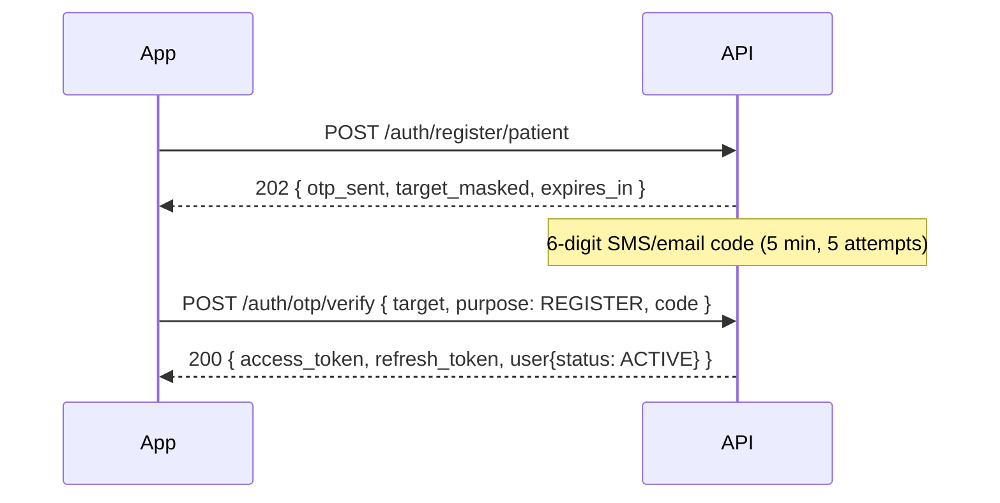
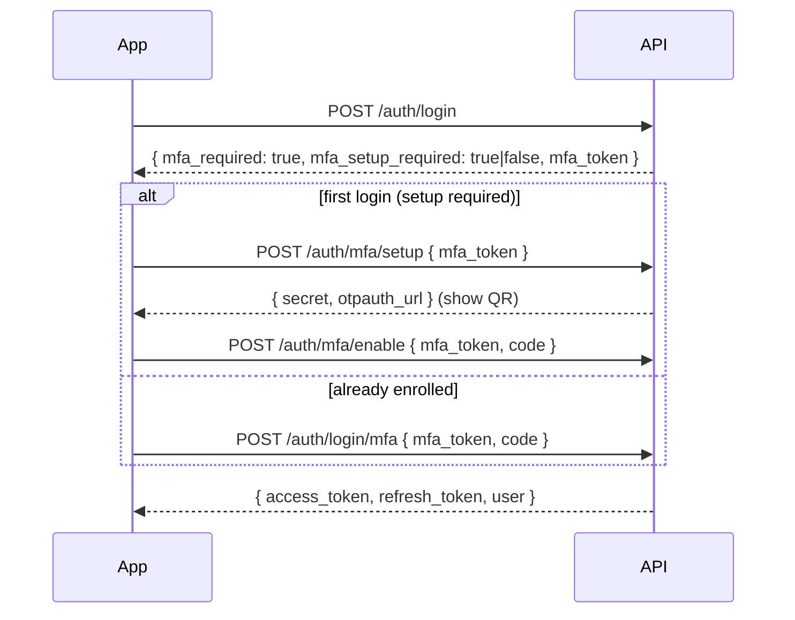
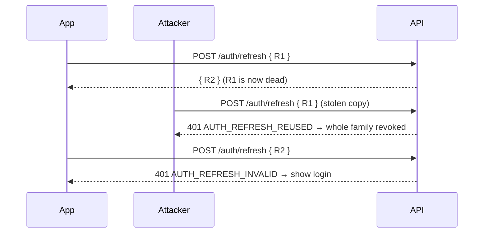

# 02 – Authentication, authorization & account security

Read [00-conventions.md](./00-conventions.md) first (envelope, errors, pagination). Error messages per code: [errors.md](./errors.md).
All responses below show only `data`; the envelope is always present.

## Contents

1. [Flows at a glance](#1-flows-at-a-glance)
2. [Token handling (mobile/web)](#2-token-handling)
3. [Registration](#3-registration) — patient, pharmacy, delivery company, driver, staff invitation
4. [OTP](#4-otp)
5. [Login](#5-login) — password, SMS code, MFA step
6. [Refresh, logout, sessions](#6-refresh-logout-sessions)
7. [Passwords](#7-passwords)
8. [MFA (TOTP)](#8-mfa-totp)
9. [Devices & biometric login](#9-devices--biometric-login)
10. [Me & consents](#10-me--consents)
11. [Pharmacy staff invitations](#11-pharmacy-staff-invitations)
12. [Admin – users](#12-admin--users)
13. [Shared field rules](#13-shared-field-rules)
14. [Security notes for the frontend](#14-security-notes-for-the-frontend)

---

## 1. Flows at a glance

**Patient sign-up**



**Admin login (MFA mandatory)**



**Refresh rotation & reuse detection**



## 2. Token handling

| Token | Lifetime | Store | Use |
|---|---|---|---|
| `access_token` (JWT) | 15 min (`expires_in`) | Memory | `Authorization: Bearer …` |
| `refresh_token` (opaque) | 30 days, **single use** | iOS Keychain / Android Keystore (EncryptedSharedPreferences); web: never `localStorage` — prefer memory + re-login, or an httpOnly cookie proxy | `POST /auth/refresh` |
| `mfa_token` | 5 min | Memory | MFA step only |
| `reset_token` | 10 min, single use | Memory | `POST /auth/password/reset` |

Rules:

- On `401 AUTH_TOKEN_EXPIRED` → call `/auth/refresh` **once**, retry the request. Serialize refreshes (one in flight at a time): two parallel refreshes with the same token count as reuse and log the user out.
- On `AUTH_REFRESH_INVALID`, `AUTH_REFRESH_REUSED`, `AUTH_SESSION_REVOKED` → clear tokens and go to login.
- Logout / logout-all / suspension / role change / password reset take effect **immediately** (the server checks the session on each request).

## 3. Registration

All self-registration endpoints are **public**, answer **`202`** with the same body whether or not the email/phone already exists (no account enumeration), and send a 6-digit code with purpose `REGISTER` to the phone (or email if no phone). If the identifier already belongs to an account, the owner receives an "account exists" message instead of a code.

Response (`202`) — `OtpSentDto`:

| Field | Type | Example |
|---|---|---|
| `otp_sent` | boolean | `true` (always) |
| `target_masked` | string | `+213*****4567` / `a***@example.dz` |
| `expires_in` | integer (s) | `300` |

Common body fields (all registration endpoints except staff):

| Field | Type | Required | Validation |
|---|---|---|---|
| `email` | string | one of email/phone | valid email, ≤ 254, stored lower-case |
| `phone` | string | one of email/phone | valid phone (E.164 or DZ local) → stored E.164 |
| `password` | string | yes | 10–128 chars, ≥ 1 upper, 1 lower, 1 digit |
| `first_name` | string | yes | 1–100 |
| `last_name` | string | yes | 1–100 |
| `preferred_language` | `ar` \| `fr` | yes | |
| `consents` | array of `{type, version}` | yes | 2–4 items, no duplicates; **must** contain `TERMS` and `PRIVACY` at the current version (`2026-10`). Optional: `HEALTH_DATA_PROCESSING`, `SHARE_PRESCRIPTION_WITH_PHARMACY` |

Common errors: `AUTH_IDENTIFIER_REQUIRED`, `AUTH_CONSENT_REQUIRED`, `AUTH_CONSENT_VERSION_OUTDATED` (`details.current_version`), `OTP_RESEND_COOLDOWN` (`message` contains the seconds), `VALIDATION_FAILED`, `RATE_LIMITED`.

### POST /auth/register/patient

Body: common fields only. Account is `PENDING_VERIFICATION` until the code is verified, then `ACTIVE`.
An unverified pending patient may simply register again (overwrites the pending data).

```json
{
  "phone": "+213661234567",
  "password": "Str0ngPassw0rd",
  "first_name": "Amina",
  "last_name": "Benali",
  "preferred_language": "fr",
  "consents": [
    { "type": "TERMS", "version": "2026-10" },
    { "type": "PRIVACY", "version": "2026-10" }
  ]
}
```

### POST /auth/register/pharmacy

Creates a `PHARMACY_OWNER` account (`PENDING_VERIFICATION`, **not** self-activating) and a pharmacy in `DRAFT`, linked as `OWNER`.

Extra fields:

| Field | Type | Required | Validation |
|---|---|---|---|
| `pharmacist_license_number` | string | no | ≤ 100 |
| `pharmacy.name_fr` | string | yes | 1–200 |
| `pharmacy.name_ar` | string | yes | 1–200 |
| `pharmacy.legal_name` | string | no | ≤ 255 |
| `pharmacy.authorization_number` | string | yes | 3–100, unique |
| `pharmacy.tax_id_nif` | string | no | ≤ 30 |
| `pharmacy.commercial_register_rc` | string | no | ≤ 30 |
| `pharmacy.wilaya_id` | integer | yes | 1–58 |
| `pharmacy.commune_id` | integer | yes | must belong to `wilaya_id` |
| `pharmacy.address_line` | string | yes | 3–255 |
| `pharmacy.latitude` / `longitude` | number | no | valid lat / lng |
| `pharmacy.phone` | string | no | valid phone |

Extra errors: `GEO_INVALID_COMMUNE`, `PHARMACY_AUTHORIZATION_NUMBER_TAKEN`.

### POST /auth/register/delivery-company

Creates a `DELIVERY_COMPANY_ADMIN` (`PENDING_VERIFICATION`) and a company (`PENDING_VERIFICATION`).

| Field | Type | Required | Validation |
|---|---|---|---|
| `company.name` | string | yes | 1–200 |
| `company.legal_name` | string | no | ≤ 255 |
| `company.tax_id` | string | no | ≤ 30 |
| `company.rc_number` | string | no | ≤ 30 |
| `company.phone` | string | no | valid phone |
| `company.email` | string | no | valid email |

### POST /auth/register/driver

Independent driver (`DRIVER`, `PENDING_VERIFICATION`).

| Field | Type | Required | Validation |
|---|---|---|---|
| `vehicle_type` | `MOTORCYCLE` \| `CAR` \| `VAN` \| `BIKE` | yes | |
| `plate_number` | string | no | ≤ 20 |
| `license_number` | string | no | ≤ 50, stored encrypted |

### POST /auth/invitations/preview

Public. Shows the invitee what they are joining before registering.

| Field | Type | Required |
|---|---|---|
| `invitation_token` | string | yes (≤ 256) |

`200` → `{ pharmacy_name_fr, pharmacy_name_ar, staff_role: "PHARMACIST"|"ASSISTANT", target_masked, expires_at }`
Errors: `INVITATION_INVALID` (unknown, used or revoked), `INVITATION_EXPIRED` (410).

### POST /auth/register/staff

Accepts a pharmacy invitation and creates the account. The email/phone comes from the invitation and is marked verified. Returns tokens directly (`201`, `LoginResponseDto`). Role = `PHARMACIST` or `PHARMACY_ASSISTANT`; status `PENDING_VERIFICATION` until an admin approves.

| Field | Type | Required | Validation |
|---|---|---|---|
| `invitation_token` | string | yes | |
| `password` | string | yes | password rule |
| `first_name`, `last_name` | string | yes | 1–100 |
| `preferred_language` | `ar` \| `fr` | yes | |
| `pharmacist_license_number` | string | **yes for PHARMACIST** | ≤ 100 |
| `consents` | array | yes | as above |

Errors: `INVITATION_INVALID`, `INVITATION_EXPIRED`, `IDENTIFIER_ALREADY_USED` (409), `VALIDATION_FAILED` (`pharmacist_license_number`), consent errors.

## 4. OTP

Codes: 6 digits, valid **5 min**, **5 attempts**, new code allowed after **60 s** (`OTP_RESEND_COOLDOWN`). Requesting a new code invalidates the previous one. Codes are stored hashed.

### POST /auth/otp/request

Public; optionally authenticated (Bearer) for `VERIFY_*`.

| Field | Type | Required | Validation |
|---|---|---|---|
| `target` | string | yes | email or phone |
| `purpose` | `REGISTER` \| `LOGIN` \| `RESET_PASSWORD` \| `VERIFY_PHONE` \| `VERIFY_EMAIL` | yes | |

Behaviour per purpose:

| Purpose | Sent when | Notes |
|---|---|---|
| `REGISTER` | account pending & identifier unverified | otherwise "account exists" message / nothing |
| `LOGIN` | phone verified, account not suspended | **phone targets only** (`OTP_PURPOSE_NOT_ALLOWED` for email) |
| `RESET_PASSWORD` | identifier verified | same as `/auth/password/forgot` |
| `VERIFY_PHONE` / `VERIFY_EMAIL` | Bearer token + your own phone/email | else `OTP_PURPOSE_NOT_ALLOWED` / `RESOURCE_FORBIDDEN` |

`202` → `OtpSentDto` (always the same shape).

### POST /auth/otp/verify

| Field | Type | Required | Validation |
|---|---|---|---|
| `target` | string | yes | email or phone |
| `purpose` | as above | yes | `LOGIN` is rejected here → use `/auth/login/otp` |
| `code` | string | yes | `^\d{6}$` |

`200` response depends on the purpose:

| Purpose | `data` |
|---|---|
| `REGISTER` | `LoginResponseDto` (tokens, or `mfa_required`). Patients become `ACTIVE`; other roles stay `PENDING_VERIFICATION`. |
| `RESET_PASSWORD` | `{ "reset_token": "…" }` |
| `VERIFY_PHONE` / `VERIFY_EMAIL` | `{ "verified": true }` |

Errors: `OTP_INVALID` (wrong, expired, or no such code — deliberately indistinguishable), `OTP_TOO_MANY_ATTEMPTS` (429 – request a new code), `OTP_PURPOSE_NOT_ALLOWED`, `ACCOUNT_SUSPENDED`.

## 5. Login

`LoginResponseDto`:

| Field | Type | Present when |
|---|---|---|
| `access_token` | string (JWT) | tokens issued |
| `refresh_token` | string | tokens issued |
| `token_type` | `"Bearer"` | tokens issued |
| `expires_in` | integer (s) | tokens issued (900) |
| `user` | `{ id, role, status, preferred_language }` | tokens issued |
| `mfa_required` | `true` | MFA step needed (no tokens!) |
| `mfa_setup_required` | boolean | with `mfa_required`: `true` → enrol first (§8) |
| `mfa_token` | string | with `mfa_required` |

```json
{
  "access_token": "eyJhbGciOiJIUzI1NiIs…",
  "refresh_token": "8f6c0a3e-1b2c-4d5e-9f00-112233445566.Q2h…",
  "token_type": "Bearer",
  "expires_in": 900,
  "user": { "id": "…", "role": "PATIENT", "status": "ACTIVE", "preferred_language": "fr" }
}
```

### POST /auth/login

| Field | Type | Required | Validation |
|---|---|---|---|
| `identifier` | string | yes | email or phone (local DZ accepted) |
| `password` | string | yes | 1–128 |

- After **5** consecutive failures (password or MFA code) the account is locked for **15 min**.
- Errors are generic: unknown account and wrong password both return `AUTH_INVALID_CREDENTIALS`. `AUTH_ACCOUNT_LOCKED` (with minutes in `message`) is only returned to someone who knows the password.
- `ACCOUNT_SUSPENDED` (403) is returned after a correct password.
- `PENDING_VERIFICATION` accounts can log in (status is in `user.status`).

### POST /auth/login/otp

| Field | Type | Required | Validation |
|---|---|---|---|
| `phone` | string | yes | valid phone, must be verified |
| `code` | string | yes | `^\d{6}$`, purpose `LOGIN` |

Errors: `OTP_INVALID`, `OTP_TOO_MANY_ATTEMPTS`, `ACCOUNT_SUSPENDED`.

### POST /auth/login/mfa

| Field | Type | Required | Validation |
|---|---|---|---|
| `mfa_token` | string | yes | from `/auth/login` |
| `code` | string | yes | `^\d{6}$` (authenticator app) |

Errors: `MFA_TOKEN_INVALID`, `MFA_INVALID_CODE` (counts towards lockout), `MFA_SETUP_NOT_STARTED` (token was issued for setup – use §8), `AUTH_ACCOUNT_LOCKED`, `ACCOUNT_SUSPENDED`.

## 6. Refresh, logout, sessions

### POST /auth/refresh

| Field | Type | Required | Validation |
|---|---|---|---|
| `refresh_token` | string | yes | ≤ 256 |
| `device_id` | string | when the session is device-bound (§9) | 8–128 |

`200` → `LoginResponseDto` with a **new** refresh token. The old one is dead.

Errors: `AUTH_REFRESH_INVALID`, `AUTH_REFRESH_REUSED` (whole session family revoked), `AUTH_DEVICE_MISMATCH`, `ACCOUNT_SUSPENDED`.

### POST /auth/logout · POST /auth/logout-all

Bearer. No body. `logout` revokes the current session; `logout-all` revokes every session (`{ ok, sessions_revoked }`).

### GET /auth/sessions

Bearer. Paginated. Query: `page`, `limit`, `order`, `sort` = `created_at` (default) | `last_used_at`.

Item (`SessionDto`): `{ id, current, ip, user_agent, device_id, device_platform, created_at, last_used_at, expires_at }`.

### DELETE /auth/sessions/:id

Bearer. Revokes one of **your** sessions. Someone else's id → `404 NOT_FOUND`.

## 7. Passwords

### POST /auth/password/forgot

Public. `{ "identifier": "<email or phone>" }` → `202 OtpSentDto` (always). Code is only sent to a **verified** identifier.
Next: `POST /auth/otp/verify` with `purpose: RESET_PASSWORD` → `reset_token`.

### POST /auth/password/reset

| Field | Type | Required | Validation |
|---|---|---|---|
| `reset_token` | string | yes | from OTP verify, 10 min, single use |
| `new_password` | string | yes | password rule |

`200 { ok: true }`. Revokes **all** sessions and clears any lockout. Errors: `OTP_INVALID` (expired/used token).

### POST /auth/password/change

Bearer.

| Field | Type | Required | Validation |
|---|---|---|---|
| `current_password` | string | yes | |
| `new_password` | string | yes | password rule, ≠ current |

`200 { ok: true }`. Keeps the current session, revokes all others. Errors: `AUTH_PASSWORD_INCORRECT`, `AUTH_PASSWORD_REUSED`.

## 8. MFA (TOTP)

| Role | MFA |
|---|---|
| `ADMIN`, `SUPER_ADMIN` | **Mandatory** — no token is ever issued before TOTP. Cannot be disabled. |
| `PHARMACY_OWNER`, `PHARMACIST`, `PHARMACY_ASSISTANT` | Optional |
| Others | Not available (`MFA_NOT_AVAILABLE_FOR_ROLE`) |

Any authenticator app works (Google Authenticator, Microsoft Authenticator, Aegis…): 30 s period, 6 digits, ±1 step tolerance.

### POST /auth/mfa/setup

Auth: Bearer (staff opting in) **or** `{ "mfa_token": "…" }` (admin login flow).
`200` → `{ secret, otpauth_url }` — render `otpauth_url` as a QR code, offer `secret` for manual entry. Calling again before enabling replaces the secret.
Errors: `MFA_TOKEN_INVALID`, `MFA_ALREADY_ENABLED`, `MFA_NOT_AVAILABLE_FOR_ROLE`, `AUTH_TOKEN_MISSING`.

### POST /auth/mfa/enable

| Field | Type | Required |
|---|---|---|
| `code` | string `^\d{6}$` | yes |
| `mfa_token` | string | when not using Bearer |

With `mfa_token` → `LoginResponseDto` (tokens). Admin accounts created by a super admin become `ACTIVE` here.
With Bearer → `{ mfa_enabled: true }`.
Errors: `MFA_INVALID_CODE`, `MFA_SETUP_NOT_STARTED`, `MFA_ALREADY_ENABLED`, `MFA_TOKEN_INVALID`.

### POST /auth/mfa/disable

Bearer, pharmacy staff only. `{ code, password }` → `{ mfa_enabled: false }`.
Errors: `MFA_MANDATORY_FOR_ROLE`, `MFA_NOT_ENABLED`, `MFA_INVALID_CODE`, `AUTH_PASSWORD_INCORRECT`.

## 9. Devices & biometric login

No biometric data ever reaches the server. The app:

1. Generates a random `device_id` once and stores it.
2. After a normal login, calls `POST /auth/devices` with `biometric_enabled: true`. **The current session is now bound to this device.**
3. Stores the refresh token in Keychain/Keystore protected by biometrics (`kSecAccessControlBiometryCurrentSet` / `setUserAuthenticationRequired(true)`).
4. "Login with Face ID / fingerprint" = unlock the stored refresh token locally → `POST /auth/refresh { refresh_token, device_id }`.

A device-bound refresh token used without (or with another) `device_id` → `401 AUTH_DEVICE_MISMATCH`.

### POST /auth/devices

Bearer. `201`.

| Field | Type | Required | Validation |
|---|---|---|---|
| `device_id` | string | yes | 8–128, `[A-Za-z0-9._:-]` |
| `platform` | `ios` \| `android` \| `web` | yes | |
| `biometric_enabled` | boolean | yes | |
| `push_token` | string | no | ≤ 4096 |
| `app_version` | string | no | ≤ 32 |

Upsert per (user, device_id). Response `DeviceDto`: `{ id, device_id, platform, biometric_enabled, app_version, last_seen_at, created_at }`.

### GET /auth/devices

Bearer, paginated (`page`, `limit`, `order`).

### DELETE /auth/devices/:id

Bearer. `:id` = the `DeviceDto.id` (UUID). Disables biometrics and revokes every session bound to that device → `{ ok, sessions_revoked }`. Not yours → `404`.

## 10. Me & consents

All routes: Bearer; allowed for `PENDING_VERIFICATION` accounts.

### GET /me

`MeDto`: `{ id, role, status, preferred_language, email, phone, email_verified, phone_verified, mfa_enabled, biometric_enabled, first_name, last_name, created_at }`.

### PATCH /me

`{ "preferred_language": "ar" }` → `MeDto`.

### GET /me/consents

Paginated history. Query: `page`, `limit`, `order`, `type` (consent type), `active` (`true` = non-revoked only).
Item: `{ id, type, version, granted_at, revoked_at, active }`.

### POST /me/consents

`{ "type": "HEALTH_DATA_PROCESSING", "version": "v1" }` → `201` consent. Idempotent for the same type+version. `TERMS`/`PRIVACY` must use the current version (`AUTH_CONSENT_VERSION_OUTDATED`).

### DELETE /me/consents/:type

Revokes the active consent(s) of that type → `{ type, revoked }`.
`TERMS` / `PRIVACY` → `400 CONSENT_REQUIRED_NOT_REVOCABLE` (account deletion is the way out). Nothing active → `404 CONSENT_NOT_FOUND`.

## 11. Pharmacy staff invitations

Requirements for every route: Bearer, role `PHARMACY_OWNER`, account `ACTIVE`, **OWNER of that pharmacy**, pharmacy `VERIFIED`.
Errors on every route: `ROLE_FORBIDDEN`, `ACCOUNT_PENDING_VERIFICATION`, `PHARMACY_ACCESS_DENIED`, `PHARMACY_NOT_VERIFIED`, `PHARMACY_NOT_FOUND`.

### POST /pharmacies/:id/staff/invite

| Field | Type | Required | Validation |
|---|---|---|---|
| `email` | string | one of email/phone | valid email |
| `phone` | string | one of email/phone | valid phone (invitation goes to phone if both) |
| `staff_role` | `PHARMACIST` \| `ASSISTANT` | yes | `OWNER` cannot be invited |

`201` → `InvitationDto` `{ id, staff_role, target_masked, status, expires_at, created_at }`. The token is **only** sent to the invitee (never returned). Expires after 7 days. Re-inviting the same person revokes the previous invitation.

### GET /pharmacies/:id/staff/invitations

Paginated (`page`, `limit`, `order`). `status` may be `PENDING`, `ACCEPTED`, `REVOKED`, `EXPIRED`.

### DELETE /pharmacies/:id/staff/invitations/:invitationId

Revokes a pending invitation → `InvitationDto`. Not pending → `INVITATION_INVALID`.

## 12. Admin – users

Bearer; admins always have MFA. Every call is audited (with the `reason` when required).

### POST /admin/users — SUPER_ADMIN

| Field | Type | Required | Validation |
|---|---|---|---|
| `email` | string | yes | valid email |
| `phone` | string | no | valid phone |
| `first_name`, `last_name` | string | yes | 1–100 |
| `password` | string | yes | password rule (communicate out-of-band) |
| `preferred_language` | `ar` \| `fr` | yes | |
| `reason` | string | yes | 5–500 |

`201` → `AdminUserDto`. The new `ADMIN` is `PENDING_VERIFICATION` and becomes `ACTIVE` after enrolling TOTP at first login. Errors: `IDENTIFIER_ALREADY_USED`.

### GET /admin/users — ADMIN, SUPER_ADMIN

Query: `page`, `limit`, `order`, `sort` = `created_at` | `last_login_at`, `role`, `status`, `search` (email/phone prefix, 2–100 chars).
Item `AdminUserDto`: `{ id, role, status, email, phone, email_verified, phone_verified, mfa_enabled, last_login_at, created_at }`.

### PATCH /admin/users/:id/status — ADMIN, SUPER_ADMIN

`{ "status": "ACTIVE" | "SUSPENDED", "reason": "…" }`. Suspension revokes all sessions immediately.
Rules: nobody can modify themselves (`CANNOT_MODIFY_SELF`) or a `SUPER_ADMIN`; `ADMIN` cannot modify another `ADMIN` (`ROLE_FORBIDDEN`).

### PATCH /admin/users/:id/role — SUPER_ADMIN

`{ "role": "<any role except SUPER_ADMIN>", "reason": "…" }`. Revokes all sessions of the user.

## 13. Shared field rules

| Rule | Definition |
|---|---|
| Password | 10–128 characters, at least one lower-case, one upper-case letter and one digit |
| Phone | E.164 (`+213661234567`) or Algerian local (`0661234567`); must be a valid number |
| Email | RFC-ish, ≤ 254, case-insensitive |
| OTP / TOTP code | exactly 6 digits |
| Consent versions | `TERMS` and `PRIVACY`: current version `2026-10` (configurable server-side) |

## 14. Security notes for the frontend

- Never log tokens, codes or passwords (including in crash reporters).
- Treat `target_masked` as display-only; do not infer whether an account exists.
- Serialize refresh calls; on any auth error listed in §2 → wipe tokens.
- For admins, show the TOTP QR only once; the server never shows the secret again after enabling.
- Send `Accept-Language` from the user's app language so messages and SMS templates match.

## Audit trail

The server writes an append-only audit entry for: registration, login success/failure, account lock, MFA failure, logout(-all), session revocation, refresh-token reuse, password change/reset, MFA enable/disable, identifier verification, device add/remove, consent grant/revoke, staff invite/revoke/accept, and every admin action (user create/list/status/role).
