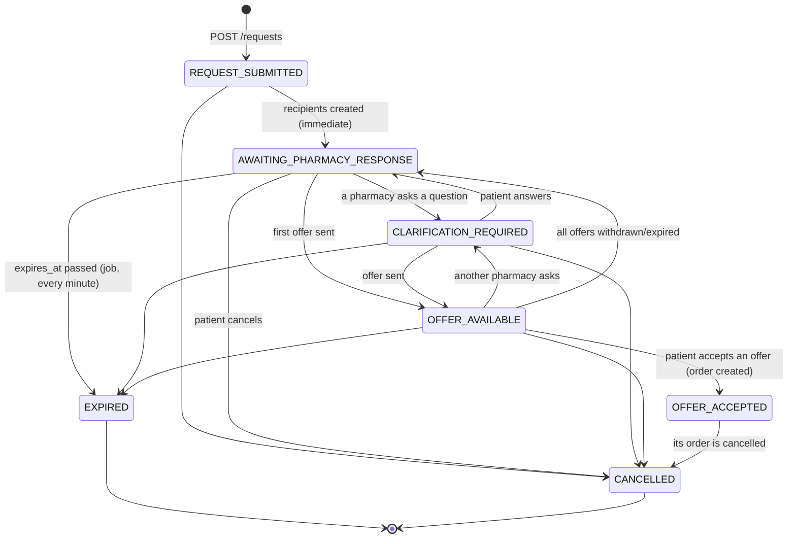

# 03 – Patient API

Conventions (envelope, errors, pagination): [00-conventions.md](./00-conventions.md). Error texts: [errors.md](./errors.md).
All routes below require `Authorization: Bearer` with role **PATIENT** and status **ACTIVE**, unless marked *public*.
Common auth errors on every route: `AUTH_TOKEN_MISSING`, `AUTH_TOKEN_INVALID`, `AUTH_SESSION_REVOKED`, `ROLE_FORBIDDEN`, `ACCOUNT_PENDING_VERIFICATION`, `ACCOUNT_SUSPENDED`.

## 0. Vocabulary – label these differently in the UI

| Term | What it is | Who creates it | Where | Typical label (fr / ar) |
|---|---|---|---|---|
| **Request** (`requests`) | The patient's ask: "here is my prescription / what I need, who can serve me?". Sent to 1–5 pharmacies. No price, no commitment. Reference `RX-YYYY-NNNNNN`. | Patient | `POST /requests` | Demande / طلب |
| **Offer** (`offers`) | One pharmacy's quote for a request: items it can supply (or alternatives), prices, preparation time, delivery fee, validity. Several offers can exist for one request. Not binding until accepted. | Pharmacy | Phase 4 | Proposition / عرض |
| **Order** (`orders`) | Created **only** when the patient accepts one offer. Prices are frozen. Has its own lifecycle (payment, pharmacist validation, preparation, pickup/delivery). | Patient (accepting) | Phase 6 | Commande / طلب شراء |
| **Validated prescription** | The pharmacist's explicit professional check of the order against the prescription (`orders.pharmacist_validated_at`). A pharmacy "accepting interest" or sending an offer is **not** a validation. OCR results are **never** a validation. | Pharmacist (role PHARMACIST/OWNER) | Phase 4/6 | Ordonnance validée par le pharmacien / وصفة مُصادق عليها من الصيدلي |
| **Delivered** | The order status `DELIVERED`, set only with valid proof (patient's delivery code, signature or photo without face). For pickup orders the final status is `COMPLETED`. | Driver (with proof) / pharmacy (pickup) | Phase 8 | Livrée / تم التسليم · Retirée / تم الاستلام |
| **CHIFA info submitted** | The patient typed/uploaded CHIFA card data. Says nothing about coverage. | Patient | this doc | Carte Chifa transmise / تم إرسال بطاقة الشفاء |
| **Coverage verified** | Only true when an **official** CNAS integration confirmed it. No such integration exists today → always `false`. Never show "remboursé"/"pris en charge" based on anything else. | — | this doc | Couverture vérifiée / تغطية مؤكدة |

## 1. Request status lifecycle

| Status | Meaning for the patient | Patient can |
|---|---|---|
| `REQUEST_SUBMITTED` | Transient (milliseconds) while recipients are created | — |
| `AWAITING_PHARMACY_RESPONSE` | Sent; waiting for pharmacies | edit items, cancel |
| `CLARIFICATION_REQUIRED` | A pharmacy asked a question (chat) | answer, edit items, cancel |
| `OFFER_AVAILABLE` | At least one offer to review | compare/accept offers, cancel |
| `OFFER_ACCEPTED` | An order exists – follow the order | cancel the **order** (not the request) |
| `EXPIRED` | No (accepted) answer before `expires_at` (`request_expiry_hours`, default 24 h) | create a new request |
| `CANCELLED` | Cancelled by the patient (or its order was cancelled) | — |

When a request is cancelled or expires, its recipients become `EXPIRED` and its draft/sent offers become `EXPIRED`.

**Recipient statuses** (per pharmacy): `SENT` → `VIEWED` → `CLARIFICATION_ASKED` / `OFFERED` / `DECLINED`; `EXPIRED` when the request closes.

## 2. Reference data (public)

### GET /geo/wilayas — *public*

Query: `page` (1), `limit` (1–100, default **100**), `sort` = `id` | `name_fr` | `name_ar` (default `id`), `order` (`asc` default), `search` (1–60 chars, fr or ar, contains).
Item: `{ id: integer (official code 1–58), name_fr, name_ar }`.

### GET /geo/wilayas/:id/communes — *public*

Same query. Item: `{ id, wilaya_id, name_fr, name_ar }`. Unknown wilaya → `404 NOT_FOUND`.

### GET /pharmacies/nearby — *public*

| Query | Type | Required | Rules |
|---|---|---|---|
| `lat` | number | yes | valid latitude |
| `lng` | number | yes | valid longitude |
| `radius` | number (km) | no | 0.1–50, default 5 |
| `open_now` | boolean | no | open now (Algiers time) or on duty (garde) |
| `delivery` | boolean | no | only pharmacies offering delivery |
| `page`, `limit` | integer | no | limit ≤ 50, default 20 |

Only `VERIFIED` pharmacies; sorted by distance. Item:

| Field | Type | Notes |
|---|---|---|
| `id` | uuid | |
| `name_fr`, `name_ar` | string | |
| `address_line` | string | |
| `commune_name_fr/ar`, `wilaya_name_fr/ar` | string | |
| `latitude`, `longitude` | number \| null | |
| `phone` | string \| null | public pharmacy phone |
| `distance_m` | integer | metres |
| `delivery_available` | boolean | |
| `open_now` | boolean | |
| `on_duty_now` | boolean | garde right now |
| `opening_hours` | array of `{ day_of_week (0=Sun…6=Sat), open_time "HH:MM:SS"\|null, close_time\|null, is_closed, is_24h }` | |

## 3. Profile

### GET /patients/me → `PatientProfileDto`

| Field | Type |
|---|---|
| `user_id` | uuid |
| `first_name`, `last_name` | string |
| `date_of_birth` | `YYYY-MM-DD` \| null |
| `gender` | `MALE` \| `FEMALE` \| null |
| `national_id_masked` | string \| null (e.g. `**************9012`) – the full value is never returned |
| `email`, `phone` | string \| null |
| `preferred_language` | `ar` \| `fr` |
| `updated_at` | datetime |

### PATCH /patients/me

All optional: `first_name` (1–100), `last_name` (1–100), `date_of_birth` (`YYYY-MM-DD`, in the past), `gender` (`MALE`|`FEMALE`), `national_id` (6–30 alphanumeric, stored encrypted), `preferred_language` (`ar`|`fr`). Returns `PatientProfileDto`. Audited (field names only).

## 4. Saved addresses

`AddressDto`:

| Field | Type | Notes |
|---|---|---|
| `id` | uuid | |
| `label` | string \| null | e.g. "Maison" |
| `wilaya_id`, `wilaya_name_fr`, `wilaya_name_ar` | | |
| `commune_id`, `commune_name_fr`, `commune_name_ar` | | |
| `street_line` | string | |
| `building_details` | string \| null | |
| `latitude`, `longitude` | number \| null | strongly recommended (used for matching distance) |
| `phone_contact` | string \| null | E.164 |
| `delivery_notes` | string \| null | |
| `is_default` | boolean | exactly one default per patient |
| `created_at`, `updated_at` | datetime | |

| Method | Path | Body / notes | Errors |
|---|---|---|---|
| GET | `/patients/me/addresses` | pagination; default first | |
| POST | `/patients/me/addresses` | see below → `201 AddressDto` | `GEO_INVALID_COMMUNE` |
| GET | `/patients/me/addresses/:id` | | `ADDRESS_NOT_FOUND` |
| PATCH | `/patients/me/addresses/:id` | any field of POST; `is_default:false` ignored | `ADDRESS_NOT_FOUND`, `GEO_INVALID_COMMUNE` |
| POST | `/patients/me/addresses/:id/default` | no body → `200 AddressDto` | `ADDRESS_NOT_FOUND` |
| DELETE | `/patients/me/addresses/:id` | soft delete; if it was default the most recent other becomes default → `{ ok }` | `ADDRESS_NOT_FOUND` |

Create body:

| Field | Type | Required | Rules |
|---|---|---|---|
| `label` | string | no | ≤ 60 |
| `wilaya_id` | integer | yes | 1–58 |
| `commune_id` | integer | yes | must belong to `wilaya_id` |
| `street_line` | string | yes | 3–255 |
| `building_details` | string | no | ≤ 255 |
| `latitude` / `longitude` | number | no | valid coordinates |
| `phone_contact` | string | no | valid phone |
| `delivery_notes` | string | no | ≤ 500 |
| `is_default` | boolean | no | first address is always default |

## 5. Dependants

`DependantDto`: `{ id, first_name, last_name, date_of_birth|null, relationship: CHILD|PARENT|SPOUSE|OTHER, authorization_status: DECLARED|VERIFIED|REJECTED, proof_file_id|null, can_request_for: boolean, created_at }`.

Workflow: created `DECLARED` → patient uploads a proof (file purpose `DEPENDANT_PROOF`, e.g. livret de famille) → an admin sets `VERIFIED` or `REJECTED` (Phase 9). Changing name / birth date / relationship / proof resets to `DECLARED`.
`can_request_for` = relationship ∈ setting `dependant_allowed_relationships` (default CHILD, PARENT, SPOUSE) AND not `REJECTED` AND (`VERIFIED` if setting `dependant_requires_verification` is true).

| Method | Path | Body | Errors |
|---|---|---|---|
| GET | `/patients/me/dependants` | pagination | |
| POST | `/patients/me/dependants` | `first_name` (1–100, req), `last_name` (1–100, req), `date_of_birth` (`YYYY-MM-DD`), `relationship` (req), `proof_file_id` (uuid) → `201` | `FILE_INVALID_FOR_USE` |
| GET | `/patients/me/dependants/:id` | | `DEPENDANT_NOT_FOUND` |
| PATCH | `/patients/me/dependants/:id` | any POST field | `DEPENDANT_NOT_FOUND`, `FILE_INVALID_FOR_USE` |
| DELETE | `/patients/me/dependants/:id` | soft delete | `DEPENDANT_NOT_FOUND` |

## 6. Files

### POST /files/upload (multipart/form-data)

| Part | Type | Required | Rules |
|---|---|---|---|
| `purpose` | text | yes | patient: `PRESCRIPTION`, `CHIFA_CARD`, `MESSAGE_ATTACHMENT`, `DEPENDANT_PROOF` |
| `files` | file (repeat) | yes | 1–5 files (`FILE_MAX_FILES`), each ≤ 10 MB (`FILE_MAX_SIZE_MB`), **JPEG, PNG or PDF detected from content** (extension and client MIME are ignored) |

Processing: magic-byte check → malware scan (provider interface; dev mock) → SHA-256 → AES-256-GCM encryption → private storage. One bad file rejects the whole batch. Prescription/CHIFA files get `retention_until` = now + `sensitive_data_retention_days`.

`201` → array of `FileDto`: `{ id, purpose, original_name, mime_type, size_bytes, sha256, malware_scan_status (CLEAN), created_at }`.

Errors: `FILE_REQUIRED`, `FILE_TOO_MANY`, `FILE_TOO_LARGE` (413), `FILE_TYPE_NOT_ALLOWED` (415), `FILE_INFECTED` (422), `FILE_PURPOSE_NOT_ALLOWED` (403).

### GET /files/:id

Metadata (`FileDto`) if you may access the file, else `404 FILE_NOT_FOUND`.

### GET /files/:id/access-url

`200` → `{ url, expires_at, mime_type, size_bytes }`. The URL is **signed and valid 300 s** (`FILE_URL_TTL_SECONDS`). Who may get it:

| File purpose | Allowed |
|---|---|
| any | the uploader |
| `PRESCRIPTION`, `CHIFA_CARD` | OWNER or PHARMACIST of a **VERIFIED recipient pharmacy** (recipient status SENT/VIEWED/CLARIFICATION_ASKED/OFFERED) **while the patient's share consent is active**. Never assistants, never other pharmacies, never drivers. Admins only with a justified time-limited grant (Phase 9). |

Every issuance is audited; prescription/CHIFA reads also create a `sensitive_access_logs` row. Unauthorized → `404 FILE_NOT_FOUND` (indistinguishable from "does not exist").

### GET /files/download/:token — *public, signed*

Returns the **raw file** (not JSON) with `Cache-Control: no-store`. Use the `url` directly in an image viewer / PDF viewer. Expired or tampered token → `403 FILE_URL_INVALID` (JSON envelope).

## 7. Requests

### POST /requests/preview-matching

Shows which pharmacies would receive the request **before** submitting.

| Field | Type | Required | Rules |
|---|---|---|---|
| `address_id` | uuid | yes | one of my addresses |
| `delivery_wanted` | boolean | yes | true = home delivery |
| `pharmacy_ids` | uuid[] | no | 1–20 (≤ `max_pharmacies_per_request`, default 5). Omit for automatic matching |

`200` → `{ pharmacies: MatchedPharmacy[], max_pharmacies: integer, mode: "AUTOMATIC" | "PATIENT_CHOICE" }`
`MatchedPharmacy`: `{ id, name_fr, name_ar, address_line, commune_name_fr, commune_name_ar, wilaya_name_fr, distance_m|null, open_now, delivery_available }`.

**Automatic matching rules**: pharmacy `VERIFIED` + `accepts_requests` + (`delivery_available` if delivery wanted) + a service area covering the address (same wilaya, commune null or equal, within `max_radius_km` if set; pharmacies without service areas only cover their own commune) + open now or on duty (if setting `matching_only_open_pharmacies`, default true). Ordered by distance, then average response time; limited to `max_pharmacies_per_request`.
**Patient choice**: each chosen pharmacy must be `VERIFIED` + `accepts_requests` (+ delivery). Otherwise `422 REQUEST_PHARMACY_NOT_ELIGIBLE` with `details.pharmacy_ids`.

Errors: `ADDRESS_NOT_FOUND`, `REQUEST_PHARMACY_NOT_ELIGIBLE`, `REQUEST_TOO_MANY_PHARMACIES`.

### POST /requests

| Field | Type | Required | Rules |
|---|---|---|---|
| `request_type` | `PRESCRIPTION` \| `CHIFA` \| `PRODUCT` | yes | |
| `address_id` | uuid | yes | my address (frozen into `delivery_address`) |
| `delivery_wanted` | boolean | yes | needs setting `delivery_enabled` + category policy `allowed_delivery` |
| `consent_to_share` | boolean | yes | **must be `true`** – recorded as consent `SHARE_PRESCRIPTION_WITH_PHARMACY` |
| `file_ids` | uuid[] | PRESCRIPTION, CHIFA | 1–10 files of purpose `PRESCRIPTION`, mine, unique, not used by another request; order = page order |
| `pharmacy_ids` | uuid[] | no | patient choice (see preview) |
| `patient_note` | string | no | ≤ 1000 |
| `dependant_id` | uuid | no | must be allowed (see §5) |
| `urgency` | `NORMAL` \| `URGENT` | no | default NORMAL |
| `items` | `RequestItemInput[]` | PRODUCT (≥ 1, each with `medicine_id`) | max 30 |
| `card_file_id` | uuid | CHIFA | file purpose `CHIFA_CARD` |
| `insurance_number` | string | CHIFA | 6–30 chars `[0-9A-Za-z -]`, stored encrypted, never returned |
| `holder_name` | string | CHIFA | 2–200 |

`RequestItemInput`: `raw_name` (1–255, req), `medicine_id` (uuid, catalog), `quantity` (1–100, default 1), `dosage_text` (≤ 255).

Order of checks: consent → address → dependant → files → CHIFA fields → **eligibility policy** → matching.
Eligibility: PRESCRIPTION/CHIFA need an **enabled** policy for category `PRESCRIPTION` with `allowed_online_request`; every item with a `medicine_id` needs its category allowed. Restricted → `422 REQUEST_CATEGORY_RESTRICTED` with `details.categories` (e.g. `["CONTROLLED"]`). All policies are seeded **disabled** until legal review.

`201` → `RequestDetailDto` (below), status `AWAITING_PHARMACY_RESPONSE`.

Errors: `REQUEST_CONSENT_REQUIRED`, `ADDRESS_NOT_FOUND`, `DEPENDANT_NOT_FOUND`, `DEPENDANT_RELATIONSHIP_NOT_ALLOWED`, `DEPENDANT_NOT_VERIFIED`, `FILE_INVALID_FOR_USE`, `CHIFA_DATA_REQUIRED`, `REQUEST_CATEGORY_RESTRICTED`, `REQUEST_DELIVERY_NOT_ALLOWED` (`details.reason`: `delivery_disabled` | `category_policy`), `REQUEST_NO_PHARMACY_MATCHED`, `REQUEST_PHARMACY_NOT_ELIGIBLE`, `REQUEST_TOO_MANY_PHARMACIES`, `VALIDATION_FAILED`.

**OCR** (if `ocr_enabled`): runs in the background after submission and adds items with `source: "OCR"`, `ocr_confidence` (0–1) and `confirmed_by_pharmacist: false`. These are suggestions only: show them as "suggestions to check", let the patient edit them; they never change the request status and are never a validation.

**CHIFA**: verification goes through `ICnasVerificationProvider`; the default provider answers `NOT_AVAILABLE`, so `coverage_verified.verified` is always `false` and `status` is `NOT_VERIFIED`. The database refuses `VERIFIED` without an official source.

### GET /requests

Query: pagination + `status` (comma list of request statuses), `request_type`, `from`/`to` (ISO datetime on `created_at`), `sort` = `created_at` | `expires_at`.

Item `RequestSummaryDto`:

| Field | Type |
|---|---|
| `id` | uuid |
| `reference` | `RX-2026-000123` |
| `request_type` | enum |
| `status` | request status |
| `urgency` | `NORMAL` \| `URGENT` |
| `delivery_wanted` | boolean |
| `dependant_first_name` | string \| null |
| `recipients_count` | integer |
| `offers_count` | integer (SENT or ACCEPTED offers) |
| `expires_at` | datetime \| null |
| `created_at` | datetime |

### GET /requests/:id → `RequestDetailDto`

All summary fields, plus:

| Field | Type | Notes |
|---|---|---|
| `patient_note` | string \| null | |
| `delivery_address` | object \| null | frozen snapshot: `label, wilaya_id, wilaya_name_fr/ar, commune_id, commune_name_fr/ar, street_line, building_details, latitude, longitude, phone_contact, delivery_notes` |
| `dependant_id` | uuid \| null | |
| `prescription_submitted` | boolean | at least one prescription page attached |
| `chifa_info_submitted` | boolean | CHIFA data submitted |
| `coverage_verified` | `{ verified: boolean, source: string\|null, status: NOT_VERIFIED\|PENDING_OFFICIAL_CHECK\|VERIFIED\|FAILED }` | see §0 |
| `files` | `[{ file_id, page_order, quality_status: UNCHECKED\|READABLE\|UNREADABLE }]` | view via `/files/:id/access-url` |
| `items` | `[{ id, raw_name, medicine_id\|null, quantity, dosage_text\|null, source: PATIENT\|OCR\|PHARMACIST, ocr_confidence\|null, confirmed_by_pharmacist }]` | |
| `recipients` | `[{ pharmacy_id, pharmacy_name_fr, pharmacy_name_ar, status, sent_at, viewed_at\|null, responded_at\|null }]` | |
| `offers_summary` | `{ count, best_total_centimes\|null, offer_ids[] }` | details in Phase 4 offer endpoints |
| `cancelled_at`, `cancel_reason` | | |
| `updated_at` | datetime | |

Not mine → `404 REQUEST_NOT_FOUND`.

### Items

| Method | Path | Body | Notes |
|---|---|---|---|
| POST | `/requests/:id/items` | `RequestItemInput` → `201 RequestDetailDto` | max 30 items |
| PATCH | `/requests/:id/items/:itemId` | any `RequestItemInput` field | edited OCR items become `source: PATIENT` |
| DELETE | `/requests/:id/items/:itemId` | | |

Only while `REQUEST_SUBMITTED`, `AWAITING_PHARMACY_RESPONSE` or `CLARIFICATION_REQUIRED` (`409 REQUEST_NOT_EDITABLE` otherwise). Items confirmed by a pharmacist are locked (`409 REQUEST_ITEM_LOCKED`). Items with a `medicine_id` are re-checked against eligibility.

### POST /requests/:id/cancel

Body: `{ reason?: string ≤ 500 }` → `200 RequestDetailDto` (status `CANCELLED`).
Allowed while the request is open. If an active order exists → `409 REQUEST_HAS_ORDER` (`details.order_id`, cancel the order instead). Otherwise `409 REQUEST_NOT_CANCELLABLE`.

### Expiry

A job (every minute) moves open requests whose `expires_at` has passed to `EXPIRED` (recipients and pending offers expire too). `expires_at` = submission + `request_expiry_hours` (default 24).

## 8. Error codes (this module)

| Code | HTTP | When |
|---|---|---|
| `GEO_INVALID_COMMUNE` | 400 | commune not in wilaya |
| `ADDRESS_NOT_FOUND` | 404 | not mine / deleted |
| `DEPENDANT_NOT_FOUND` | 404 | not mine / deleted |
| `DEPENDANT_RELATIONSHIP_NOT_ALLOWED` | 403 | relationship not allowed or REJECTED |
| `DEPENDANT_NOT_VERIFIED` | 403 | verification required by settings |
| `FILE_REQUIRED` / `FILE_TOO_MANY` | 400 | upload count |
| `FILE_TOO_LARGE` | 413 | > FILE_MAX_SIZE_MB |
| `FILE_TYPE_NOT_ALLOWED` | 415 | not JPEG/PNG/PDF by content |
| `FILE_INFECTED` | 422 | malware scan |
| `FILE_PURPOSE_NOT_ALLOWED` | 403 | purpose not allowed for role |
| `FILE_NOT_FOUND` | 404 | missing or not authorized |
| `FILE_URL_INVALID` | 403 | signed link expired / tampered |
| `FILE_INVALID_FOR_USE` | 400 | wrong purpose, not mine, not clean, already attached |
| `REQUEST_CONSENT_REQUIRED` | 400 | `consent_to_share` not true |
| `REQUEST_CATEGORY_RESTRICTED` | 422 | category not allowed online |
| `REQUEST_DELIVERY_NOT_ALLOWED` | 422 | delivery disabled or not allowed for a category |
| `REQUEST_NO_PHARMACY_MATCHED` | 422 | automatic matching found nobody |
| `REQUEST_PHARMACY_NOT_ELIGIBLE` | 422 | a chosen pharmacy cannot receive requests |
| `REQUEST_TOO_MANY_PHARMACIES` | 400 | more than `max_pharmacies_per_request` |
| `CHIFA_DATA_REQUIRED` | 400 | CHIFA without card / number / holder |
| `REQUEST_NOT_FOUND` | 404 | not mine |
| `REQUEST_NOT_EDITABLE` | 409 | items locked by status |
| `REQUEST_ITEM_NOT_FOUND` | 404 | |
| `REQUEST_ITEM_LOCKED` | 409 | confirmed by pharmacist |
| `REQUEST_NOT_CANCELLABLE` | 409 | already closed |
| `REQUEST_HAS_ORDER` | 409 | cancel the order instead |

## 9. Related settings

`request_expiry_hours`, `max_pharmacies_per_request`, `matching_only_open_pharmacies`, `delivery_enabled`, `dependant_allowed_relationships`, `dependant_requires_verification`, `ocr_enabled`, `sensitive_data_retention_days` – see `platform_settings` (admin, Phase 9).
