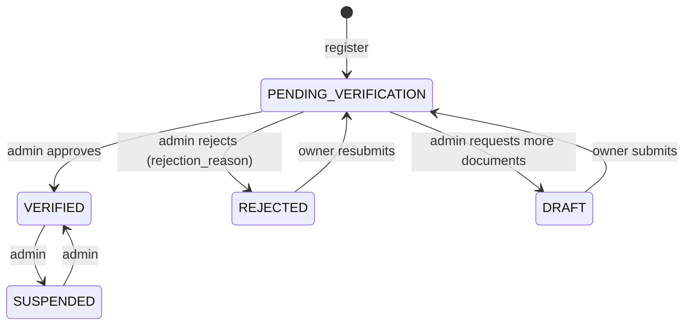

# 04 – Pharmacy API

Conventions: [00-conventions.md](./00-conventions.md) · errors: [errors.md](./errors.md) · request/offer/order vocabulary: [03-patient.md §0](./03-patient.md#0-vocabulary--label-these-differently-in-the-ui).

All `/pharmacy/*` routes act on **the pharmacy of the logged-in staff member** (a user is active staff of at most one pharmacy).
Requirements on every `/pharmacy/*` route unless stated otherwise:

1. Bearer token, user role `PHARMACY_OWNER`, `PHARMACIST` or `PHARMACY_ASSISTANT` (`403 ROLE_FORBIDDEN`).
2. Account `ACTIVE` (`403 ACCOUNT_PENDING_VERIFICATION`) – *except* routes marked **pending OK**.
3. Active staff of a pharmacy with the required **staff role** (`403 PHARMACY_ACCESS_DENIED`).
4. Pharmacy `VERIFIED` (`403 PHARMACY_NOT_VERIFIED`) – *except* routes marked **unverified OK**.

## 1. Role matrix

| Endpoint | OWNER | PHARMACIST | ASSISTANT | Pending account / unverified pharmacy |
|---|:-:|:-:|:-:|---|
| `GET /pharmacy/me` | ✅ | ✅ | ✅ | pending OK · unverified OK |
| `PATCH /pharmacy/me` | ✅ | ❌ | ❌ | pending OK · unverified OK |
| `GET /pharmacy/opening-hours` | ✅ | ✅ | ✅ | pending OK · unverified OK |
| `PUT /pharmacy/opening-hours` | ✅ | ✅ | ❌ | pending OK · unverified OK |
| `GET /pharmacy/on-duty` | ✅ | ✅ | ✅ | unverified OK |
| `POST`/`DELETE /pharmacy/on-duty` | ✅ | ✅ | ❌ | unverified OK |
| `GET /pharmacy/service-areas` | ✅ | ✅ | ✅ | pending OK · unverified OK |
| `POST`/`PUT`/`DELETE /pharmacy/service-areas` | ✅ | ❌ | ❌ | pending OK · unverified OK |
| `GET`/`POST`/`DELETE /pharmacy/payout-accounts` | ✅ | ❌ | ❌ | pending OK · unverified OK |
| `GET /pharmacy/verification` | ✅ | ✅ | ✅ | pending OK · unverified OK |
| `POST /pharmacy/verification/submit` | ✅ | ❌ | ❌ | pending OK · unverified OK |
| `GET /pharmacy/documents` | ✅ | ✅ | ❌ | pending OK · unverified OK |
| `POST`/`DELETE /pharmacy/documents` | ✅ | ❌ | ❌ | pending OK · unverified OK |
| `GET /pharmacy/staff`, `POST /pharmacy/staff/invite`, `PATCH /pharmacy/staff/:id` | ✅ | ❌ | ❌ | — |
| `GET /pharmacy/stock`, `PUT /pharmacy/stock/:medicineId` | ✅ | ✅ | ✅ | — |
| `DELETE /pharmacy/stock/:medicineId`, `POST /pharmacy/stock/import` | ✅ | ✅ | ❌ | — |
| `GET /pharmacy/requests`, `GET /pharmacy/requests/:id` | ✅ | ✅ | ✅ (no prescription files) | — |
| `POST /pharmacy/requests/:id/accept-interest` | ✅ | ✅ | ✅ | — |
| `POST /pharmacy/requests/:id/decline` | ✅ | ✅ | ❌ | — |
| `POST /pharmacy/requests/:id/clarification` | ✅ | ✅ | ❌ | — |
| `POST /pharmacy/requests/:id/offers`, `PATCH`/`send`/`withdraw` | ✅ | ✅ | ✅ **without substitutions** | — |
| Prescription / CHIFA file links (`/files/:id/access-url`) | ✅ | ✅ | ❌ | needs patient consent |
| `GET /pharmacy/reports/summary` | ✅ | ✅ | ❌ | — |
| `GET /pharmacy/settlements` | ✅ | ❌ | ❌ | — |
| `GET /pharmacy/complaints`, `GET /:id`, `POST /:id/reply` | ✅ | ✅ | ❌ | — |
| `GET /pharmacy/orders`, `POST /pharmacy/orders/:id/validate` … | see [06-orders.md](./06-orders.md) | | | |

## 2. Registration & verification

### POST /pharmacies/register — *public* (alias of `POST /auth/register/pharmacy`)

Body = common registration fields (see [02-auth.md §3](./02-auth.md#3-registration)) + `pharmacist_license_number?` + `pharmacy { name_fr, name_ar, legal_name?, authorization_number, tax_id_nif?, commercial_register_rc?, wilaya_id, commune_id, address_line, latitude?, longitude?, phone? }`.
Creates the owner (`PENDING_VERIFICATION`) and the pharmacy (**`PENDING_VERIFICATION`**). `202 OtpSentDto`.
Errors: `AUTH_IDENTIFIER_REQUIRED`, `AUTH_CONSENT_REQUIRED`, `GEO_INVALID_COMMUNE`, `PHARMACY_AUTHORIZATION_NUMBER_TAKEN`, `OTP_RESEND_COOLDOWN`.

Onboarding: verify OTP → upload each document (`POST /files/upload`, purpose `PHARMACY_DOC`) → `POST /pharmacy/documents` → admin review (Phase 9). Admin approval activates the pharmacy and the owner account.

### Pharmacy status



Only `VERIFIED` pharmacies are matched with requests, appear in `/pharmacies/nearby`, and can use the inbox, offers, stock and orders.

### GET /pharmacy/verification → `VerificationStatusDto`

| Field | Type |
|---|---|
| `status` | pharmacy status |
| `rejection_reason` | string \| null |
| `submitted_for_review_at`, `verified_at` | datetime \| null |
| `missing_documents` | required types without a PENDING/APPROVED document: `AUTHORIZATION`, `PHARMACIST_DIPLOMA`, `ID` |
| `documents` | `DocumentDto[]` |
| `can_submit` | boolean (status DRAFT/REJECTED and nothing missing) |

### POST /pharmacy/verification/submit

No body. DRAFT/REJECTED → PENDING_VERIFICATION. Errors: `PHARMACY_VERIFICATION_NOT_ALLOWED` (409), `PHARMACY_DOCUMENTS_MISSING` (400, `details.types`).

### Documents

`DocumentDto`: `{ id, doc_type: AUTHORIZATION|PHARMACIST_DIPLOMA|ID|TAX|OTHER, file_id, review_status: PENDING|APPROVED|REJECTED, review_note|null, reviewed_at|null, created_at }`.

| Method | Path | Body | Errors |
|---|---|---|---|
| GET | `/pharmacy/documents` | | |
| POST | `/pharmacy/documents` | `{ doc_type, file_id }` (file purpose PHARMACY_DOC, uploaded by you) → `201` | `FILE_INVALID_FOR_USE` |
| DELETE | `/pharmacy/documents/:id` | only PENDING / REJECTED | `PHARMACY_DOCUMENT_NOT_FOUND`, `PHARMACY_DOCUMENT_LOCKED` |

## 3. Profile & settings

### GET /pharmacy/me → `PharmacyMeDto`

`{ id, name_fr, name_ar, legal_name, authorization_number, tax_id_nif, commercial_register_rc, wilaya_id, commune_id, address_line, latitude, longitude, phone, email, status, rejection_reason, submitted_for_review_at, verified_at, accepts_requests, delivery_available, avg_response_minutes, my_staff_role, updated_at }`.

### PATCH /pharmacy/me (OWNER)

All optional: `name_fr` (1–200), `name_ar` (1–200), `legal_name`*, `authorization_number`* (3–100, unique), `tax_id_nif`*, `commercial_register_rc`*, `wilaya_id`, `commune_id` (must match), `address_line` (3–255), `latitude`, `longitude`, `phone`, `email`, `delivery_available` (bool), `accepts_requests` (bool – pause/resume new requests).
\* legal fields: `403 PHARMACY_FIELD_LOCKED` once VERIFIED (contact support).

### Opening hours

`GET /pharmacy/opening-hours` → `[{ day_of_week 0–6 (0 = Sunday), is_closed, is_24h, open_time "HH:MM"|null, close_time|null }]`.
`PUT /pharmacy/opening-hours` body `{ days: OpeningDay[] }` (≤ 7, unique days) replaces the week. Each day: closed, or 24 h, or `open_time` + `close_time` (`close_time` < `open_time` = overnight). Error `OPENING_HOURS_INVALID`.
Times are **Algiers local time**.

### On duty (garde)

`GET /pharmacy/on-duty` (upcoming, paginated) → `{ id, date_from, date_to, created_at }`.
`POST /pharmacy/on-duty` `{ date_from, date_to }` (ISO; ends in the future; ≤ 14 days). `DELETE /pharmacy/on-duty/:id` (`ON_DUTY_NOT_FOUND`).
On-duty pharmacies count as open for matching and `open_now`.

### Service areas

`{ id, wilaya_id, commune_id|null (= whole wilaya), max_radius_km|null }`. `GET`, `POST` (body `{ wilaya_id, commune_id?, max_radius_km? 1–200 }`), `PUT /:id`, `DELETE /:id`. Errors `GEO_INVALID_COMMUNE`, `SERVICE_AREA_NOT_FOUND`.
Without any service area, the pharmacy only receives requests from its own commune.

### Payout accounts (OWNER)

`POST` `{ account_type: BANK|CCP, holder_name (2–200), account_number (8–30 digits/spaces) }` → `{ id, account_type, holder_name, account_number_masked: "****************7890", verified, created_at }`. Stored encrypted; the full number is **never** returned. `verified` is set by finance admins. `DELETE /:id` (`PAYOUT_ACCOUNT_NOT_FOUND`).

### Staff (OWNER)

`GET /pharmacy/staff` (paginated) → `StaffMemberDto { id (pharmacy_staff id), user_id, first_name, last_name, staff_role, is_active, pharmacist_license_number, account_status, joined_at }`.
`POST /pharmacy/staff/invite` = `POST /pharmacies/:id/staff/invite` (see [02-auth.md §11](./02-auth.md#11-pharmacy-staff-invitations)).
`PATCH /pharmacy/staff/:staffId` `{ staff_role?: PHARMACIST|ASSISTANT, is_active?: boolean, pharmacist_license_number? }`.
Rules: the OWNER and yourself cannot be changed (`STAFF_CANNOT_MODIFY_OWNER`); PHARMACIST needs a license number (`STAFF_LICENSE_REQUIRED`); role change and deactivation revoke the member's sessions immediately; audited (`USER_ROLE_CHANGED` / `PHARMACY_STAFF_UPDATED`).

## 4. Catalog & stock

### GET /medicines/search (any authenticated user)

Query: `q` (2–100, required) – matches brand name (fr), Arabic name and DCI with typo tolerance (pg_trgm); `category`; pagination.
`MedicineDto`: `{ id, brand_name, name_ar, inn_dci, form, dosage, pack_size, manufacturer, category: OTC|PRESCRIPTION|CONTROLLED|COLD_CHAIN|PSYCHOTROPIC|OTHER, requires_prescription, reimbursable_flag (informational only), regulatory_code }`.
`GET /medicines/:id` → `MedicineDto` (`MEDICINE_NOT_FOUND`).

### Stock

`GET /pharmacy/stock` – query `stock_status`, `q`, `sort` = `updated_at` | `brand_name`, pagination → `{ medicine: MedicineDto, stock_status, quantity|null, unit_price_centimes|null, updated_at }`.
`PUT /pharmacy/stock/:medicineId` `{ stock_status: IN_STOCK|LOW|OUT_OF_STOCK, quantity? ≥0, unit_price_centimes? ≥0 }` (upsert).
`DELETE /pharmacy/stock/:medicineId` (`STOCK_NOT_FOUND`).

### POST /pharmacy/stock/import (OWNER, PHARMACIST)

multipart `file` (CSV ≤ 2 MB, ≤ 5000 lines, UTF-8, `,` or `;`). Query `dry_run=true` to validate only.

```csv
medicine_id;stock_status;quantity;unit_price_centimes
2b6f0c1e-…;IN_STOCK;24;25000
```

`regulatory_code` may replace `medicine_id`. Response:

```json
{ "dry_run": false, "processed": 3, "created": 0, "updated": 1,
  "errors": [ { "line": 3, "field": "medicine_id", "message_key": "errors.MEDICINE_NOT_FOUND", "value": "…" } ] }
```

Invalid lines are skipped; valid lines are written in one transaction. Error `STOCK_IMPORT_INVALID_FILE`.

## 5. Request inbox

### GET /pharmacy/requests

Query: `recipient_status` (comma list: SENT, VIEWED, INTERESTED, CLARIFICATION_ASKED, OFFERED, DECLINED, EXPIRED), `request_status` (comma list), `urgency` (NORMAL|URGENT), `from`/`to` (received), `sort` = `sent_at` | `expires_at` (URGENT always first), pagination.
Item: `{ request_id, reference, request_type, urgency, request_status, recipient_status, delivery_wanted, patient_first_name, commune_name_fr, commune_name_ar, items_count, files_count, my_offer_status|null, sent_at, viewed_at, expires_at }`.

### GET /pharmacy/requests/:id

Side effects: sets `viewed_at` (recipient SENT → VIEWED) and writes a **sensitive_access_log** (+ audit) for every call.

| Field | Notes |
|---|---|
| `request_id`, `reference`, `request_type`, `urgency`, `request_status`, `recipient_status`, `delivery_wanted`, `sent_at`, `viewed_at`, `expires_at` | |
| `patient` | `{ first_name }` only |
| `dependant` | `{ first_name, relationship }` \| null |
| `patient_note` | |
| `delivery_area` | `{ wilaya_name_fr/ar, commune_name_fr/ar }` – **no street** before an order |
| `items` | `[{ id, raw_name, medicine_id, quantity, dosage_text, source, ocr_confidence, confirmed_by_pharmacist }]` |
| `files` | `[{ file_id, page_order, quality_status }]` – open with `/files/:id/access-url` |
| `can_view_prescription` | true only for OWNER/PHARMACIST, active recipient, patient consent active |
| `chifa` | `{ submitted, card_file_id*, holder_name*, insurance_number_masked*, coverage_verified { verified, source, status } }` \| null (\* OWNER/PHARMACIST only, else null) |
| `my_offer` | `{ id, status, total_centimes }` \| null |
| `conversation_id` | uuid \| null |

Not a recipient → `404 REQUEST_NOT_FOUND`.

### Actions

| Endpoint | Body | Effect | Errors |
|---|---|---|---|
| `POST /pharmacy/requests/:id/accept-interest` | — | recipient → `INTERESTED`. **Not** a dispensing authorization, **no** order, **no** offer | `RECIPIENT_CLOSED` |
| `POST /pharmacy/requests/:id/decline` | `{ reason: 3–500 }` | recipient → `DECLINED`, drafts discarded (withdraw a SENT offer first) | `RECIPIENT_CLOSED` |
| `POST /pharmacy/requests/:id/clarification` | `{ question: 3–1000 }` | conversation created if needed, `CLARIFICATION_QUESTION` message, recipient → `CLARIFICATION_ASKED`, request → `CLARIFICATION_REQUIRED` → `{ request_id, request_status, conversation_id, message_id }` | `RECIPIENT_CLOSED`, `CLARIFICATION_NOT_ALLOWED` |

`RECIPIENT_CLOSED` (409) = recipient declined/expired or request no longer open. Response times feed `avg_response_minutes`.

## 6. Offers

### POST /pharmacy/requests/:id/offers → `201 OfferDto` (DRAFT)

| Field | Type | Required | Rules |
|---|---|---|---|
| `items` | `OfferItemInput[]` | yes | 1–50 |
| `preparation_minutes` | integer | no | 0–10080 |
| `valid_until` | ISO datetime | no | future; default now + `offer_validity_hours` (12) |
| `delivery_available` | boolean | yes | true requires: request wants delivery, pharmacy `delivery_available`, setting `delivery_enabled` (else `OFFER_DELIVERY_NOT_AVAILABLE`) |
| `note` | string | no | ≤ 1000 |
| `requires_prescription_original` | boolean | no | patient must bring the original |

`OfferItemInput`:

| Field | Type | Required | Rules |
|---|---|---|---|
| `request_item_id` | uuid | no | must belong to the request (`OFFER_ITEM_INVALID`) |
| `medicine_id` | uuid | no | category must be allowed online (`OFFER_ITEM_RESTRICTED`) |
| `name` | string | yes | 1–255 |
| `quantity_requested` | integer | no | default = request item quantity |
| `quantity_offered` | integer | yes | 0–1000; forced to 0 if UNAVAILABLE |
| `unit_price_centimes` | integer | yes | 0–100 000 000 |
| `availability` | `AVAILABLE`\|`PARTIAL`\|`UNAVAILABLE`\|`ALTERNATIVE` | yes | |
| `is_alternative` | boolean | no | **OWNER/PHARMACIST only** (`OFFER_ALTERNATIVE_REQUIRES_PHARMACIST`); sets `patient_approval = PENDING` |
| `alternative_reason` | string | if alternative | ≤ 500 |

**Server-side computation** (any total sent by the client is rejected as an unknown field):
`line_total = unit_price × quantity_offered` · `items_subtotal = Σ line_total` · `delivery_fee` from `delivery_fee_rules` (most specific active zone for the patient's commune/wilaya: `base + per_km × distance`, clamped to `[min, max]`; no zone → `DELIVERY_ZONE_NOT_COVERED`) · `service_fee` = setting `service_fee_centimes` (0 by default) · `total = subtotal + delivery_fee + service_fee` (also enforced by a DB CHECK).

One DRAFT/SENT offer per pharmacy and request (`OFFER_ALREADY_EXISTS`).

### Other offer endpoints

| Method | Path | Notes | Errors |
|---|---|---|---|
| GET | `/pharmacy/offers` | `status` filter (comma list) → `{ id, request_id, request_reference, status, total_centimes, valid_until, sent_at, created_at }` | |
| GET | `/pharmacy/offers/:id` | `OfferDto` | `OFFER_NOT_FOUND` |
| PATCH | `/pharmacy/offers/:id` | same body as create, DRAFT only | `OFFER_NOT_EDITABLE` |
| POST | `/pharmacy/offers/:id/send` | DRAFT → SENT; recipient → OFFERED; request → OFFER_AVAILABLE; if sent by OWNER/PHARMACIST, linked request items → `confirmed_by_pharmacist`; event `offer.new` | `OFFER_NOT_SENDABLE` (no available line), `OFFER_EXPIRED`, `RECIPIENT_CLOSED` |
| POST | `/pharmacy/offers/:id/withdraw` | DRAFT/SENT → WITHDRAWN; if no SENT offer remains the request goes back to AWAITING_PHARMACY_RESPONSE | `OFFER_NOT_WITHDRAWABLE` |

Offer statuses: `DRAFT` → `SENT` → `ACCEPTED` (order created, Phase 6) / `REJECTED` (another offer accepted) / `EXPIRED` (past `valid_until`, job every minute) / `WITHDRAWN`.

`OfferDto`: `{ id, request_id, pharmacy { id, name_fr, name_ar }, status, items: OfferItemDto[], items_subtotal_centimes, delivery_fee_centimes, service_fee_centimes, total_centimes, effective_total_centimes (minus alternatives the patient rejected), alternatives_pending, preparation_minutes, valid_until, delivery_available, pharmacy_note, requires_prescription_original, sent_at, created_at }`.
`OfferItemDto`: `{ id, request_item_id, medicine_id, name, quantity_requested, quantity_offered, unit_price_centimes, line_total_centimes, availability, is_alternative, alternative_reason, patient_approval: NOT_REQUIRED|PENDING|APPROVED|REJECTED }`.

### Patient-facing offer endpoints (role PATIENT)

| Method | Path | Notes |
|---|---|---|
| GET | `/requests/:id/offers` | all non-draft offers, cheapest first |
| GET | `/requests/:id/offers/compare` | `{ request_id, request_items_count, offers: [{ offer_id, pharmacy, total_centimes, effective_total_centimes, items_subtotal_centimes, delivery_fee_centimes, service_fee_centimes, preparation_minutes, delivery_available, valid_until, items_offered, missing_items[], partial_items[], alternatives, alternatives_pending, covers_all_items, distance_km }] }` (SENT only, sorted by effective total) |
| GET | `/offers/:id` | `OfferDto` (not mine / draft → `OFFER_NOT_FOUND`) |
| POST | `/offers/:id/items/:itemId/approval` | `{ decision: APPROVED \| REJECTED }` – every PENDING alternative must be decided before acceptance; `OFFER_ITEM_APPROVAL_NOT_PENDING` |

## 7. Fulfillment

`GET /pharmacy/orders`, `POST /pharmacy/orders/:id/validate` (pharmacist validation with explicit confirmation + note), `start-preparing`, `ready`, `handover` – documented in [06-orders.md](./06-orders.md) (they run through the order state machine).

## 8. Reports & settlements

`GET /pharmacy/reports/summary?from&to` (default last 30 days):
`{ from, to, requests_received, requests_by_recipient_status { SENT, VIEWED, … }, avg_response_minutes, offers_sent, offers_accepted, conversion_rate (0–1), orders_by_status { … }, revenue_centimes (DELIVERED + COMPLETED) }`.

`GET /pharmacy/settlements` (OWNER, paginated) → `{ id, period_start, period_end, gross_centimes, commission_centimes, refunds_centimes, net_centimes, status: DRAFT|APPROVED|PAID, paid_at, payout_reference }`. Records only until the payout model is legally confirmed (Phase 7).

## 9. Complaints

| Method | Path | Who | Body |
|---|---|---|---|
| POST | `/complaints` | patient, driver, staff | `{ against_type: PHARMACY\|DRIVER\|PATIENT\|PLATFORM, against_id? (required unless PLATFORM), order_id?, category, description 10–4000 }` → reference `CMP-YYYY-NNNNNN` |
| GET | `/complaints`, `/complaints/:id` | reporter | |
| POST | `/complaints/:id/messages` | reporter | `{ body 1–4000, file_id? }` |
| GET | `/pharmacy/complaints`, `/pharmacy/complaints/:id` | OWNER, PHARMACIST | complaints against my pharmacy |
| POST | `/pharmacy/complaints/:id/reply` | OWNER, PHARMACIST | `{ body, file_id? }` |

Categories: `ORDER_NOT_RECEIVED`, `WRONG_ITEMS`, `DAMAGED_PACKAGE`, `DELAY`, `BEHAVIOUR`, `PRICING`, `PRIVACY`, `PAYMENT`, `OTHER`. Statuses: `OPEN`, `IN_REVIEW`, `RESOLVED`, `REJECTED`, `ESCALATED` (admin, Phase 9). Errors: `COMPLAINT_NOT_FOUND`, `COMPLAINT_CLOSED`.

## 10. Error codes (this module)

`PHARMACY_NOT_VERIFIED`, `PHARMACY_ACCESS_DENIED`, `PHARMACY_FIELD_LOCKED`, `PHARMACY_AUTHORIZATION_NUMBER_TAKEN`, `PHARMACY_DOCUMENT_NOT_FOUND`, `PHARMACY_DOCUMENT_LOCKED`, `PHARMACY_DOCUMENTS_MISSING`, `PHARMACY_VERIFICATION_NOT_ALLOWED`, `STAFF_NOT_FOUND`, `STAFF_CANNOT_MODIFY_OWNER`, `STAFF_LICENSE_REQUIRED`, `PAYOUT_ACCOUNT_NOT_FOUND`, `SERVICE_AREA_NOT_FOUND`, `ON_DUTY_NOT_FOUND`, `OPENING_HOURS_INVALID`, `MEDICINE_NOT_FOUND`, `STOCK_NOT_FOUND`, `STOCK_IMPORT_INVALID_FILE`, `REQUEST_NOT_FOUND`, `RECIPIENT_CLOSED`, `CLARIFICATION_NOT_ALLOWED`, `OFFER_NOT_FOUND`, `OFFER_ALREADY_EXISTS`, `OFFER_NOT_EDITABLE`, `OFFER_NOT_SENDABLE`, `OFFER_NOT_WITHDRAWABLE`, `OFFER_ALTERNATIVE_REQUIRES_PHARMACIST`, `OFFER_ITEM_RESTRICTED`, `OFFER_ITEM_INVALID`, `OFFER_EXPIRED`, `OFFER_DELIVERY_NOT_AVAILABLE`, `DELIVERY_ZONE_NOT_COVERED`, `OFFER_ITEM_APPROVAL_NOT_PENDING`, `COMPLAINT_NOT_FOUND`, `COMPLAINT_CLOSED` – texts in [errors.md](./errors.md).
