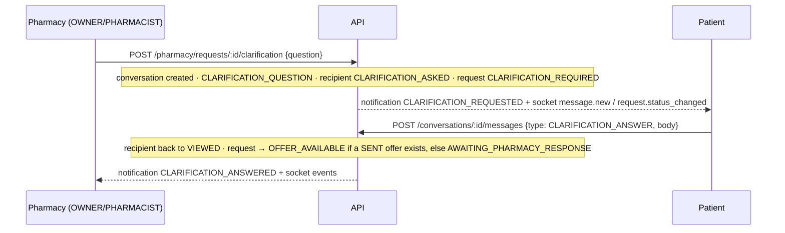

# 05 – Messaging & notifications

Conventions: [00-conventions.md](./00-conventions.md) · realtime events: [05-realtime.md](./05-realtime.md) · errors: [errors.md](./errors.md).

## 1. Conversations

One conversation per **(request, pharmacy)**. It is created automatically when the pharmacy **asks a clarification** or **sends an offer** – there is no "create conversation" endpoint.

| Who | Access |
|---|---|
| The patient of the request | ✅ |
| Active staff of that pharmacy (OWNER, PHARMACIST, ASSISTANT) | ✅ |
| Other patients / other pharmacies | `404 CONVERSATION_NOT_FOUND` |
| Admins | no direct access (`403 ROLE_FORBIDDEN`); only through a justified, time-limited, logged dispute grant ([09-admin.md](./09-admin.md)) |

Conversation status: `OPEN` → `CLOSED` when the request is cancelled / expires, or for the pharmacies whose offer was **not** accepted. Closed conversations are read-only (`409 CONVERSATION_CLOSED`).

### GET /conversations

Roles: PATIENT, PHARMACY_OWNER, PHARMACIST, PHARMACY_ASSISTANT. Query: pagination, `status` (OPEN|CLOSED), `request_id`. Sorted by last message.

| Field | Type |
|---|---|
| `id` | uuid |
| `request_id`, `request_reference` | |
| `pharmacy` | `{ id, name_fr, name_ar }` |
| `patient_first_name` | string \| null |
| `status` | OPEN \| CLOSED |
| `unread_count` | messages from the other side not yet read (SYSTEM excluded) |
| `last_message` | `{ id, message_type, body_preview (≤120 chars), created_at }` \| null |
| `last_message_at`, `created_at` | datetime |

### GET /conversations/:id/messages — cursor pagination

Query: `limit` (1–100, default 30), `before` (message id = `meta.cursor.next_cursor` of the previous page). Newest first.

```json
{ "success": true, "data": [ …messages… ], "error": null,
  "meta": { "request_id": "…", "cursor": { "next_cursor": "9b1f…", "limit": 30 } } }
```

`next_cursor: null` = no older messages.

Message:

| Field | Type | Notes |
|---|---|---|
| `id` | uuid | |
| `conversation_id` | uuid | |
| `sender_user_id` | uuid \| null | null for SYSTEM |
| `sender_side` | `PATIENT` \| `PHARMACY` \| `SYSTEM` | |
| `is_mine` | boolean | |
| `message_type` | `TEXT` \| `IMAGE` \| `SYSTEM` \| `CLARIFICATION_QUESTION` \| `CLARIFICATION_ANSWER` | |
| `body` | string \| null | for SYSTEM: an i18n key, e.g. `system.request_status.OFFER_AVAILABLE` – translate it client-side (keys in `src/i18n/*.json` → `system`) |
| `file_id` | uuid \| null | open with `/files/:id/access-url` (participants only) |
| `metadata` | object \| null | SYSTEM: `{ key, … }`; substitution proposal: `{ key: "system.offer_alternatives_pending", offer_id, offer_item_ids[] }` |
| `read_at` | datetime \| null | |
| `created_at` | datetime | |

### POST /conversations/:id/messages

| Field | Type | Required | Rules |
|---|---|---|---|
| `type` | `TEXT` \| `IMAGE` \| `CLARIFICATION_QUESTION` \| `CLARIFICATION_ANSWER` | yes | patient: TEXT, IMAGE, CLARIFICATION_ANSWER · staff: TEXT, IMAGE, CLARIFICATION_QUESTION (`403 MESSAGE_TYPE_NOT_ALLOWED`) |
| `body` | string | unless IMAGE | trimmed; ≤ `message_max_length` (2000) |
| `file_id` | uuid | IMAGE | file uploaded by you with purpose `MESSAGE_ATTACHMENT` (JPEG/PNG/PDF, scanned) |

`201` → message.

**Safety rules** (all configurable in platform settings):

| Rule | Setting | Error |
|---|---|---|
| Length | `message_max_length` (2000) | `400 MESSAGE_TOO_LONG` |
| Empty | — | `400 MESSAGE_EMPTY` |
| Rate limit per user | `message_rate_limit_per_minute` (20) | `429 MESSAGE_RATE_LIMITED` |
| Phone numbers (≥ 9 digits) | `message_block_phone_numbers` (true) | `422 MESSAGE_CONTAINS_PHONE` |
| Blocked words | `message_blocked_words` ([]) | `422 MESSAGE_BLOCKED_CONTENT` |
| Attachment | own MESSAGE_ATTACHMENT, clean | `400 FILE_INVALID_FOR_USE` |

Message content is never written to logs or audit (only ids and type).

### POST /conversations/:id/read

Marks the other side's messages as read → `{ conversation_id, marked_read }`.

## 2. Clarification flow



- A pharmacy can also ask a follow-up question in the chat with `type: CLARIFICATION_QUESTION` (request → CLARIFICATION_REQUIRED again).
- **The app must send `CLARIFICATION_ANSWER`** (not TEXT) when the patient replies to a question; plain TEXT does not change the request status.
- If another pharmacy sends an offer while a question is open, the request becomes `OFFER_AVAILABLE`.

### Substitution proposals

When an offer with alternatives is sent, a SYSTEM message with `metadata.key = "system.offer_alternatives_pending"`, `offer_id` and `offer_item_ids` is posted. Render each listed item with **Approve / Reject** buttons calling `POST /offers/:offerId/items/:itemId/approval { decision }` ([04-pharmacy.md §6](./04-pharmacy.md#6-offers)). Every alternative must be decided before the offer can be accepted.

## 3. Notifications

Event-driven: domain events (request, offer, message, order, payment, delivery, account) → notification rows → delivery jobs (BullMQ when `REDIS_URL` is set, in-process otherwise).

**Privacy rule: push / SMS / email texts NEVER contain medicine names or medical details** – only references (`RX-…`, order reference), statuses and generic wording.

| Type | Recipient | Default channels |
|---|---|---|
| `REQUEST_RECEIVED` | pharmacy staff | IN_APP, PUSH |
| `CLARIFICATION_REQUESTED` | patient | IN_APP, PUSH, SMS |
| `CLARIFICATION_ANSWERED` | pharmacy staff | IN_APP, PUSH |
| `OFFER_RECEIVED` | patient | IN_APP, PUSH, SMS |
| `OFFER_ACCEPTED` | pharmacy staff | IN_APP, PUSH |
| `NEW_MESSAGE` | other side | IN_APP, PUSH |
| `REQUEST_EXPIRED` | patient | IN_APP, PUSH |
| `REQUEST_CANCELLED` | pharmacy staff | IN_APP |
| `ORDER_STATUS_CHANGED` / `PHARMACY_ORDER_UPDATE` | patient / pharmacy | IN_APP, PUSH |
| `DELIVERY_CODE` / `PICKUP_CODE` | patient / pharmacy | IN_APP (+SMS) – not mutable |
| `DELIVERY_JOB_AVAILABLE` | drivers | IN_APP, PUSH |
| `PAYMENT_CONFIRMED`, `PAYMENT_FAILED`, `REFUND_COMPLETED` | patient | IN_APP, PUSH (+SMS) |
| `ACCOUNT_STATUS_CHANGED`, `VERIFICATION_DECIDED` | user | IN_APP, EMAIL, SMS |
| `ADMIN_ALERT` | admins | IN_APP |

Templates: `src/i18n/{ar,fr}.json` → `notifications.<TYPE>.title|body`, rendered in the recipient's `preferred_language`.
Providers: `IPushProvider` (mock; FCM/APNs to plug), `ISmsProvider`, `IEmailProvider` (console mocks, refused in production).

**Delivery & retries**: IN_APP is stored as `SENT` immediately. PUSH/SMS/EMAIL are `QUEUED` and sent by a job: up to **5 attempts** with exponential backoff (`NOTIFICATION_RETRY_BASE_MS`, default 2 s → 2, 4, 8, 16 s). After the last failure: status `FAILED`, `dead_lettered_at` set, and a row in `job_dead_letters` for operators. Missing push token / unverified phone / no email → `FAILED` immediately (`last_error`), no retry.

### GET /notifications

Any authenticated user (also pending). Query: pagination, `unread=true`, `type`. Only IN_APP rows.
Item: `{ id, type, title, body (rendered in your language), title_key, body_key, data { request_id?, offer_id?, order_id?, conversation_id?, message_id? }, read_at, created_at }`. `meta.unread_count` = badge.

### POST /notifications/:id/read · POST /notifications/read-all

→ `{ id, read_at }` · `{ updated }`. Unknown / not yours → `404 NOTIFICATION_NOT_FOUND`.

### GET / PATCH /notifications/preferences

```json
{ "push_enabled": true, "sms_enabled": false, "email_enabled": true,
  "muted_types": ["NEW_MESSAGE"], "available_types": ["REQUEST_RECEIVED", "…"] }
```

PATCH accepts any of `push_enabled`, `sms_enabled`, `email_enabled` (booleans), `muted_types` (string[] ⊂ `available_types`). Muted types are still recorded in-app but not pushed/sent. `DELIVERY_CODE`, `PICKUP_CODE`, `ACCOUNT_STATUS_CHANGED` cannot be muted.

## 4. Error codes

`CONVERSATION_NOT_FOUND`, `CONVERSATION_CLOSED`, `MESSAGE_TYPE_NOT_ALLOWED`, `MESSAGE_EMPTY`, `MESSAGE_TOO_LONG`, `MESSAGE_RATE_LIMITED`, `MESSAGE_CONTAINS_PHONE`, `MESSAGE_BLOCKED_CONTENT`, `FILE_INVALID_FOR_USE`, `NOTIFICATION_NOT_FOUND`.
