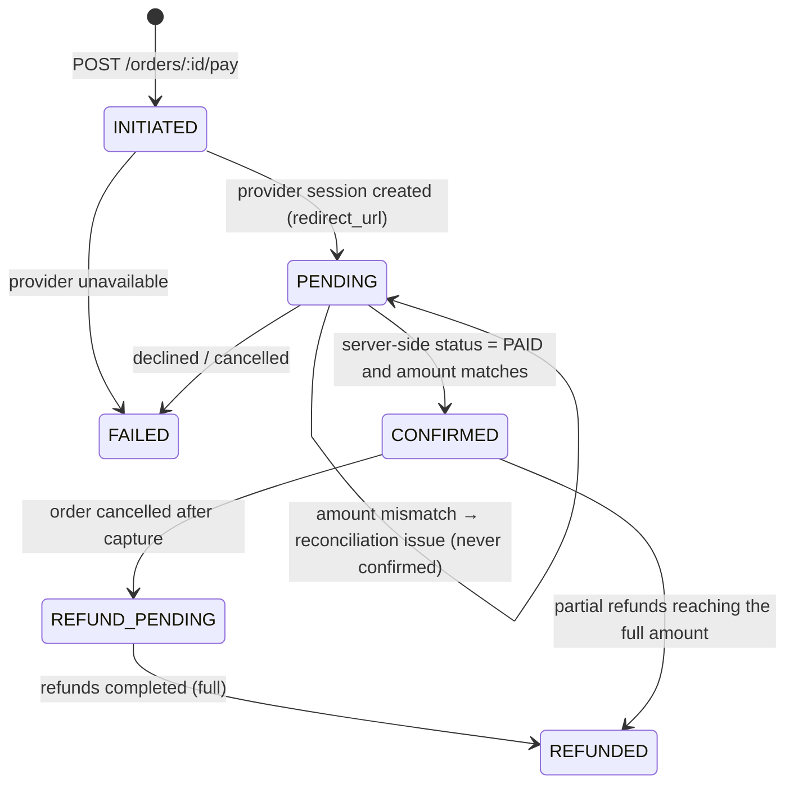
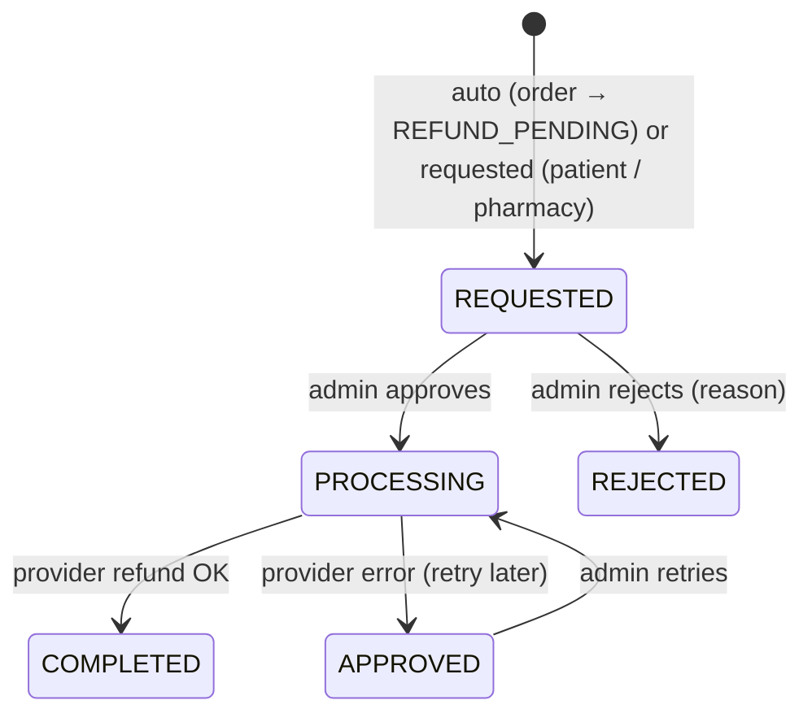

# 07 – Payments, refunds, receipts & settlements

Conventions: [00-conventions.md](./00-conventions.md) · order lifecycle: [06-orders.md](./06-orders.md) · errors: [errors.md](./errors.md).

> **Status of integrations**: only the **MockPaymentProvider** works. The **SATIM / Edahabia** provider is a **skeleton** (`src/modules/payments/providers/satim-edahabia.provider.ts`) that throws until it is implemented from the official merchant documentation. No CIB/Edahabia API details are assumed.

## 1. Principles

- The patient pays on the **provider's hosted page** – card data (PAN, PIN, CVV) never reaches DEWA.
- **Amounts always come from the server-side order**, never from the client.
- A payment is `CONFIRMED` **only after a server-to-server status check** with the provider (`verified_server_side_at`, DB CHECK). Neither the browser return nor the webhook body can confirm a payment.
- Every webhook is **stored before processing**, signature-checked, de-duplicated (`provider_event_id` unique) and processed idempotently.
- Raw provider responses are **encrypted** at rest; logs never contain card or personal data.

## 2. Payment status



Effects on the order: pay → `PAYMENT_PENDING`; CONFIRMED → `PAYMENT_CONFIRMED` (payment-first variant then automatically `PHARMACIST_VALIDATION_PENDING`) + receipt; FAILED → back to `AWAITING_PAYMENT` (or `CANCELLED` if the deadline passed).

## 3. Paying (role PATIENT)

### GET /orders/:id/checkout

```json
{
  "order_id": "…", "reference": "ORD-2026-000042", "status": "AWAITING_PAYMENT", "currency": "DZD",
  "lines": [{ "name": "Augmentin 1g", "quantity": 2, "unit_price_centimes": 40000, "line_total_centimes": 80000 }],
  "medicines_subtotal_centimes": 80000, "delivery_fee_centimes": 0, "service_fee_centimes": 0, "total_centimes": 80000,
  "payable": true, "payment_deadline_at": "2026-10-16T12:30:00.000Z",
  "payment_provider": "MOCK", "payment_collection_model": "MARKETPLACE"
}
```

### POST /orders/:id/pay

Header **`Idempotency-Key` (required)** – generate one per "Pay" tap and reuse it for retries; a double tap returns the same payment.
No body. `201`:

| Field | Type |
|---|---|
| `payment_id` | uuid |
| `order_id` | uuid |
| `provider` | `MOCK` \| `EDAHABIA_SATIM` |
| `status` | `PENDING` |
| `amount_centimes`, `currency` | from the order |
| `redirect_url` | open in a browser / webview |
| `expires_at` | payment deadline |

Errors: `IDEMPOTENCY_KEY_INVALID`, `IDEMPOTENCY_KEY_REUSED`, `IDEMPOTENCY_IN_PROGRESS`, `PAYMENT_NOT_ALLOWED` (order not AWAITING_PAYMENT), `PAYMENT_DEADLINE_PASSED`, `PAYMENT_ALREADY_IN_PROGRESS` (a concurrent attempt is pending), `PAYMENT_NOT_ALLOWED_FOR_CATEGORY` (eligibility policy `allowed_online_payment` false – `details.categories`), `PAYMENT_PROVIDER_ERROR` (502, order back to AWAITING_PAYMENT).

### After the redirect

The hosted page returns the browser to `GET /payments/return/:paymentId` (informational). The app must **poll `GET /payments/:id/status`** (every 2–3 s, up to the deadline): each call re-checks the provider server-side and returns the payment (`status` INITIATED / PENDING / CONFIRMED / FAILED / …). Show success only when `status === "CONFIRMED"` (then refetch the order).

`GET /orders/:id/payments` lists all attempts of an order.

### Mock gateway (dev & tests only)

`redirect_url` → `GET /payments/mock/checkout/:providerOrderId` (JSON). Simulate the bank: `POST /payments/mock/:providerOrderId/simulate { "result": "PAID" | "FAILED" | "CANCELLED", "captured_centimes"?, "send_webhook"?: true }`. Disabled when `NODE_ENV=production` or with another provider (`404 MOCK_PROVIDER_DISABLED`).

## 4. Webhooks – POST /payments/webhook/:provider (public)

`:provider` = `mock` (or `edahabia` once implemented). Mock signature: header `x-mock-signature` = hex HMAC-SHA256(`MOCK_PAYMENT_WEBHOOK_SECRET`, raw body). Body `{ event_id, type, provider_order_id }`.

1. Event stored in `payment_events` (with `signature_valid`) **before** anything else.
2. Duplicate `event_id` → `200 { received: true, duplicate: true }` (replay protection, nothing processed).
3. Invalid signature → `401 PAYMENT_WEBHOOK_INVALID_SIGNATURE` (event kept for investigation).
4. Valid → server-side status check (`verifyAndApply`) → `200 { received, duplicate: false, result }`.

## 5. Receipts – GET /orders/:id/receipt

Generated automatically when the payment is CONFIRMED: number `RCP-YYYY-NNNNNN`, frozen snapshot (pharmacy legal name / NIF / RC / address, customer name, lines, subtotal, delivery fee, service fee, total, provider + masked reference). JSON by default; `?format=pdf` returns a PDF (French; Arabic text in PDFs requires embedding an Arabic font – see Phase 10 notes). Not paid yet → `404 RECEIPT_NOT_FOUND`. The receipt is a platform payment receipt, not the pharmacy's fiscal invoice.

## 6. Refunds



- Order enters `REFUND_PENDING` (cancellation after capture, failed delivery) → a **full** refund is created automatically; payment → `REFUND_PENDING`.
- **Partial refunds** (item unavailable after payment, post-delivery issue): `POST /orders/:id/refund-request` (patient) or `POST /pharmacy/orders/:id/refund-request` (OWNER/PHARMACIST) with `{ amount_centimes?, reason }` (default = everything still refundable).
- Admin: `GET /admin/refunds?status=REQUESTED`, `POST /admin/refunds/:id/approve` (calls the provider), `POST /admin/refunds/:id/reject { reason }`.
- When completed refunds reach the paid amount: payment `REFUNDED`; an order in `REFUND_PENDING` moves to `REFUNDED`; patient notified.
- `GET /orders/:id/refunds` for the patient.

Errors: `REFUND_NOT_ALLOWED` (no confirmed payment / wrong state), `REFUND_AMOUNT_INVALID` (`details.refundable_centimes`), `PAYMENT_PROVIDER_ERROR`.

Refund item: `{ id, order_id, payment_id, amount_centimes, reason, status, requested_by, approved_by_admin_id, provider_refund_reference, created_at, completed_at }`.

## 7. Reconciliation (admin)

A job (every 5 min) re-checks PENDING payments and flags anomalies in `payment_reconciliation_issues`:

| Kind | Meaning |
|---|---|
| `AMOUNT_MISMATCH` | provider captured a different amount – payment NOT confirmed |
| `DUPLICATE_PAYMENT` | more than one confirmed payment for an order |
| `STALE_PENDING` | pending for more than 24 h |
| `MISSING_PAYMENT` | order past payment without a confirmed payment |
| `ORPHAN_EVENT` | webhook for an unknown provider order |
| `PAID_ORDER_NOT_PAYABLE` | paid after the order was cancelled → refund needed |

`GET /admin/payments/reconciliation?status&kind`, `POST /admin/payments/reconciliation/run`, `POST /admin/payments/reconciliation/:id/resolve { note }` (audited).

## 8. Settlements – **records only**

A daily job builds one settlement per pharmacy and closed period (`settlement_period_days`, default 7, aligned on Monday 2026-01-05): gross = paid orders handed over (DELIVERED / COMPLETED) in the period, commission = active commission rule (pharmacy-specific first, else global; PERCENT in basis points on the medicines subtotal, FIXED per order, SUBSCRIPTION billed separately), refunds = completed refunds in the period, net = gross − commission − refunds.
Admin: `GET /admin/settlements`, `POST /admin/settlements/generate { period_start, period_end }`, `POST /admin/settlements/:id/approve`, `POST /admin/settlements/:id/mark-paid { payout_reference }`. Pharmacy view: `GET /pharmacy/settlements`.

**Open legal / commercial question – collection model** (`platform_settings.payment_collection_model`):
- `MARKETPLACE`: the platform's merchant account collects for all pharmacies and pays them out (requires a legal basis for holding funds for third parties, payout agreements, possibly a payment-institution status).
- `PER_PHARMACY_MERCHANT`: each pharmacy collects on its own merchant account; the platform only records commissions (invoiced separately).
Until decided, settlements are **records only**: `mark-paid` records an off-platform transfer; no payout API exists.

## 9. Security checklist

- No card data stored or logged; hosted page only.
- `amount_centimes` and currency always from the order.
- Confirmation only through `verifyAndApply` (server-to-server); CHECK constraint `CONFIRMED ⇒ verified_server_side_at`.
- Webhooks: signature, store-first, unique event id, idempotent processing.
- Double payment protection: required Idempotency-Key + order version lock + reconciliation of duplicates.
- Raw provider payloads encrypted (AES-256-GCM).

## 10. Error codes

`PAYMENT_NOT_FOUND`, `PAYMENT_NOT_ALLOWED`, `PAYMENT_DEADLINE_PASSED`, `PAYMENT_ALREADY_IN_PROGRESS`, `PAYMENT_NOT_ALLOWED_FOR_CATEGORY`, `PAYMENT_PROVIDER_ERROR`, `PAYMENT_PROVIDER_UNKNOWN`, `PAYMENT_WEBHOOK_INVALID_SIGNATURE`, `MOCK_PROVIDER_DISABLED`, `REFUND_NOT_FOUND`, `REFUND_NOT_ALLOWED`, `REFUND_AMOUNT_INVALID`, `RECEIPT_NOT_FOUND`, `SETTLEMENT_INVALID_STATE`, `RECONCILIATION_ISSUE_NOT_FOUND`, `IDEMPOTENCY_*`.
