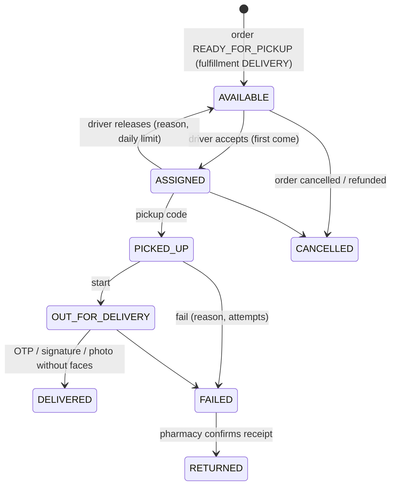

# 08 – Delivery

Conventions: [00-conventions.md](./00-conventions.md) · order lifecycle: [06-orders.md](./06-orders.md) · payments/refunds: [07-payments.md](./07-payments.md) · errors: [errors.md](./errors.md).

> Home delivery is **off by default** (`platform_settings.delivery_enabled = false`, eligibility policies `allowed_delivery = false`). It works only once delivery partners and the legal review are in place.

## 1. Privacy rules (enforced and tested)

Driver and delivery-company responses **never** contain prescription files, medicine names, request or order items, Chifa data, the patient's national ID or the date of birth.

- The parcel carries an **opaque label** (`PKG-XXXXXX`). Medicine names never appear on it.
- The job board shows the pickup pharmacy and only the **destination area** (commune / wilaya). The drop-off (patient first name, phone, address, GPS, notes) is revealed **only to the assigned driver**.
- `DriverPrivacyInterceptor` checks every driver and company response for forbidden keys (`items`, `files`, `medicine*`, `chifa*`, `national_id`, …). If one is found, the request **fails closed** with a 500 and the field names are logged. The e2e suite also checks every response for the medicine name, the prescription file id and the request item ids.
- Push and SMS messages never include medicine names. Codes are sent as encrypted one-time parameters.

## 2. Onboarding

### POST /delivery/register (public)

This endpoint uses the same body as `/auth/register/*`, plus:

| Field | Type | Notes |
|---|---|---|
| `account_type` | `COMPANY` \| `DRIVER` | |
| `company` | object | required for COMPANY: `{ name, legal_name?, tax_id?, rc_number?, phone?, email? }` |
| `vehicle_type` | `MOTORCYCLE` \| `CAR` \| `VAN` \| `BIKE` | required for DRIVER |
| `plate_number`, `license_number` | string | optional; the license number is stored encrypted |

It returns `202` (OTP sent). The account is created as `PENDING_VERIFICATION`. Next steps:
1. Verify the OTP and log in.
2. Upload documents (`POST /files/upload`, purpose `DRIVER_DOC` or `DELIVERY_COMPANY_DOC`).
3. Attach them with `POST /delivery/me/documents` or `POST /delivery/company/documents`, body `{ doc_type, file_id }`.

An admin then verifies the account (Phase 9). Until then, **drivers see no jobs**:
- a pending account gets `403 ACCOUNT_PENDING_VERIFICATION`;
- an unverified driver, or a driver of an unverified company, gets `403 DRIVER_NOT_VERIFIED`.

Driver `doc_type`: `ID_CARD`, `DRIVING_LICENSE`, `VEHICLE_REGISTRATION`, `INSURANCE`, `OTHER`. Company `doc_type`: `COMMERCIAL_REGISTER`, `TAX`, `ID`, `INSURANCE`, `OTHER`.

### Company admin (role DELIVERY_COMPANY_ADMIN)

| Method | Path | Notes |
|---|---|---|
| GET | /delivery/company | Profile, status and documents (allowed while pending) |
| POST | /delivery/company/documents | `{ doc_type, file_id }` |
| GET | /delivery/company/drivers | Paginated; `?available=true`. Includes `active_jobs` |
| DELETE | /delivery/company/drivers/:id | Fails with `409 DELIVERY_DRIVER_BUSY` while the driver carries a parcel |
| POST | /delivery/company/invitations | `{ phone }` or `{ email }`. The company must be VERIFIED. The token is sent by SMS / email and is valid for 7 days |
| GET / DELETE | /delivery/company/invitations[/:id] | List / revoke |
| GET | /delivery/company/reports?from&to | `by_status`, `delivered`, `failed`, `success_rate`, `delivery_fees_centimes`, `driver_payouts_centimes`, `average_delivery_minutes`, `drivers[]` (name shown as "Karim L.") |

A driver (already registered) joins a company with `POST /delivery/invitations/accept { token }`. The token is accepted only if it was sent to the driver's **own** phone or email (otherwise `400 DELIVERY_INVITATION_INVALID`).

## 3. Lifecycle



Each delivery transition is applied **in the same transaction** as the matching order transition (order state machine), and both are written to append-only histories.

| Delivery | Order |
|---|---|
| created AVAILABLE | PREPARING → READY_FOR_PICKUP |
| ASSIGNED | READY_FOR_PICKUP → DELIVERY_ASSIGNED |
| released → AVAILABLE | DELIVERY_ASSIGNED → READY_FOR_PICKUP |
| PICKED_UP | → PICKED_UP |
| OUT_FOR_DELIVERY | → OUT_FOR_DELIVERY |
| DELIVERED | → DELIVERED |
| FAILED | → FAILED |
| RETURNED | FAILED → REFUND_PENDING (an automatic full refund request is created, see 07) |

**Codes** are 6 digits, stored as HMAC hashes bound to the delivery, and locked after `delivery_code_max_attempts` wrong attempts (default 5, `429 DELIVERY_CODE_LOCKED`):
- the **pickup code** is sent to the pharmacy staff (PICKUP_CODE notification). `POST /pharmacy/orders/:id/delivery/pickup-code` shows a new one and resets the attempts;
- the **delivery code** is sent to the patient (DELIVERY_CODE notification, in-app + SMS). `POST /orders/:id/delivery/code` shows a new one and resets the attempts.

## 4. Driver endpoints (role DRIVER)

| Method | Path | Body / query | Notes |
|---|---|---|---|
| GET | /delivery/me | | Profile, `can_take_jobs`, company, documents (allowed while pending) |
| POST | /delivery/me/documents | `{ doc_type, file_id }` | Allowed while pending |
| PATCH | /delivery/me/availability | `{ is_available }` | Going online requires a verified driver |
| PATCH | /delivery/me/location | `{ latitude, longitude }` | One update every `driver_location_min_interval_seconds` (10 s), otherwise `429 DELIVERY_LOCATION_THROTTLED` with `details.retry_after_seconds` |
| GET | /delivery/jobs/available | `radius_km` (default 20), `wilaya_id`, `commune_id`, pagination | Job cards, nearest first when your location is known |
| GET | /delivery/jobs/active | | My ASSIGNED / PICKED_UP / OUT_FOR_DELIVERY jobs, plus FAILED jobs not yet returned |
| GET | /delivery/jobs/:id | | Full job if it is assigned to me, the public card if AVAILABLE, otherwise 404 |
| POST | /delivery/jobs/:id/accept | | `409 DELIVERY_ALREADY_TAKEN` if another driver won; `409 DRIVER_NOT_AVAILABLE` if you are offline |
| POST | /delivery/jobs/:id/release | `{ reason }` | Before pickup only; at most `delivery_max_releases_per_day` (3) per UTC day, otherwise `429 DELIVERY_RELEASE_LIMIT_REACHED` |
| POST | /delivery/jobs/:id/confirm-pickup | `{ pickup_code }` | `400 DELIVERY_CODE_INVALID` (`details.attempts_remaining`) / `429 DELIVERY_CODE_LOCKED` |
| POST | /delivery/jobs/:id/start | `{ eta_minutes? }` | |
| POST | /delivery/jobs/:id/confirm-delivery | exactly one of `delivery_code`, `signature_file_id`, `photo_file_id` (+ `photo_has_no_face: true`) | Files use purpose `PROOF_OF_DELIVERY`. Without a valid proof: `400 DELIVERY_PROOF_REQUIRED` |
| POST | /delivery/jobs/:id/fail | `{ reason, attempts }` | From PICKED_UP or OUT_FOR_DELIVERY |
| POST | /delivery/jobs/:id/confirm-return | | Records `returned_by_driver_at`. The pharmacy confirms receipt |
| GET | /delivery/history | `status?`, pagination | Finished jobs |
| GET | /delivery/earnings | `from`, `to` (default last 30 days) | Payouts per day (records only) |

Job card (board):
```json
{ "id": "…", "status": "AVAILABLE", "package_label": "PKG-K7M2QX",
  "pickup": { "pharmacy_name": "Pharmacie …", "address": "1 Rue …", "latitude": 36.75, "longitude": 3.05 },
  "destination_area": { "wilaya_id": 16, "wilaya_name_fr": "Alger", "commune_id": 554, "commune_name_fr": "…" },
  "distance_to_pickup_km": 0.2, "delivery_fee_centimes": 30000, "driver_payout_centimes": 30000, "created_at": "…" }
```
An assigned job adds `order_reference`, the full `pickup` and `dropoff` (`first_name`, `phone`, `address`, commune/wilaya, `latitude`, `longitude`, `notes`), the remaining code attempts, timestamps, `failure_reason`, `delivery_attempts`, `proof_type` and the return timestamps.

## 5. Patient tracking (role PATIENT)

`GET /orders/:id/delivery` returns:

```json
{ "delivery_id": "…", "order_id": "…", "status": "OUT_FOR_DELIVERY", "package_label": "PKG-K7M2QX",
  "driver": { "first_name": "Karim", "vehicle_type": "MOTORCYCLE" },
  "estimated_arrival_at": "…", "assigned_at": "…", "picked_up_at": "…", "delivered_at": null,
  "failure_reason": null, "proof_type": null,
  "live_location": { "latitude": 36.76, "longitude": 3.052, "updated_at": "…" } }
```

`live_location` is filled **only while OUT_FOR_DELIVERY**. Live updates also arrive on the socket (`/realtime`): `delivery.location` `{ order_id, latitude, longitude, updated_at }` and `delivery.status_changed`.

## 6. Pharmacy (OWNER / PHARMACIST / ASSISTANT)

| Method | Path | Notes |
|---|---|---|
| GET | /pharmacy/orders/:id/delivery | Status, driver first name / vehicle / plate, timestamps, `returned_by_driver_at`, `return_confirmed_at` |
| POST | /pharmacy/orders/:id/delivery/pickup-code | New pickup code (AVAILABLE / ASSIGNED only) |
| POST | /pharmacy/orders/:id/delivery/confirm-return | FAILED → RETURNED. The order goes to REFUND_PENDING and a refund request is created |

Proof-of-delivery files can be read by the patient of the order, the pharmacy staff and the driver who uploaded them.

## 7. Error codes

`DELIVERY_NOT_FOUND`, `DELIVERY_ALREADY_TAKEN`, `DELIVERY_INVALID_TRANSITION`, `DELIVERY_VERSION_CONFLICT`, `DELIVERY_RELEASE_LIMIT_REACHED`, `DELIVERY_CODE_INVALID`, `DELIVERY_CODE_LOCKED`, `DELIVERY_PROOF_REQUIRED`, `DELIVERY_LOCATION_THROTTLED`, `DRIVER_PROFILE_NOT_FOUND`, `DRIVER_NOT_VERIFIED`, `DRIVER_NOT_AVAILABLE`, `DELIVERY_COMPANY_NOT_FOUND`, `DELIVERY_COMPANY_NOT_VERIFIED`, `DELIVERY_INVITATION_INVALID`, `DELIVERY_DRIVER_BUSY`, `DELIVERY_DRIVER_NOT_FOUND`.
